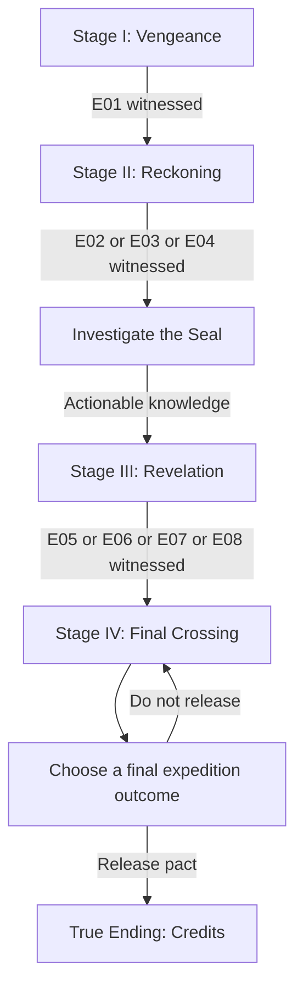
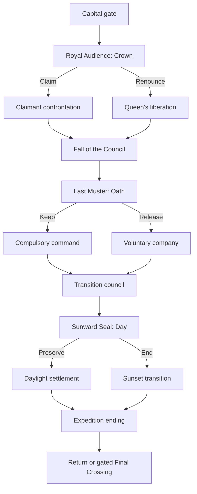

# THE UNDEAD PRINCE — Narrative Design
# 亡魂王子 — 剧情设计文档

**A.5 · 24 November 2026 · Working design / 暂定设计**

This document is for players and developers. Part I may be shared publicly; Part II contains full spoilers and provisional implementation specifications. The `WORLD-BIBLE.md` is the authoritative background reference. The names, exact events, paths, dialogue and gates below are working proposals; the nine expedition outcomes, sequential unlocks, separate capital decisions and final closure are creator-confirmed.

本文件面向玩家及开发者。第一部分可公开展示；第二部分含完整剧透及暂定开发规格。背景设定以 `WORLD-BIBLE.md` 为准。以下名称、具体事件、路线、对白与门槛均可深化；九种轮回结局、分阶段开放、王都分次决定及终局封档为创作者已定方向。

---

# PART I — PLAYER OVERVIEW / 玩家篇（无重大剧透）

## 1. A kingdom that buried its prince / 一个埋葬了王子的王国

The fleet went down in Greywake Bay. The bells of Sunhold rang for the defeat of a traitor. His sister was crowned, the Council kept its seats, and the families of the drowned were forbidden to mourn them in public.

Then someone lit a lantern among the wrecks.

Edmund returns with a broken crown, a borrowed sword and a company of soldiers who have nowhere else to go. He knows who he wants to kill. He has rather less idea what to do afterwards.

舰队沉没于灰潮海湾。白昼王城响起钟声，庆祝叛徒败亡。妹妹继承了王位，议员们继续执政，沉船死者的家属甚至不能公开悼念亲人。

直到有人在沉船之间点亮一盏灯。

埃德蒙戴着断冠，手持冥火之剑，带着一群无处可归的旧部回到世间。他知道自己想向谁复仇，至于复仇之后要做什么，他还没有想好。

## 2. The voyage / 出征

Command an undead army across a northern archipelago. Choose landing sites, break defended settlements and strongholds, recruit different kinds of undead, and combine temporary blessings into a force suited to the next assault. The islands are miniature tactical battlefields; their terrain, fortifications and inhabitants also tell the history of the kingdom.

率领亡灵军团穿越北方群岛，选择登陆点，攻克城镇与堡垒，招募不同兵种，将临时增益组合为适合下一场攻城的军队。岛屿既是微缩战术战场，也通过地形、建筑和居民讲述王国的历史。

A mysterious Ferryman brings the Prince back to the same shore. Roads and old enemies return, but Edmund remembers. A route that once led only to battle may reveal a family, a lost letter or another way into the capital. Not every island need be visited on one voyage.

神秘的渡魂人将王子带回同一处海岸。旧敌与道路重新出现，而埃德蒙记得此前的旅程。一条原本只有战斗的航路，也许藏着一个家庭、一封家书或进入王都的另一种办法。每次出征不必访问所有岛屿。

## 3. The people who wait at the wreck / 沉船旁的人们

- **The Ferryman / 渡魂人:** Knows more about the Prince's journeys than he cares to explain. / 对王子的旅程知道得比他愿意解释的更多。
- **Captain Bernard / 伯纳德卫队长:** A soldier who considers the company his family. / 将军团视为家人的老兵。
- **Matilda / 玛蒂尔达:** A surgeon delighted by the unexpected possibilities of death. / 对死亡之后的医术可能性颇感兴趣的军医。
- **Oswin / 奥斯温:** A disgraced mage who has waited a long time to prove himself right. / 等了很久才有机会证明自己没有错的落魄法师。
- **Pip / 皮普:** The bugler, who has places to see and entirely too much to say. / 有许多地方想去，也有说不完的话的小号手。

The person Edmund most wants to see is not waiting on the wreck. His sister now wears the crown of Alderreach.

埃德蒙最想见的人并不在沉船旁。他的妹妹已经戴上奥德里奇的王冠。

## 4. Different histories / 不同的未来

The first victory will not settle every question. Discoveries carry into later expeditions, and new approaches to old encounters become possible. Decisions in the capital shape the scenes that follow, the people who stand beside Edmund and the future of the realm. Some outcomes are only accessible after the Prince has lived through earlier ones.

第一次胜利不会回答所有问题。新的发现会保留到以后出征，旧场景也会产生新的应对方式。王都中的决定改变接下来的剧情、站在埃德蒙身边的人，以及王国的未来。部分结局只有在王子经历更早的结果之后才能开放。

The story has multiple expedition outcomes and a final conclusion. A completed story is a completed save; a new voyage begins with a new story.

游戏具有多个出征结局以及一次最终收束。故事完结后，该存档随之完结；想重新踏上旅程，可以开启新的故事。

---

# PART II — DEVELOPER SPECIFICATION / 开发者篇（完整剧透）

## 5. Narrative pillars / 叙事支柱

| Pillar / 支柱 | Authoring requirement / 创作要求 |
|---|---|
| Revenge / 复仇 | A complete political motive for the murder exists even without magic. The five conspirators have distinct interests. / 不依赖魔法也有完整谋杀因果，五名仇人各有利益。 |
| Family / 亲情 | Eleanor is a legitimate queen controlled by a regency, not an object to rescue. She and Edmund can disagree and still care for one another. / 妹妹是受摄政控制的合法君主，不是待救物品；兄妹可以意见相左而仍彼此关心。 |
| The company / 军团 | Service, affection and compulsion are separate. Some undead want adventure or a profession, others want rest. / 服役、感情与强制不同；有些亡灵想冒险或继续职业，有些想安息。 |
| The light / 永昼 | A once necessary winter intervention has become an economy based on the consumption of people. Ending it saves surviving souls at a real cost. / 曾经救灾的技术变成依赖消耗人格的经济；终止能释放尚存囚魂，但代价真实。 |
| The Return / 回溯 | The Prince alone remembers, the Ferryman knows. The repeated world is the consequence of an unclosed pact, not a simulation. / 只有王子记得，渡魂人知情；反复世界源于未解除的契约，并非模拟。 |

## 6. Campaign structure and provisional unlock path / 战役结构与暂定解锁路线

The minimum proposed main-story path is four successful expeditions. Failures, route choices and optional discoveries may make it longer, but a fixed number of failures or collection of all endings is never required. Each stage checks actual knowledge and witnessed outcomes, not a generic run counter.

建议主线最短需要四次成功出征。失败、路线选择及可选探索可延长过程，但不强制失败次数，也不强制收集全部结局；阶段检查真实亲历结果与知识，而非泛用周目计数。

| Stage / 阶段 | Minimum story work / 必要叙事工作 | Available outcomes / 可达结局 |
|---|---|---|
| I Vengeance / 复仇 | Learn that the fleet was deliberately trapped; reach Eleanor and confront Walter. First successful history makes Edmund king and retains the oath; the light continues by default. / 确认舰队被设局，见妹妹并对质沃尔特。首胜继位、保留军誓，永昼按旧政策延续。 | E00, E01 |
| II Reckoning / 反思 | Ferryman comments on E01; encounter the Queen's own political wishes and the company's different desires. Witness any new resolution E02–E04. / 渡魂人点评 E01，了解女王执政意志与军团不同愿望，达成 E02–E04 中任一新结局。 | E00–E04 |
| III Revelation / 揭密 | A guaranteed lead opens after a Stage II new ending. Discover the source of the light, the original winter compact and the safe way to stop the Seal. Acquire access in the active history. All four new combinations open together. / 第二阶段新结局后必定获得后期线索，发现燃料、严冬盟约及安全停机法，在本轮取得入口。四种新组合同时开放。 | E00–E08 |
| IV Final Crossing / 最后的渡航 | After actually witnessing one E05–E08, return to the Ferryman, learn voluntary release of the pact, and complete a subsequent expedition. / 亲历 E05–E08 之一后回到渡魂人身边，获得自愿解约知识，再完成一轮成功讨伐。 | E00–E08 + separately gated True Ending / 独立真结局 |

Stage II information may be discovered during its expedition but the new political and oath choices are reliably introduced at the capital before the relevant decisions. Stage III's investigation may finish during a later expedition after E02–E04; the intervention cannot appear on a first or second successful history. Stage IV requires a *previous* successful history ending the Day, not merely viewing the chamber or attempting its shutdown. In Stage IV the previously unlocked release knowledge persists even if the player deliberately chooses another ending.

第二阶段知识可在本轮发现，但王权与军誓的新办法必须在王都相应节点前可靠开放。第三阶段调查可在亲历 E02–E04 后的一轮出征中完成；第一、第二次成功不能终止永昼。第四阶段必须此前真正亲历一次终止永昼的成功历史，不能仅凭见到秘印或尝试停机。第四阶段即使改选其他结局，已解锁的解约知识仍保留。

### 6.1 Discovery register / 主线知识表

| Fact ID | Content / 内容 | Reliable acquisition / 可靠来源 | Gameplay consequence / 开放内容 |
|---|---|---|---|
| K01 | Conspiracy / 谋杀计划 | Route evidence or Walter's palace papers / 地方证据或宰相宫廷档案 | Exposes regency's plot / 揭露摄政阴谋 |
| K02 | Queen's wishes / 女王意志 | Letters, childhood token, direct audience / 家书、童年信物或直接会面 | Recognise the Queen without forcing abdication / 可承认女王，不强制退位 |
| K03 | Oath's compulsion / 军誓强制 | Company dialogue; the muster guarantees the explanation / 军团对白，集结保底解释 | End compulsory service / 解除强制服役 |
| K04 | Souls diverted / 截留亡魂 | Saltmarsh records, funerary convoy or city register / 盐沼档案、送葬货运或王都名册 | Understand fuel supply / 理解燃料来源 |
| K05 | Founding compact / 初始盟约 | Drowned Archive or copied charter in palace / 沉水藏书阁或宫廷盟约副本 | Understand why light was built / 理解永昼起源 |
| K06 | Seal shutdown / 秘印停机 | Oswin's interpretation of K04/K05 and access drawings, guaranteed late-game fallback / 奥斯温解读前两条和通道图，后期保底 | End the Day in active run / 本轮终止永昼 |
| K07 | Voluntary pact release / 自愿解约 | Ferryman after a witnessed E05–E08 / 亲历 E05–E08 后由渡魂人解释 | True Ending preparation / 真结局准备 |

K04 and K05 may be foreshadowed before Stage III. A discovered fact is permanent; a document, witness or military ally must be present in the active history. Do not gate K06 behind a rare random island. A capital fallback is unlocked by prior progression, not available at the very beginning.

K04、K05 可在第三阶段前埋伏笔。发现的知识永久保留，但文书、证人和军事盟友必须在本轮取得。K06 不得依赖稀有随机岛；王都补充来源随主线进度开放，并非初始可用。

## 7. Route paths and capital entry / 出征航路与王都入口

Current graph: C/CAMPAIGN-DATA.json; C.3 replaces the earlier illustrative routes. Capital entry depends on the route; the three decisions retain their order and availability. / 现行图为C/CAMPAIGN-DATA.json；C.3替代早期示例航路。王都入口随路径变化；三次决定的顺序与开放不变。

### Representative routes / 代表性航路

**Coastal / 沿岸 · Act 1**

Bellgrave Bay → Wrecker’s Rest → The Last Lighthouse → Broken Oar Harbour → Saltmarket → The Drowned Kings → Crown Roads → Merchant Gate → Sunhold

沉钟湾 → 断桅滩 → 天涯灯塔 → 折桨港 → 盐市港 → 沉王群像 → 王冠海道 → 白港门 → 永昼王城

**Naval / 军道 · Act 1**

Bellgrave Bay → Wrecker’s Rest → Pilot’s Rest → Watchman’s Skerry → The Iron Gate → Ashen Foundry → Blackwake Yard → Lion Gate → Sunhold

沉钟湾 → 断桅滩 → 引航岛 → 孤哨礁 → 锁海之门 → 灰铁工坊 → 黑浪船厂 → 雄狮门 → 永昼王城

**Grain / 粮运 · Act 1**

Bellgrave Bay → Wrecker’s Rest → The Last Lighthouse → Broken Oar Harbour → Lantern Isle → Miller’s Crossing → Titheford → Harvest End → The Great Granary → King’s Lock → Provision Gate → Sunhold

沉钟湾 → 断桅滩 → 天涯灯塔 → 折桨港 → 长灯岛 → 磨桥渡 → 十税渡 → 麦尽村 → 万谷仓 → 王闸 → 粮运门 → 永昼王城

**Marsh / 葬海 · Act 2**

Bellgrave Bay → Wrecker’s Rest → The Last Lighthouse → Broken Oar Harbour → Lantern Isle → Harvest End → Silent Shoals → Hollow Graves → Saint Orlan’s Hospice → The Pale Abbey → Provision Gate → Sunhold

沉钟湾 → 断桅滩 → 天涯灯塔 → 折桨港 → 长灯岛 → 麦尽村 → 寂礁群 → 无碑墓园 → 静息院 → 苍白圣堂 → 粮运门 → 永昼王城

**Late old court / 后期旧王庭 · Act 3**

Bellgrave Bay → Wrecker’s Rest → Pilot’s Rest → Old Crown Keep → The Winter Palace → The King’s Orchard → The Pale Abbey → Funeral Landing → The Sealed Wharf → Processional Gate → Sunhold

沉钟湾 → 断桅滩 → 引航岛 → 旧王堡 → 寒宫 → 旧王果园 → 苍白圣堂 → 灵渡码头 → 封印码头 → 圣仪门 → 永昼王城

## 8. Sunhold: three decisions, one unfolding chapter / 王都：三次决定，连续剧情

The chapter uses C01–C06 and short subscene IDs. These are narrative nodes, not mandatory new 3D environments or boss fights. The player commits each decision at the relevant event. Between decisions there must be consequential story and, where appropriate, tactical variation. Never ask all three again at the end.

王都利用 C01–C06 及短场景子编号。节点不等于必须新增 3D 地图或首领。玩家在相关事件中提交决定，决定之间必须有受其影响的剧情，必要时体现战术变化；结算不再一次性重问三项决定。

### C05A — The Royal Audience / 王室会面：王权

**Setup / 前提。** Edmund reaches Eleanor before the Chancellor's final confrontation. She learns he is the brother she knew, but recognises that her existing legal claim is real. The route determines which guards and witnesses are present. First success enacts Edmund's original demand rather than offering a disabled alternative; later runs present both choices.

埃德蒙在与宰相最后对质前见到妹妹。她确认他是自己认识的兄长，却也知道自己的继承权真实有效。航路决定在场守卫和证人。首次成功执行王子原定的继位目标，不展示灰掉的假选项；后续两种决定开放。

| Choice / 选择 | Immediate next scene / 后续即时剧情 | Later consequence / 后续影响 |
|---|---|---|
| Claim the Crown / 坚持王位主张 | Eleanor asks what law and purpose support his return. A negotiated recognition or exceptional succession settlement is made. Some guards may oppose the claimant. / 妹妹追问继位的法理与目的；通过谈判承认或特别继承安排确立主张，部分宫卫可能反抗。 | Edmund signs the regency's dismissal and leads the transition council. Eleanor retains a voice, but her position depends on the settlement. / 王子签署撤销摄政并主持过渡会议；妹妹仍有发言权，地位由安排决定。 |
| Renounce the Claim / 承认妹妹王位 | Edmund recognises her authority and asks her to revoke the regency. She can summon loyal guards and speak against Walter herself. / 王子承认妹妹权力，请她亲自撤销摄政；她可召集效忠宫卫并亲自质问宰相。 | Eleanor issues decrees and authorises the later decision on the Seal. A retained undead army can still threaten her independence. / 女王签发政令并授权后续秘印决定；保留的亡灵军团仍可能威胁其独立性。 |

**Sample / 示例：** “If you have come for the throne, I would rather hear it from you than from my guards.” / “如果你是为王位而来，我宁愿亲耳听你说，也不愿从卫兵那里听到。”

### C05B — The Fall of the Council / 摄政覆灭：前一选择生效

The final palace confrontation follows. Walter offers a selective pardon for Edmund and his officers while leaving conscripted sailors condemned. The recognised sovereign dismisses the Council and insists on an accurate record. Route evidence affects the extent of immediate accountability, not the availability of the later oath decision. A viable settlement includes the support of enough surviving officers and administrators; military victory does not magically make every distant province obedient.

进入宫城最后对质。沃尔特提出只为王子与近卫平反，仍将被征船员列作叛军。此前确立的君主撤销摄政并要求如实登记。航路证据影响即时追责范围，不锁死随后军誓决定。有效政治安排需要足够存续军官和行政者支持；军事胜利并不让远方领地自动服从。

### C05C — The Last Muster / 最后的集结：军誓

The company gathers after the palace victory. Bernard requests clear orders. Matilda and Pip have different views of staying; Oswin notices that a command can bind a person even when no battle remains. In Stage I the old oath continues by default; later the Prince can consciously release it. Present the choice before the transition council and any late encounter, so the next scene acknowledges who serves voluntarily.

宫城胜利后军团集结。伯纳德请求明确命令，玛蒂尔达和皮普对留下有不同想法，奥斯温指出无战事时命令仍能束缚一个人。首胜延续旧军誓，后续王子可有意识解除。决定须在过渡会议及任何后期遭遇前作出，使下一场景反映谁仍自愿服务。

| Choice / 选择 | Immediate consequence / 即时后果 | Later consequence / 后续影响 |
|---|---|---|
| Keep the Oath / 保留军誓 | Military authority is unchanged; those who wish to leave can object but cannot refuse an order. / 军事支配力不变，想离开的亡魂可反对却无法拒令。 | A force can be assigned to harbour security and emergency work without consent; unease or resistance appears in the epilogue. / 可强制调度军队守港和救急；尾声呈现不安或抵抗。 |
| Release the Oath / 解除军誓 | Named individuals decide whether to stay, depart or finish one final voluntary task. Existing tactical army can remain available through a clearly volunteered escort, rather than a hidden build penalty. / 具名人物决定留下、离去或自愿完成最后任务；现有战斗编制可通过明确自愿护送保留，不暗扣构筑。 | No forced labour. Later dialogue and transition rely on volunteers and living institutions. / 不再强征，后续会议及过渡依靠自愿者与活人机构。 |

**Sample / 示例：** “The men are asking what comes next, sir. Some are hoping there isn't a next.” / “弟兄们在问接下来有什么命令，殿下。有些人希望，已经没有下一道了。”

### C05D — The Winter Council / 冬政会议：前两次选择的共同后果

This short scene makes the earlier decisions visible before the last one. In the claim branch Edmund presides, and in the recognition branch Eleanor presides. A retained oath offers compulsory transport/security; release offers an explicitly voluntary company, royal guard and civil organisation. The route determines available reserves, alternative shipping and allies. The sovereign and Oswin discuss the consequences of losing the light. This scene does not ask the player to reselect the first two choices.

这一短场景在最终决定前呈现前两次选择的后果。继位分支由王子主持，承认分支由女王主持；保留军誓可强制调运、警戒，解除则依靠自愿军团、宫卫及民政。航路决定粮储、替代航运和盟友。君主与奥斯温讨论失去白昼的代价；本场不重问前两个选项。

### C06 — The Sunward Seal / 日轮秘印：永昼

After K04–K06 and current access, the party enters the hidden chamber. The lawful ruler authorises the intervention; if Eleanor is queen, she explicitly grants permission after hearing the winter plan (she may demand conditions). In early stages the secret facility is not available for intervention, and daylight continues. Once late intervention is open, both options are always valid for all four prior combinations. No hidden trust threshold blocks a combination; evidence and consent alter the settlement's cost and tone, not the ending bit.

取得 K04–K06 与本轮通道后进入秘印。合法君主授权操作；若妹妹为女王，她在听取冬季安排后明确授权，可提出条件。早期不能干预设施，永昼默认继续。后期开放后，前两项任意组合都能选择延续或终止。不设隐藏信任门槛锁组合；证据和同意方式影响政治代价及语气，不修改结局位。

| Choice / 选择 | Consequence / 后续剧情 |
|---|---|
| Preserve the Light / 延续永昼 | The ruler keeps the system running. Surviving captives remain bound; audits or reduced demand can be promised but cannot magically erase present exploitation. / 君主继续运转设施；囚魂仍受束缚，可承诺审计或缩减需求，但不能魔法消除现存剥削。 |
| Let the Sun Set / 终止永昼 | Oswin safely opens the binding sequence; surviving captives cross. The next natural sunset arrives; stores, heating and alternative ports matter. The Prince's own existence and surviving volunteers are not destroyed by the shutdown. / 奥斯温依序解除束缚，尚存囚魂离去；下一个自然日落出现，粮储、供暖与备用港口发挥作用。王子和幸存自愿者不会因停机消散。 |

**Sample / 示例：** “I can stop it. I cannot promise you a mild winter.” / “我能让它停下。却不能保证今年的冬天会好过。”

## 9. Ending paths / 九种轮回结局的详细路径（暂定）

The paths below specify prerequisites, decisions, connecting events and witnessed aftermaths. Names and dialogue may change. Ordinary outcomes do not roll the credits; a short ending card, illustration and aftermath are followed by the Ferryman's recall. A single run can record only one of E00–E08. The separate True Ending may follow an already recorded success in the final stage.

下列路径给出门槛、决定、衔接事件及亲历尾声。名称与对白可改。普通结局不播放演职员表，而是短结局卡、插画及战后故事，再由渡魂人召回。一轮仅记录 E00–E08 中一个；最终阶段可在已记录成功后进入独立真结局。

| ID | Crown / 王权 | Oath / 军誓 | Day / 永昼 | First available / 首次开放 |
|---|---|---|---|---|
| E00 Lost at Sea / 再沉灰海 | — | — | — | I |
| E01 The Crown of Ash / 灰烬王冠 | Claim | Keep | Continue | I |
| E02 The Hollow Crown / 空冠 | Claim | Release | Continue | II |
| E03 The Black Regent / 冥夜摄政 | Recognise | Keep | Continue | II |
| E04 Homeward Bound / 归途 | Recognise | Release | Continue | II |
| E05 The King of Night / 长夜之王 | Claim | Keep | End | III |
| E06 A Mortal Kingdom / 凡世王国 | Claim | Release | End | III |
| E07 The Last Watch / 最后的守望 | Recognise | Keep | End | III |
| E08 The First Sunset / 第一次日落 | Recognise | Release | End | III |

### E00 — Lost at Sea / 再沉灰海

**Path:** Defeat before the successful settlement is committed, on any island or during the capital chapter. Partial decisions are cleared; discovered knowledge persists. The Council may have suffered major losses in this erased history, so the narration reflects actual progress rather than declaring it wholly untouched. No ending unlock purely from defeat count.

**路径：** 在任何岛屿或王都章节、成功政治安排最终结算之前遭遇失败。清除部分决定，保留发现知识。摄政可能已遭重创，旁白反映实际进度，不一律说议会安然无恙。失败次数不单独解锁结局。

**Witnessed scene / 亲历场景：** The standard drops; Edmund hears the oars before he can see the shore. First defeat has a distinct illustration; later losses use shorter comments appropriate to the location. / 军旗落下，埃德蒙先听见桨声，才重新看见海岸。首次失败有专属插画，后续按地点用简短点评。

**Ferryman:** “Not quite home, then.” / “看来还没到家。”

### E01 — The Crown of Ash / 灰烬王冠

**Path:** Claim → defeat Walter and establish Edmund's claim → keep the oath → leave the Day running. On the first success these are his original goals and inherited policy, not three unlocked menus. A coastal or military route gives a direct revenge emphasis, but every route is valid.

**路径：** 坚持王位→击败沃尔特并确立继承主张→保留军誓→沿用永昼。首次成功体现既定目标与继承政策，而非三个已开放菜单。沿海或军事路线突出复仇，但所有路线有效。

**Aftermath:** A crown is restored, names are cleared as far as the evidence permits, and the undead guard stands before the throne. Eleanor may remain at court or withdraw from it. Orders still govern the company. Edmund sees that a victory can restore status without restoring his old life.

**尾声：** 王冠复归，在证据允许范围内平反，亡灵卫队站在王座前。妹妹可能留在宫廷或退居别处，军团仍受命令束缚。王子发现胜利能够恢复身份，却不能让生前生活回来。

**After Return:** “Well, Your Majesty. Was it everything you hoped for?” / “那么，陛下。一切都如你所愿吗？”

### E02 — The Hollow Crown / 空冠

**Path:** Claim → recognised new ruler → release oath at the muster → retain Day. Bernard may volunteer to guard the new sovereign, while others depart. Ordinary royal forces and civil officers make the government viable without compulsory undead troops.

**路径：** 坚持王位→确立新君主→集结时解除军誓→延续永昼。伯纳德可能自愿守护新君，其他人离去；常规宫卫和民政机构维持不依赖强制亡灵的政府。

**Aftermath:** Edmund keeps his crown but sees empty places in the guardroom. Some ordinary families receive overdue compensation; the hidden supply of souls continues. In Stage II he is not yet able to intervene in the machinery.

**尾声：** 王子保留王冠，卫队室中却空出一些位置。部分家属获得拖欠补偿，隐秘的灵魂供给仍在继续。第二阶段他尚无干预设施的办法。

**After Return:** “You let your soldiers go. The city, I notice, kept its light.” / “你让士兵走了。我倒是注意到，城里依然亮着。”

### E03 — The Black Regent / 冥夜摄政

**Path:** Recognise Eleanor → her warrant dissolves the regency → keep oath → retain Day. The siblings negotiate the army's mandate; Edmund's armed influence can undermine the autonomy he meant to restore.

**路径：** 承认妹妹→女王签令解除摄政→保留军誓→延续永昼。兄妹协商军团权限，王子的军事影响可能损害他本想恢复的妹妹自主权。

**Aftermath:** Eleanor sits on the throne; Edmund stands beside it. A court official learns to seek his opinion before hers, or a negotiated charter limits his power. The difference belongs in epilogue variants, not a new ending ID.

**尾声：** 妹妹坐在王座上，王子立于其侧。宫廷官员可能习惯先询问兄长，或由协商章程明确限制军权；差异属于尾声变体，而非新编号。

**After Return:** “You left her the crown. Did you leave her the kingdom?” / “你把王冠留给了她。王国呢？”

### E04 — Homeward Bound / 归途

**Path:** Recognise Eleanor → she governs in her own name → release oath → retain Day. Voluntary companions may remain. Edmund is no longer a claimant or compulsory commander, yet the pact keeps him in the world until recall.

**路径：** 承认妹妹→她以自己的名义执政→解除军誓→延续永昼。自愿同伴可留；王子不再主张继位，也不再强征，却仍由契约维持存在直至召回。

**Aftermath:** Pip plays a dismissal call. The siblings spend an ordinary afternoon near the harbour; the city has forgotten what darkness looks like. A bereaved family still awaits a missing person's release, revealing that personal reconciliation has not repaired the system.

**尾声：** 皮普吹响散队号。兄妹在港口度过平常的一段时光，这座城早已忘了黑暗是什么样子。一户家属仍等待失踪者解脱，显露个人和解没有改变整个制度。

**After Return:** “All hands home. Except the ones we haven't found.” / “弟兄们都到家了。除了那些我们还没找到的人。”

### E05 — The King of Night / 长夜之王

**Path:** Claim → establish rule → keep oath → use late knowledge to end Seal. Edmund authorises the shutdown, then orders the bound company to transport grain and defend ports. The success saves the surviving captive souls but preserves military compulsion.

**路径：** 坚持王位→确立统治→保留军誓→凭后期知识终止秘印。王子授权停机，再命令受束缚军团运粮守港；释放尚存囚魂，却保留军事强制。

**Aftermath:** The first sunset after the Unending Day falls over an undead king and working docks. Across the realm, towns burn wood and peat for the first winter in living memory; the outer islands and the capital are at last equally cold and equally dark. Voluntary aid and compulsory labour are visibly different. Food shortages or effective reserves alter the immediate mood, not the core outcome.

**尾声：** 永昼结束后的第一次日落照耀亡灵君主和仍在工作的码头。全国城镇在这个冬天第一次烧起木柴和泥炭；外岛与王都终于一样冷、一样黑。自愿支援与强制劳役有明确差异；粮食不足或储备充分改变当下氛围，不改结局组合。

**After Return:** “The sun went down. Your orders did not.” / “太阳落下了。你的命令却还没有结束。”

### E06 — A Mortal Kingdom / 凡世王国

**Path:** Claim → secure recognised succession and functioning administration → release oath → end Seal. Edmund remains undead by virtue of his pact. He must rely on ordinary institutions, voluntary followers and emergency economic arrangements, not supernatural coercion.

**路径：** 坚持王位→取得认可的继承安排和有效行政→解除军誓→终止秘印。王子仍靠契约作为亡灵存在，只能依靠常规制度、自愿支持与紧急经济安排，而非超自然强制。

**Aftermath:** The king signs a winter budget by candlelight while towns across the realm burn wood and peat; the outer islands and the capital are at last equally cold and equally dark. Eleanor can serve as an independent adviser, seek another life or disagree publicly. The kingdom faces a difficult transition; the name refers to its institutions, not a magically mortal Edmund.

**尾声：** 国王在烛光下签署冬季预算，全国城镇烧起木柴和泥炭；外岛与王都终于一样冷、一样黑。妹妹可担任独立顾问、另寻生活或公开反对。王国经历艰难过渡；结局名称指国家制度回归凡世，并非王子突然变回活人。

**After Return:** “A kingdom that needs candles. Imagine the expense.” / “一个需要蜡烛的王国。想想那笔开销吧。”

### E07 — The Last Watch / 最后的守望

**Path:** Recognise Eleanor → she dissolves the regency → keep oath → jointly arrange and end Seal. Edmund offers the undead army to defend the realm and aid winter logistics. Eleanor may accept under limits or challenge continued compulsion; she remains the sovereign.

**路径：** 承认妹妹→她解除摄政→保留军誓→共同安排并终止秘印。王子让亡灵军团守国、协助过冬；女王可附条件接受，或质疑仍在持续的强制，她仍是君主。

**Aftermath:** The siblings meet on the shore at the end of the first winter preparations, while towns across the realm burn wood and peat and the outer islands and the capital are at last equally cold and equally dark. Edmund promises to stand watch. An optional projected future shows a mortal sister growing old and an undead brother keeping watch, clearly labelled as a possibility, not remembered decades.

**尾声：** 首轮冬季准备结束时兄妹在岸边相见，全国城镇烧起木柴和泥炭，外岛与王都终于一样冷、一样黑。王子承诺守望。可选的远期推演展示逐渐衰老的妹妹与亡灵兄长，须注明为可能未来，不是王子记得的数十年。

**After Return:** “A long watch. I hope you remembered to ask for volunteers.” / “漫长的守望。希望你还记得问问谁愿意留下。”

### E08 — The First Sunset / 第一次日落

**Path:** Recognise Eleanor → restore her independent government → release oath → end Seal with her consent and a viable winter plan. This is the most direct emotional continuation of E04, but is not the only successful late ending or only gate to the final chapter.

**路径：** 承认妹妹→恢复她独立执政→解除军誓→经她同意并制定可行过冬安排，终止秘印。它是 E04 最直接的情感延续，但非唯一后期成功结局或终章门槛。

**Aftermath:** The Unending Day goes out. After the natural sun sets, night falls completely over Sunhold for the first time, and the city sees a sky full of stars. Eleanor watches the white walls lose their colour. Pip's horn sounds dismissal; those who volunteer remain free. Across the realm, towns burn wood and peat; the outer islands and the capital are at last equally cold and equally dark. The kingdom faces an uncertain winter. Edmund is still bound to Return until he has the separate knowledge and chooses release.

**尾声：** 永昼之日熄灭。自然太阳落山后，王都第一次迎来完整的黑夜，第一次看见满天星。妹妹看着白色城墙逐渐失去光彩；皮普吹响散队号，自愿留下者保持自由。全国城镇烧起木柴和泥炭；外岛与王都终于一样冷、一样黑。王国面对未知寒冬；王子在掌握独立解约知识并选择解除之前仍受回溯束缚。

**After Return (if not yet final):** “It was a fine sunset. Pity no one else remembers it.” / “很美的一场日落。可惜没有别人记得。”

## 10. The True Ending — The Final Crossing / 真结局：最后的渡航

### 10.1 Why the pact does not end on victory / 胜利为什么不等于解约

The pact recalls the Prince when a campaign fails or reaches its closing tide. Edmund took the Ferryman's offer to mean a second chance at revenge; he discovers only after victory that success is not the release clause. The Ferryman maintains the passage of the dead but cannot act directly in living government or know every future. He chose the wronged royal commander because the condemned fleet was about to be diverted, and because Edmund could reach the machinery himself. His identity and knowledge mechanism remain undisclosed.

契约在讨伐失败或抵达战后收潮时召回王子。埃德蒙以为渡魂人给的是复仇机会，首胜才发现成功并非解约条款。渡魂人维护死者渡海，却不能直接干涉现世政权，也不知晓所有未来。他选择蒙冤的王室统帅，是因为被定罪舰队即将被截留，且王子有能力亲自到达设施。其身份及知情机制仍不公开。

After witnessing the Seal release its captives in one late outcome, Edmund first understands that a binding can be laid down without destroying its subject. The insight is a precedent in understanding, not a mechanism the two bindings share: the right to release his own pact has always been his, though he did not know it. In the following anchor conversation the Ferryman explains that Edmund's pact is terminable by informed, voluntary relinquishment. The Ferryman cannot revoke it for him; this must be Edmund's own act. No final test of moral purity is implied.

亲历一次后期结局、见到秘印释放囚魂之后，埃德蒙第一次理解：束缚可以被放下，而不必消灭被束缚者。这是认知上的先例，不是两套束缚共享的机制；解约的权利一直在王子手里，只是他此前不知道。下一次锚点对话中，渡魂人解释王子自身的契约亦可经知情、自愿放弃而解除；渡魂人不能代为解除，须由王子自己完成。这并非道德纯洁测试。

> Edmund: “You never told me how to stop coming back.”
>
> The Ferryman: “You asked me for a road, not a place to stay.”
>
> 埃德蒙：你从没告诉我怎么才能不再回来。
>
> 渡魂人：你向我求的是一条路，不是一个能留下的地方。

### 10.2 Final episode sequence / 最终章流程

1. **K07 unlocked at the hub.** The Ferryman explains the voluntary release clause. A new optional main objective appears: complete a history Edmund can leave behind. / **据点开放 K07。** 渡魂人解释自愿解约条款；新增可选主线目标：完成一个王子能够告别的未来。
2. **Final expedition.** Start again at S00 with the basic army. All previously opened political choices remain available. Defeat still returns normally. / **最终候选出征。** 从断桅岛和基础部队重新开始；既有选择均可用，失败仍正常回溯。
3. **Record one of E01–E08.** The political choices are already committed. The usual aftermath plays; no repeat choice menu. / **记录 E01–E08 中之一。** 政治决定已经提交，播放正常尾声，不重复选择。
4. **The Farewell / 告别。** Before the closing tide, Edmund can prepare departure. If he is king he must appoint a lawful successor under a publicly recognised settlement; if he holds the compulsory oath he must release it. These are visible consequences of his departure, not retroactive changes to the earlier outcome. The player may decline to proceed and the usual Return takes place. / **收潮前告别。** 王子可准备离去；若为国王则依据公开认可的安排确立合法继承人，若仍持强制军誓则解除。它们是离去的显性后果，不回填改写原结局。可暂不继续，此时正常回溯。
5. **The Last Shore / 最后的海岸。** Confirm irreversibility before the actual release. The Ferryman takes the crown-token or extinguishes the anchor lantern as Edmund voluntarily lays down the pact. He passes into the Grey Sea; this history continues. / **最后的海岸。** 真正解约前明确提示不可逆；王子主动放弃契约，渡魂人收下王冠信物或熄灭锚灯，王子渡过灰海，当前历史继续。
6. **Credits / 演职员表。** Display title card `The Final Crossing`, followed by the final illustration and cast/credits. The save enters `COMPLETED` and returns to the title screen. / **演职员表。** 显示真结局标题、最终插画及演职员表。存档进入 `COMPLETED`，返回标题界面。

**Provisional release dialogue / 暂定解约对白：**

> The Ferryman: “If I put out this light, there will be no shore to come back to.”
>
> Edmund: “I know.”
>
> The Ferryman: “Then come aboard.”
>
> 渡魂人：这盏灯一旦熄灭，就再没有回来的岸了。
>
> 埃德蒙：我知道。
>
> 渡魂人：那就上船吧。

### 10.3 Final-history variants / 真结局历史变体

The True Ending is a single authored conclusion, not an additional combinatorial axis. It can follow a chosen success once K07 is unlocked, with consequences consistent with Edmund's disappearance. E08 is the simplest and most emotionally complete route; the other histories may have unfinished problems. If the eventual creative decision is to make E08 the exclusive route, revise this working gate explicitly; do not hide an extra morality condition in implementation.

真结局是一个独立创作的终章，不增加排列组合维度。暂定解锁 K07 后可在自选成功历史中进入，必须交代王子消散后的后果。E08 是最直接、情感最完整的路径；其他历史仍可能遗留问题。如果最终创作选择只允许 E08，须明确修订这一暂定门槛，不暗藏善恶条件。

| Prior choice / 此前选择 | True-ending preparation / 真结局准备 |
|---|---|
| Claim / 继位 | Edmund was genuinely king for the witnessed aftermath. His final departure requires lawful succession, typically Eleanor if she accepts; do not claim he can rule forever after releasing the pact. / 王子在亲历尾声中确为国王。最终离去须合法交接，通常由愿意接受的妹妹继承；不能宣称解约后仍永久执政。 |
| Recognise / 承认妹妹 | Eleanor remains sovereign; she and Edmund settle his departure without another succession crisis. / 妹妹仍为君主，兄妹安排告别，不需再起继承危机。 |
| Keep oath / 保留军誓 | Compulsion cannot pass to another officer; Edmund explicitly releases it before leaving. Record the earlier compulsory reign and the later release as separate events. / 强制权不能交给其他军官；王子离开前明确解除，记录此前强制服役与后来解除为不同事件。 |
| Release oath / 解除军誓 | The company is already free; a final escort consists of volunteers. / 军团已自由，最后护送由自愿者组成。 |
| Preserve Day / 延续永昼 | The institution remains and its unresolved human cost is acknowledged; the Ferryman's pact concerns the Prince and original company, not a magical guarantee of nationwide liberation. / 制度仍存并明确留下代价；渡魂人契约关乎王子和旧部，不是全国解放的魔法保证。 |
| End Day / 终止永昼 | Natural night returns; the winter plan remains in force and the surviving captives have been freed. / 自然黑夜恢复，过冬计划继续执行，尚存囚魂已释放。 |

The final confirmation is a story decision, not a disguised fourth bit: **“End this story / 结束这段故事”** and **“Not yet / 还不是时候”**. Warn that the completed save cannot launch a new expedition. The second option does not permit indefinitely staying in an open historical future; it leads to the normal Return when the epilogue ends.

最后确认是剧情选择而非第四维：明确提示完成存档不再出征，选“结束这段故事”或“还不是时候”。后者不允许无限停留于未闭合历史，而在尾声结束时正常回溯。

## 11. Repeated dialogue and side stories / 重复对白与支线

The Ferryman acknowledges erased outcomes during the first or second run. Thereafter select a line from the previous outcome and avoid replaying the reveal. His optional mental speech is one-way initiation, brief and delivered outside tactical input. Ordinary NPCs must never say “last time” about a previous history, though Edmund may use knowledge to approach them differently.

渡魂人在前一至两轮确认知晓历史；此后按上轮结果选对白，不再重复揭示。可选意识传声由他单向主动发起，简短且不干扰战斗。普通角色不得对上一条历史说“上次”，但王子可凭知识改变本轮接近方式。

Example side-story chain: Edmund finds a sailor's unposted letter at Broken Oar Harbour. On a later route through Lanternwick he knows which family to seek. If he has not recovered the physical letter in the active run, he can speak its contents but cannot hand over the document. The family can be reunited with a voluntary shade; that event is not persistent, but the address and the way to achieve it are. Subsequent attempts offer a shorter action or alternate route. No ordinary side-story completion is required for the True Ending.

示例支线：王子在折桨港找到未寄出的家书。之后经过长明渔村时知道该寻找哪户家人。若本轮没有重新取得信件，可复述内容，不能凭空交出文书。家人可与自愿亡魂团聚；事件本身不跨轮保留，但地址和实现方法会保留。再次处理时提供简化操作或捷径。真结局不强制完成普通支线。

Other location arcs remain as specified in the Bible: royal warrant, hidden names, soldier's orders, letters to the Queen, what keeps the light. Each gets local colour, character-specific responses and at most a few essential beats. Optional explorations reward current builds or knowledge without forcing a route that undermines a viable army.

其他地点支线沿用总纲的王子旧令、碑背姓名、军令、女王家书及永昼调查。每条具有地方特色、人物反应和少量必要节点。可选探索提供本轮构筑或知识收益，不迫使玩家放弃有效军队路线。

## 12. Implementation contract and acceptance / 实现约定与验收

This section is a proposed data contract; adapt to existing project architecture instead of prescribing a new engine or save format.

本节为暂定数据约定，应适配现有工程，不强制新引擎或存档格式。

| Scope / 范围 | Fields / 字段 |
|---|---|
| Persistent per save / 存档持久 | `known_facts`, `known_routes`, `endings_seen`, `last_outcome`, `permanent_unlocks`, `ferryman_recognised`, `pact_release_known`, `save_status` |
| Current expedition / 本轮 | `run_id`, `capital_entry`, `site_results`, `evidence`, `allegiance`, `councillor_fates`, `civilian_harm`, `stores`, `crown`, `oath`, `day`, `settlement_committed`, `aftermath_seen`, `time_of_day`, `legion_state` |
| Final coda / 终章 | `final_history_outcome`, `successor_settled`, `final_oath_released`, `closure_confirmed`, `credits_seen` |

**Day and night / 昼夜与军团：** Combat occurs only at natural night. By day the Prince may act in diplomacy, meetings, investigation and administration, but cannot use battle powers. At sunrise echoes disperse; the old company and the original fleet dead sink with the fleet, which sails submerged by day and rises after dark. The Unending Day is artificial light and does not count as natural daylight. `time_of_day` records natural day or night; `legion_state` records whether the fleet is afloat or submerged. / **昼夜与军团：** 战斗只在自然夜晚发生。王子白天可以外交、会面、调查和理政，但不能施展战斗力量。日出时回声散去，旧部与最初的舰队亡魂随舰队沉入水下；舰队白天在水下航行，入夜再浮起。永昼之日是人造光，不算自然白天。`time_of_day` 记录自然昼夜；`legion_state` 记录舰队浮起或沉潜。

**Evaluation / 判定：** if the expedition fails before success is committed, record E00. Otherwise compute ending once from the three committed choices; do not evaluate uninitialised values as choices. Stage I and II supply the inherited Day policy only when the Seal decision is not available; no late success bit may be left unresolved. Clear all current-run data on Return. Final closure records the current ending and coda separately, then persists `COMPLETED` atomically before credits. A crash during credits must not restore an open anchor; offer credits replay or completed-save view. A new save starts fresh. / 若结算前失败记 E00；成功从已提交三项决定一次判定，不把未初始化值当作选择。前两阶段无秘印选择时使用继承政策，后期不能留下未定值。回溯清空本轮数据。终章分别记录本轮结局与收束，并在演职员表之前原子写入 `COMPLETED`。播放中崩溃不得恢复开放锚点，可重播演职员表或查阅完成档。新存档全部重置。

| Test / 验收 | Expected / 预期 |
|---|---|
| First success / 首胜 | Only E01, no false choice of stopping the Day. / 仅 E01，不出现虚假永昼选项。 |
| Stage II / 第二阶段 | E01–E04 possible; any new E02–E04 is a valid progression gate. / E01–E04 可达，任一 E02–E04 新结局有效。 |
| Stage III / 第三阶段 | All eight success combinations feasible, including E08; no extra moral lock. / 八组合均可达，包括 E08，无额外道德锁。 |
| Failed capital / 王都失败 | E00; decisions and deaths reset, knowledge persists; no partial success. / E00，决定死亡重置、知识保留，无半个成功结局。 |
| Capital branches / 王都分支 | Crown alters council/guards; oath alters transition participants; Day alters city and aftermath. No ending menu reselect. / 王权改变会议宫卫，军誓改变过渡参与者，永昼改变城市和尾声；无结局重选菜单。 |
| Untouched councillor / 未交战议员 | Status is accurately recorded, never assumed dead. / 如实记录状态，不默认已死。 |
| Return after late ending / 后期普通回溯 | First E05–E08 teaches K07 on return, not retroactive closure. / 首次 E05–E08 回溯后获知 K07，不追溯解约。 |
| Decline closure / 暂不解约 | Normal automatic Return. / 正常自动回溯。 |
| True ending / 真结局 | Explicit irreversible confirmation; lawful succession/release where needed; credits and closed save. / 不可逆明确确认，必要时继承与解除军誓，播放演职员表及完结存档。 |
| New Game / 新存档 | Initial knowledge, army and unlocks; no canonical replay within closed save. / 初始知识、部队和解锁；完结档内不正史重玩。 |

## 13. Production plan / 物料与制作顺序

| Deliverable / 物料 | Minimum scope / 最小范围 |
|---|---|
| A: World Bible + this document / 世界观及本稿 | One active source of truth; gates, choices, consequences, historical research leads. / 单一现行基准，门槛、决定、后果、历史参考。 |
| B: Character dossiers / 人物档案 | 13 principal biographies with character art and associated scenes; Queen, Prince and Ferryman first; company and local arcs next. / 13 份主要传记与概念图、场景，优先兄妹渡魂人，再军团与地方支线。 |
| C: Kingdom Atlas / 王国地图 | Fixed geography, 38 candidate locations, actual navigable routes and four capital approaches; distinguish art location from battle map. / 固定地理、38候选地点、真实航路和四王都入口，区分美术地点与战斗地图。 |
| Capital script / 王都剧本 | C05A–D, C06, four crown/oath transition variants, two Day outcomes; share scene assets. / 王室会面至冬政会议、秘印，四种王权军誓组合和两种永昼结果，共用场景。 |
| Ending art / 结局美术 | One defeat, eight outcome cards, one final crossing and credits backdrop; reuse palace, harbour, company and lighting layers. / 一失败、八结局卡、一最终渡航及演职员表背景，可复用宫城、港口、军团与光照。 |
| Script library / 对白库 | Short battle entry/exit, hub, discoveries, capital choices, aftermaths, Ferryman comments; English source + paired Chinese. / 关前关后、据点、发现、王都选择、尾声及渡魂人点评，英文原创与中文对照。 |

**Prototype priority / 原型优先级：** first prove Stage I/E00/E01, one branching capital entry and a complete automatic Return. Then add Stage II decision consequences; then Stage III investigations and four late combinations; lastly the Final Crossing and save closure. This is sequencing for validation, not a proposal to delay B/C world building. / 先验证第一阶段、失败首胜、一个分支入口及完整自动回溯；再验证第二阶段决定后果、第三阶段调查及四个后期组合，最后验证渡航和封档。这是实现验证顺序，不推迟 B/C 世界观创作。
