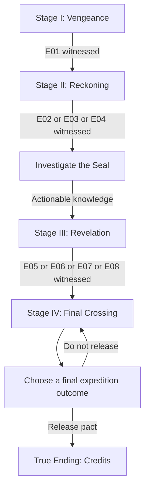
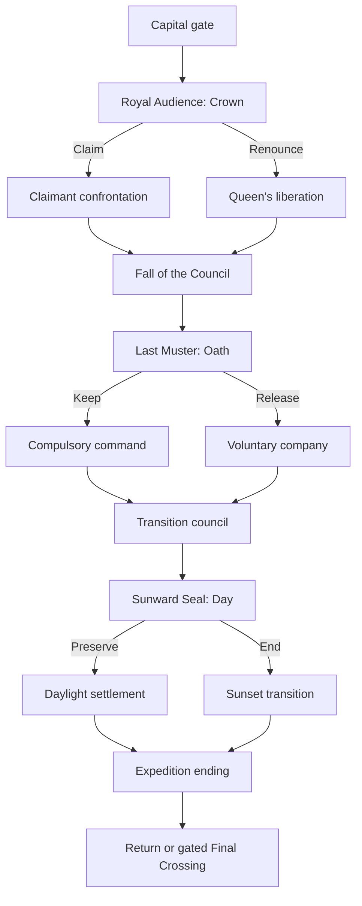

# The Undead Prince — World, Characters & Kingdom / 亡魂王子：世界、人物与王国

**R1 author-facing bilingual compendium; contains full spoilers. Art remains in production. / R1作者用双语合编，含全部剧透；美术仍在制作。**

## Part I — The world and its history / 第一部：世界与历史

## 1. Premise, gameplay and tone / 核心前提、玩法与基调

**LOCKED.** A prince is betrayed and killed by his own kingdom. Raised by the Ferryman, he leads an undead army against the people responsible. The campaign is an offensive island-assault roguelike: the offensive structure is inspired by *Boom Beach*, the miniature tactical islands by a reversal of *Bad North*, and the accumulating narrative across expeditions by *Hades II*. Different undead troop classes and temporary boons create distinct builds. Every expedition starts from the same initial island and basic force. Branching routes lead to the capital; exploration gradually reveals additional places, histories and side stories. There are eight successful ending combinations based on three binary decisions, plus a failed expedition outcome. Endings unlock progressively.

**已定。** 王子遭本国陷害而死，由渡魂人唤醒，率亡灵军团向仇人复仇。局内采用《海岛奇兵》式攻城、反向《Bad North》的微缩岛屿战术形式，跨周目叙事参考《哈迪斯2》。不同亡灵兵种结合临时增益形成肉鸽构筑。每轮从固定初始岛屿及基础部队开始，沿不同路线进攻王都；探索逐渐揭开更多地点、历史与支线。三项二元决定产生八种成功结局，另有讨伐失败结局，分阶段开放。

**WORKING tone.** A dark maritime fairy tale with restrained black humour. The world can be cruel, but the undead have ordinary habits, affections and ridiculous inconveniences. The central conflict is revenge, responsibility and what a ruler may demand of the dead. Avoid a morality lecture during combat; let decisions and their consequences carry the theme. Player-facing narrative should remain economical, chiefly short exchanges, documents and static illustrations. Author-facing history may be much richer.

**暂定基调。** 带有克制黑色幽默的海洋黑暗奇幻童话。世界可以残酷，亡灵仍有日常习惯、情感与滑稽的不便。核心冲突涉及复仇、责任、统治者对死者的支配。避免在战斗中频繁进行道德说教，以选择及其后果体现主题。玩家端以简短对白、文书及静态插画为主，作者掌握的历史可以丰富得多。

**Visual anchor / 视觉基准：** The supplied Prince has a fractured gold crown, ragged purple cloak, worn white-and-gold armour, partially skeletal face and green spectral sword, with stylised low-poly proportions. Preserve that recognisable silhouette; no compulsory progressive facial decay or costly alternative body models. / 王子现有设定图为断金冠、紫色破披风、白金旧甲、局部骷髅脸和青绿冥火剑，造型卡通化、低多边形。保留可辨识轮廓，不强制制作渐进骷髅化或昂贵的结局模型。

## 2. The kingdom, succession and the Council / 王国、继承与议会

**WORKING.** Alderreach is a northern maritime monarchy built around islands, sheltered sounds, rivers and a broken coast. Grain, timber, fish, iron, tolls and shipping sustain the realm. The crown relies on local lords for ships, provisions and soldiers. The capital, Sunhold, lies under the supernatural, uninterrupted light of the Unending Day and keeps an unusually ice-free harbour, warmed by the sacred flame; natural day and night still turn beyond the city, the Unending Day gives light but no heat, and the rest of the kingdom has ordinary seasons and winter, relying on sacred fire to survive the cold. The capital's advantage does not abolish its dependence on food, shipping, weather and labour elsewhere.

**暂定。** 奥德里奇（Alderreach）为北方海洋君主国，拥有群岛、海峡、河道与曲折海岸。粮食、木材、渔业、铁、港税和航运支撑国家。王室依赖地方领主提供船只、军粮和士兵。王都 Sunhold（暂译白昼王城）处于永昼之日超自然的长明光照下，港口靠圣火供暖而少结冰；城外自然昼夜仍在，永昼之日只发光、不供热，其他地方仍有正常季节与寒冬，靠圣火过冬。王都的优势不能替代其他地区的粮食、劳动力、航运及自然条件。

The royal arms are a gold eight-rayed sun on white, adopted after the Unending Day; the dynasty's older arms were a guiding star above the waves (design pending). The regency adds a red bend to its banners; Edmund's personal arms bear a crown, now broken on the undead standard. Ordinary families believe the dead sail across the Grey Sea; they light shore lanterns, speak names and commit tokens to the water. The Church of the Sun administers official rites, records deaths and teaches that the capital's light is a divine covenant. Ordinary clergy can be compassionate without knowing its hidden machinery.

王室纹章为白底金色八芒太阳，是永昼之后的纹章；王朝旧纹章为星与浪（图样待定）。摄政议会在军旗上加红斜带；王子私人纹章为王冠，亡灵军旗上的王冠已破碎。百姓相信死者渡过灰海，习惯点岸灯、念姓名、将纪念物放入水中。太阳教会主持官方葬仪、登记死亡并宣扬永昼是神与王室的盟约。普通教士可以善良而并不知晓隐藏机制。

### 2.1 Crown and regency / 王室与摄政议会

**LOCKED direction:** The younger sister inherits the crown in Edmund's absence, is controlled by the Council, and remains a person he deeply cares for. **WORKING chronology:** King Aldric falls ill, his Council governs under his seal, and after the fleet is destroyed he dies of ordinary illness. Eleanor is crowned under a fictional succession law and is twenty, an adult, but below the Crown’s special age of independent rule (twenty-one, working). The Council controls access to her, correspondence, seal and household guard. Her public condemnation of Edmund rests on false information and coercion. She has an actual legal claim; her brother's return from death does not automatically invalidate it. Her release from the Council need not mean surrendering her crown to him. She must have her own views and choices.

**已定方向：** 妹妹在王子死后继承王位，受议会操纵，也是王子内心的牵挂。**暂定时间线：** 老国王阿尔德里克卧病，议会代掌印玺；舰队沉没后国王因普通疾病去世。妹妹埃莉诺依虚构继承法即位，二十岁，已成年但未到王室专设的二十一岁亲政年龄（暂定）。议会控制她的接见、通信、印玺和宫卫；她公开谴责兄长源于虚假信息与压力。她拥有真实的合法继承权，死者归来并不会自动使其失效。解救妹妹不等于必须让她交出王位，她应有独立意志。

### 2.2 Five offices / 五名掌权者

| ID | Working name / 暂名 | Power and responsibility / 权力与责任 |
|---|---|---|
| CHAR_EARL | Earl Roderick / 罗德里克伯爵 | Shipping concessions, customs; sold the route, paid mercenaries, prohibited rescue. / 港税及航运特权；出卖航线、支付佣兵、禁止搜救。 |
| CHAR_COUNTESS | Lady Agnes, Countess of Barley Vale / 阿格尼丝女伯爵 | Grain contracts and levies; withheld supplies, prolonged the Prince's warrant. / 粮食与征发；扣押补给并延续王子旧令。 |
| CHAR_ARCHBISHOP | Archbishop Anselm / 安塞姆大主教 | Rites, records, the Seal; falsified the treason ruling and denied public burial. / 葬仪、记录、秘印；伪造叛国判决并拒绝公开安葬。 |
| CHAR_MARSHAL | Lord Marshal Hugh / 休元帅 | Former mentor, military cohesion; knowingly closed the bay, believing stability justified the murder. / 王子旧师、军队稳定；明知谋杀仍封锁海湾。 |
| CHAR_CHANCELLOR | Lord Chancellor Walter / 沃尔特宰相 | Royal seal, succession; coordinated the plot and secured control of the regency. / 王室印玺、继承；组织阴谋并控制摄政。 |

They have overlapping interests, not identical motives. Some know the Seal; others defend it without understanding it. The murder has a sufficient political explanation without magic. / 五人利益重叠而动机不同。部分人了解秘印，其他人只知道必须保护某设施。谋杀本身已有完整政治因果，不必靠魔法解释。

### 2.3 Current-history settlement / 本轮政治安排

Eleanor's coronation is valid under the law at the anchor. Edmund's former right does not automatically revive. A new settlement can recognise him only if Eleanor formally assents or the Crown's surviving institutions recognise an exceptional succession claim under a publicly recorded procedure. A successful assault gives him leverage, not automatic legitimacy. He may choose to press the claim or recognise Eleanor's crown. For the baseline eight endings, both paths achieve a settlement; a coercive settlement and a consensual one receive different epilogues. The Queen must speak and act on her own behalf. She knows administration and court politics; Edmund knows the fleet and provinces. Neither is universally wiser.

锚点时埃莉诺加冕具有法律效力；哥哥旧有权利不会自动恢复。新安排只有经妹妹正式同意，或由仍存续的王室机构按公开记录的特殊继承程序承认，才获得政治合法性。军事胜利提供筹码，不自动等同合法性。王子可以坚持继承主张，或承认妹妹的王冠。八种成功结局的基础均为达成政治安排；强制与自愿的安排影响尾声。女王必须表达和实践自己的意志。她熟悉行政与宫廷，王子熟悉舰队与地方；两人不分绝对高下。

All five councillors need not be defeated personally. Each route undermines a different source of the regency's power: harbour revenue and shipping, levy and provision contracts, Church authority and official records, or military orders and reinforcement. When the palace falls, the Queen's household and surviving officers can revoke the regency's common warrant and establish a provisional government. The conspirators who remain outside the capital can be summoned, arrested by loyal local forces, negotiate surrender, flee or become a continuing threat. The ending must distinguish the fall of the regency as a government from the punishment of every individual. No claim that all five are dead without current-run evidence. A failed route does not count as having dismantled the Council in the next history.

不要求逐一亲手击败五名议员。各航路削弱摄政不同权力来源：港税航运、征发粮约、教会权威及公文、军令与增援。宫城失守后，女王身边的机构与存续官员可以撤销共同摄政授权并建立临时政府。王都以外的阴谋者可能被传召、由效忠新政府的地方军队逮捕、谈判投降、逃亡或成为残留威胁。结局必须区别摄政政府覆灭与每个个体受罚；无本轮证据不得宣称五人均死。失败轮瓦解的权力网络不能延续到下一轮。

## 3. Fixed history before the anchor / 锚点以前的历史

| Sequence / 顺序 | Event / 事件（WORKING 暂定） |
|---|---|
| Generations earlier / 数代前 | Crown and Church establish the Unending Day in a severe winter; voluntary offerings gradually become coercive. / 王室和教会在严冬建立永昼，最初自愿献祭逐渐变成强制。 |
| Years earlier / 数年前 | Edmund serves with the fleet; Eleanor grows up at court. Their father presents the sun as royal protection. / 王子服役于舰队，妹妹在宫廷长大；父亲教导他们太阳象征王室庇护。 |
| Previous winter / 上一冬 | Edmund signs an emergency warrant for ships, provisions and men, with compensation promised but no effective expiry or oversight. / 王子签署紧急船粮与人员征发令，承诺补偿却没有有效期限与监督。 |
| Before voyage / 出航前 | Discovering withheld grain and unpaid arrears, he demands an audit, ends the levy and proposes relief funded by port revenue (his demand is frustrated). / 发现军粮被扣和欠款后，他要求审计、终止征发、用港税赈济，但未能落实。 |
| Last voyage / 最后航行 | The Council arranges a relief convoy; the Earl compromises its route, Agnes delays supplies, Hugh traps the fleet and paid mercenaries attack. Edmund refuses to abandon the transport ships. / 议会安排赈粮船队；伯爵出卖航线、女伯爵拖延补给、元帅封湾、佣兵伏击。王子拒绝弃船逃生。 |
| After wreck / 沉船后 | A prepared treason judgment condemns the dead. Honours, arrears and official funerals are withheld; families fear retaliation. The fleet's souls are marked for diversion to the Seal. / 预拟叛国判决生效，荣誉、欠饷、官方葬礼被剥夺，家属不敢申辩；舰队亡魂被指定转送秘印。 |
| Before anchor / 锚点前 | Aldric dies, Eleanor is crowned; the Ferryman intercepts the dead and raises Edmund and the original company at Bellgrave Bay. / 国王去世、妹妹加冕；渡魂人截下亡魂，在沉钟湾唤醒王子及最初旧部。 |
| Anchor / 锚点 | Five councillors are alive; Eleanor has never met her undead brother. The Prince begins the first assault. / 五名仇人均存活；妹妹未见过亡灵化的兄长；王子开始首次讨伐。 |

Edmund is innocent of treason, but his earlier warrant harmed people he meant to protect. His army contains both volunteers and conscripts. Preserve his genuine courage and affection alongside his tendency to mistake loyalty for unlimited consent. / 王子没有叛国，但自己早年的征发令伤害了原本想保护的人。军团中既有自愿旧部也有被征来的士兵。保留他的勇气与感情，同时表现他容易把忠诚误认为无限服从的弱点。

## 4. Death, soulfire and the Unending Day / 死亡、冥火与永昼

The founding winter closed several harbours, stranded grain ships and killed many. The first Seal was a temporary means of drawing residual soulfire and, when insufficient, accepting the deliberate sacrifice of a few dying volunteers. The city survived. Over generations the court expanded its demands: an ice-free harbour, protected winter stores, reliable shipping, then civic prestige. Each winter the churches of the realm received sacred fire from the capital; the public rite was a gift of divine grace, while the flame itself was drawn from the Seal. Residual soulfire is inadequate for continuous operation at the present scale. A soul is a person; the Seal binds a soul and gradually consumes its capacity to remain a person. It has no infinite fuel. At the present rate of use, regular consignments of newly dead are required. There is no precise universal conversion of souls to days; authoring must keep scarcity and depletion consistent.

建立永昼的严冬封冻了数座港口，粮船滞留，大量百姓死亡。最初秘印是临时措施，抽取残余冥火，不足时接受少数临终者自愿献出的灵魂。城市得以存续。此后宫廷逐代扩大需求：不冻港、冬储、稳定航运，最后还有城市威望。王都每年冬天还把圣火送往各地教堂：公开的说法是神恩下乡，火种实际由秘印分出。残余冥火不足以按现有规模持续运转。灵魂是一个人；秘印束缚并逐渐消耗其保持人格的能力，燃料并非无限，现有规模必须定期补充死者。暂不设灵魂与天数的精确换算，但创作必须保持稀缺和消耗规律一致。

Aldric knew how the system was supplied. Early in his reign he attempted to restrict diversions to voluntary donors; a severe winter and a shortage led him to sign an exception for condemned dead. The exception outlived the emergency. He loved his children and his country, but bears responsibility for a policy he chose and concealed. The Council extended the exception to the entire fleet to silence its families and exploit the supply. Its motive for murder remains political; fuel is an additional use of the victims, not the sole explanation for the conspiracy.

阿尔德里克知道燃料来源。执政初期曾试图限制为自愿献祭者，却在严冬和短缺后签署了允许截留获罪死者的例外条款。紧急状态结束后例外仍然保留。他爱子女和国家，但应为自己的决定及隐瞒负责。议会把例外扩大到整支舰队，以压制家属并利用亡魂。谋杀的主要动机仍是政治利益；将死者作为燃料是附加利用，不是阴谋唯一原因。

Ending the Seal releases surviving captives; souls already consumed in the active history do not return. The capital loses artificial light and warmth, not the natural sun. The immediate cost is a return to seasonal shipping and the need for food reserves, alternate anchorages and heating. A prepared government can survive the transition, but cannot abolish the cost. A player who preserves the light can order reforms and a supply audit; these can affect epilogues, but a fully non-consuming, permanent replacement would contradict the present premise and is not an instant third option. A smaller temporary residual-energy system may be researched as a later epilogue prospect, not a completed solution.

终止秘印释放尚存囚魂；本轮已经耗尽的灵魂不会恢复。王都失去人工光热，不失去自然太阳。直接代价是季节性航运恢复，需要粮储、备用港口及供暖。准备充分的政府可以渡过转型，却不能取消代价。选择延续永昼的玩家可以下令改革和审计燃料来源，改变尾声；但不能立即通过无消耗的永久替代方案化解整个矛盾。小规模临时冥火设施可作为远期研究方向，而非已经完成的第三种解决方案。

Necromancy normally uses residual soulfire to give a willing or unclaimed shade a body; routine troop summons are not a Seal-like destruction of persons. The original company's oath is a binding command that initially makes refusal impossible. Edmund can release that power without ending voluntary enlistment. Any optional civilian harvesting or explicit compulsion is clearly marked as a distinct action; ordinary combat is not a hidden morality tax. A soul does not disappear merely because its body is destroyed.

常规招魂使用残余冥火让愿意应召或尚未归属的亡魂获得实体，不像秘印一样消耗人格。基础部队的军誓具有约束力，最初不能拒绝命令。王子可以解除这种能力而保留自愿入伍。若玩法允许伤害平民收魂或额外强征，明确标记为独立行为，不以常规战斗暗扣善恶值。实体被毁不等于灵魂消亡。

The death register records identities and claims; it has no magical control over names. Ordinary families' sea burial, shore lanterns and mourning customs remain distinct from the Church's hidden diversion of souls. / 死亡名册登记身份及权益，不能靠名字控制灵魂。普通人的海葬、岸灯与悼念习俗，与教会截留亡魂的秘密行为分开。

## 5. The Return and True Ending / 回溯与真结局

**LOCKED / 已定。** The Ferryman grants a Return to a fixed anchor. Only Edmund remembers the histories he personally lived through; the Ferryman knows their outcomes by an undisclosed means. Everyone else, living or dead, resets. No borrowed memories, dreams or inexplicable familiarity. The anchor is immediately before the first expedition: the ship has sunk, Aldric is dead, Eleanor is crowned, the original company is raised. Geography is fixed; different expeditions are real events, not simulations.

渡魂人赋予固定锚点回溯。只有埃德蒙保留亲历记忆，渡魂人以未公开方式知晓结果；其余生者与死者均重置，不以梦境、借来记忆或莫名熟悉感绕过。锚点位于首次出征前：沉船、国王死亡、妹妹加冕、基础军团唤醒均已发生。地理固定，各轮是实际发生过的历史，不是模拟。

**WORKING trigger / 暂定触发：** The pact recalls Edmund when an expedition is defeated, or when a completed political settlement reaches its first closing tide (a short aftermath, narrated in weeks where appropriate). Victory is not a release clause. The recall is automatic; selecting Continue acknowledges it, not a choice to remain in that history. There is no real-time countdown, no forced failure quota, no permanent memory loss. A saved game can pause at any permitted point; stopping play is not a canonical release. Edmund initially misunderstands the extent of the bargain; his first victory exposes the difference between winning and being free to stay. The Ferryman may explain the clause without revealing his origin.

契约在讨伐失败时自动召回埃德蒙；成功达成政治安排后，待其第一段战后生活结束、迎来约定的收潮时刻，同样自动回溯（可用旁白呈现数周）。胜利不是解约条件。继续按钮只是承接必然回溯，不提供留下的假选项。不设现实时间倒计时、强制失败次数或永久失忆。暂停游玩不等于正史解约。王子起初误解契约范围，首胜后才明白获胜不意味着有权留下；渡魂人可以解释该条款而不揭露来历。

| Persistent / 跨轮保留 | Reset / 本轮重置 |
|---|---|
| First-hand memories, known facts and routes, learned summoning/command techniques, ending records, one-time dialogue flags. / 亲历记忆、事实航路知识、习得招魂指挥技术、结局记录、一次性对白标记。 | Current army, boons, physical equipment/documents, allegiance, trust, occupations, deaths, evidence and capital choices. / 本轮军队、增益、实物装备文书、效忠、信任、占领、死亡、证据、王都决定。 |

Persistent unlocks are knowledge or reproducible spiritual techniques (otherwise explicitly a gameplay abstraction), never unexplained physical renovation. A remembered clue can enable a shortcut; it is not a physical document. A soul consumed after the anchor is restored on Return; one consumed before it cannot be restored. Edmund remembers only aftermaths he actually lives through; projected decades in an epilogue are clearly labelled forecasts.

永久解锁是知识或可重复的灵魂技艺（否则明确为玩法抽象），不是无解释保存物理建设。记得线索可走捷径，不等于持有实物。本轮锚点后耗尽的灵魂可随回溯恢复；锚点前耗尽的不能恢复。王子只记得亲历的战后事件，几十年远期推演明确标为可能未来。

**LOCKED resolution / 已定收束。** The pact sustains Edmund independently of the Seal and compulsory military oath. Ending either does not destroy him. The True Ending occurs when he relinquishes the pact; he crosses the Grey Sea and the chosen history continues without him or further Return. Credits follow. The completed slot remains readable, but cannot launch an expedition. New Game starts at the original anchor with no narrative knowledge, ending unlocks or permanent progression carried over. No save deletion or silent resurrection.

契约支撑王子独立于秘印及强制军誓的存在；终止后二者不会让他消散。真结局是主动解除契约、渡过灰海，当前历史失去回溯并在他离去后延续，随后播放演职员表。完结存档可查阅，但不可开启出征；新存档回到原始锚点，不继承剧情知识、结局解锁或永久成长。不删存档，不暗中复活。

**WORKING closure mechanism / 暂定解约机制：** the Seal and the Return are separate bindings; neither powers the other, and ending the Day does not end the Return, destroy Edmund, or open the True Ending by itself. By witnessing the Seal release its captives, Edmund first understands that a binding can be laid down without consuming the person. This is a change of understanding, not a mechanical dependency: the right to release his pact has always been his, though he did not know it. The Ferryman can then explain the voluntary release clause of their pact. On a later successful run, before the closing tide, Edmund can explicitly relinquish it. He must settle the consequences of his departure first: if king, name a lawful successor; if still wielding the compulsory oath, release it, because it cannot be inherited by another commander. Voluntary units may remain. This is an irreversible coda to the already recorded E01–E08 outcome, not a fourth bit or a secret reclassification. E08 is the simplest emotional route, not a moral password. See the design document for concrete gates and branches.

秘印与回溯是两套彼此独立的束缚，互不供能；终止永昼既不会让回溯停止，也不会让王子消散，更不会自动进入真结局。王子在秘印前亲眼看到灵魂被释放，才第一次理解：束缚可以被放下，而不必消耗被束缚者。这是认知上的契机，不是机制上的依赖；解约的权利一直在王子手里，只是他此前不知道。渡魂人此后解释契约的自愿解约条款。在之后成功出征的收潮前，王子可以明确解除契约。必须先安排离去的后果：若为国王，指定合法继承安排；若仍持强制军誓，必须解除，因这种支配权不可由其他指挥者继承；自愿者仍可留下。这是真实发生的 E01–E08 之后不可逆的终章，不是第四维或偷偷重分类。E08 是情感上最直接的路线，不是道德密码。具体门槛与分支见剧情设计文档。

The emotional cost is grief and accumulated responsibility, not a punishment meter. The Ferryman's knowledge is not omniscience. The player can decline closure and the tide recalls Edmund again until he is ready; after closure the current save is finished.

代价是累积悲痛与责任，而非惩罚条。渡魂人并非全知。玩家可以暂不解约，此时收潮照常回溯，直到准备好；一旦解约，本存档完结。

## 6. The Ferryman / 渡魂人

**LOCKED.** Important recurring NPC, grants the Return and may comment on the previous outcome when a run starts. Edmund learns within the first one or two expeditions that the Ferryman knows the erased histories. Afterwards this is ordinary shared understanding, not a recurring revelation. Keep his origin, motives, limits and means of knowing mysterious. He can be dry, courteous, occasionally gentle, and need not constantly speak in riddles.

**已定。** 渡魂人是重要常驻 NPC，赋予回溯能力，可在新一轮开始点评上轮结局。王子在前一至两轮获知渡魂人了解被抹去的历史；之后双方视之为共同认知，不再反复惊讶。保留来历、目的、能力边界及知情方式的神秘性。性格可礼貌、冷幽默、偶尔温柔，不必总说谜语。

**WORKING presentation:** visible at Bellgrave Bay; may initiate a voice heard only in Edmund's mind elsewhere. Edmund cannot demand answers at will. This is an optional presentation, not a new power for ordinary NPCs. Use rare comments on important discoveries, not a constant tactical guide. / **暂定呈现：** 在沉钟湾可见，出征时可主动以只有王子听见的意识传声交流；王子无法随时召唤答案。此为呈现提案，不赋予其他角色新能力。少量用于关键发现，不持续指导战术。

| Context / 场景 | English source | 中文本地化 |
|---|---|---|
| First recognition / 初次确认 | Edmund: “You remember?” Ferryman: “I know where you've been. Let us leave it at that.” | 埃德蒙：你也记得？渡魂人：我知道你去过哪里。这就够了。 |
| After E01 / 灰烬王冠后 | “Well, Your Majesty. Was it everything you hoped for?” | 那么，陛下。一切都如你所愿吗？ |
| After E03 / 冥夜摄政后 | “You gave her the crown. Did you ever give her the kingdom?” | 你把王冠给了她。可你真的把王国交给她了吗？ |
| After E04 / 归途后 | “You dismissed the company. Yet here you are, with all hands on deck.” | 你已经解散了军队。可你又回来了，船上一个人都没少。 |
| Different route / 换航路 | Ferryman: “A different road this time.” Edmund: “Same bloody castle.” | 渡魂人：这回倒是换了条路。埃德蒙：还不是那座该死的城堡。 |
| Failed expedition / 讨伐失败 | “The kingdom lives to see another day. So do you, in a manner of speaking.” | 王国又迎来了新的一天。某种意义上，你也是。 |

Never spoil an unvisited ending. Select commentary using the actual previous result and location. / 不剧透尚未见证的结局，按实际上一轮结果和地点选对白。

### Authorial boundaries / 作者层面的边界

He safeguards the passage of the dead, not the succession of kings. The Seal is an obstruction to that passage, but he cannot change a living institution, command its guards, pronounce a valid royal decree or operate its machinery in the living world. He intercepts the condemned fleet before its souls reach the Seal. Edmund is a plausible agent because he is a wronged soul, a fleet commander who can reach Sunhold, and a member of the royal family with a credible path to the palace. The condemnation of an entire fleet creates an exceptional opportunity, not the first injustice in history. The Ferryman has assisted individual dead before; this is the first Return in the story. Do not establish a universal ability to rewind any person or any historical event.

他维护死者渡海的秩序，不负责决定谁当国王。秘印妨碍渡海，但他不能直接改造活人的制度、命令守军、签署有效王令或操作现世设施。他在舰队亡魂抵达秘印之前将其截下。埃德蒙既是蒙冤死者，又是能率军抵达王都的统帅，更是能够进入宫廷的王室成员，因而是合理的行动者。整支舰队被定罪形成一次特殊机会，并不意味着此前没有不公。渡魂人过去可以帮助个别死者；本故事首次展现回溯，不建立普遍的任意时间旅行能力。

His knowledge of erased outcomes is an exception, not omniscience. He can describe what happened, but cannot supply every hidden document, mechanical detail or possible future. He may answer direct questions about what he knows; he does not deliberately force a second murder just to unlock a clue. His origin, exact knowledge mechanism and full capabilities remain mysterious to the player. He does not need to be secretly evil. After the first recognition in run one or two, never repeat the surprise. Mental speech is initiated sparingly by him, outside moments requiring tactical attention.

他对已抹去结局的知情是例外，不是全知。他可以评价已经发生的事，却不能提供所有隐秘文书、机械细节或可能未来。他可以回答自己知道的问题，不为解锁线索故意迫使王子再经历一次谋杀。其来历、知情机制和全部能力仍对玩家保密，不必是幕后反派。前一两轮确认知情后不再反复惊讶。意识传声由他少量主动发起，避免打断战术操作。

> Ferryman: “Victory was never the condition of our bargain.”
>
> 渡魂人：获胜从来就不是我们契约的条件。

## 1. The sea before the crown / 王冠之前的海

Alderreach was not born in a palace. It grew from a sea that people could cross more easily than the mountains behind their homes. The outer islands traded fish and salt for grain; the northern valleys supplied timber and iron. A safe passage was worth more than an empty stretch of coast. The earliest rulers competed for ferries, beacon hills and sheltered anchorages. Later royal chronicles turned those bargains, battles and marriages into a single story of conquest. The submerged kings are monuments to that story, not proof that every island accepted the crown at once.

奥德里奇并非诞生于宫殿。居民横渡海面远比翻越故乡背后的群山容易，海路因此孕育了这个国家。外岛以鱼盐换粮，北方河谷供给木铁；一条安全水道比大片无人海岸更有价值。最早的统治者争夺渡口、灯标山丘和避风锚地。后来的王室史书把谈判、战争和联姻编成一部统一征服史。沉王群像纪念的正是这段叙事，却不能证明每座岛屿曾同时归顺王冠。

## 2. Five ages of the realm / 王国的五个时代

Dates are provisional relative periods, not new fixed calendar years. HIST_01–03 remain the shared anchors. / 年代采用暂定相对时期，不增加固定历法；沿用共享HIST_01–03。

### The Age of Oars / 舟楫时代
Several centuries before the anchor, island chiefs and estuary towns maintained local ferries and burial customs. The first maritime agreements protected pilots and rescue crews. The later Crown inherited rather than invented these practices. / 锚点前数百年，岛屿首领和河口城镇管理各自的渡船与葬俗；早期海事协议保护引航和搜救人员。后来的王室继承了这些传统，并非凭空创造。

### The Wars of the Crownsea / 王冠海战争
Successive rulers united the sea through alliances, tribute and force. The Iron Gate and old causeways became instruments of shared defence and royal revenue. Defeated houses often survived as chartered local elites. This explains why later councillors control institutions larger than their personal estates. / 历代君主通过联盟、贡赋和战争统一内海。锁海之门和古王堤成为共同海防与王家收入的工具。战败家族往往以拥有特许权的地方豪族身份存续。这解释了后来的议员何以掌管远超私人领地的机构。

### The Great Winter / 大寒冬
A sequence of failed harvests and harbour closures threatened the court and the grain network. The first Seal at Sunhold was intended as an emergency measure, drawing on residual soulfire and voluntary contributions under the founding covenant. Its light and warmth were local, and relief still required ships and grain. The old royal household moved to the safer port. / 连续歉收与港口封闭危及宫廷及粮运网络。Sunhold的初代秘印原为紧急措施，依据初始盟约利用残余冥火及自愿献祭。其光热只覆盖局部，赈济仍需船粮。旧王庭迁往较安全的港口。

### The Golden Harbour / 黄金港时代
Merchants built warehouses beside the ice-resistant harbour. Royal offices moved east, and suppliers invested in one dependable terminus. The temporary exception became a permanent institution. The rest of the realm still experienced winter and darkness; prosperity was uneven. / 商人在不易封冻的港口旁修建货仓，王家机构东迁，供应者把投资集中在稳定终点。临时措施逐渐成为永久制度。王国其他地方仍经历黑夜和冬天，繁荣并不均等。

### The Regency / 摄政时代
Aldric's coercive exception preceded the conspiracy. During the last winter, Edmund's emergency requisition warrant compounded the abuses. Five offices cooperated to kill the heir and exploit Eleanor’s temporary royal regency; neither the Seal nor an ancient prophecy caused the assassination. / 阿尔德里克的强制献祭例外早于共谋。最后一冬，埃德蒙的紧急征发令又加剧滥用。五个机构联手杀害继承人，利用埃莉诺尚未达到王室亲政年龄维持摄政；谋杀的原因并非秘印或古代预言。

## Part II — The people of Alderreach / 第二部：海国人物

## 1. The royal house / 王室家族

### Before the children / 孩子出生以前

Aldric inherited a crown that was stronger on parchment than at sea. The great families owned ships, grain stores and fortresses; the king owned the right to ask them for all three. His marriage to Queen Beatrice brought the western shipping houses into a more durable settlement with the Crown. She was the daughter of a lesser coastal lord, educated among merchants rather than at a military court. Her gift was remembering what a promise had cost the person who made it. She insisted that a royal progress include a visit to a working harbour, not merely the hall of its lord.

阿尔德里克继承的王权，在纸面上比在海上更强大。豪族掌握船队、粮仓和堡垒，国王则拥有向他们索取这三者的权利。他与贝阿特丽斯王后的婚姻，使西部航运家族与王室建立了更稳定的合作。王后是沿海小领主之女，成长于商人之间而非军事宫廷。她善于记住别人作出承诺付出了什么代价。她坚持王室巡访必须亲自去仍在运作的港口，而非只拜访领主的厅堂。

Beatrice died of an ordinary illness when Edmund was nineteen and Eleanor thirteen. There is no secret assassination, surviving ghost or hidden parentage. Her death changed the household: Aldric withdrew into government, Edmund spent longer at sea, and Eleanor discovered that an empty place at dinner could become a permanent part of life. She survives in the story through the children's habits and a few letters. Her name is a working addition (CHAR_MOTHER), not a fourteenth principal combat character.

贝阿特丽斯因普通疾病去世，当时埃德蒙十九岁，埃莉诺十三岁。这里没有秘密暗杀、尚存亡魂或隐藏身世。她的死亡改变了家庭：阿尔德里克越来越专注政务，埃德蒙更长时间待在海上，埃莉诺发现餐桌上的空位有时会永远空着。故事通过孩子们的习惯与少量信件保留她的存在。其名为暂定新增（CHAR_MOTHER），不增加第十四名核心战斗角色。

### The boats at the orchard / 果园里的小船

The family's country residence stood near an old irrigation channel. On one summer afternoon, Edmund's boat won three races; Eleanor found a lead weight concealed inside its keel. She did not complain to their father. She removed the weight and beat him on the fourth attempt. Edmund remembered the indignity for years. The little boat with a repaired mast remained in her possession when he left for his first patrol.

王室乡间庄园旁有一条旧引水渠。一年夏日下午，埃德蒙的小船连赢三场；埃莉诺发现船底藏着铅块。她没有向父亲告状，而是拆掉铅块，在第四次比赛中赢了哥哥。埃德蒙多年都记得这次丢脸。哥哥首次出海时，那艘修过桅杆的小船仍留在妹妹手里。

The orchard scene should first be a happy memory, with the political meaning arriving much later. A later audience may use a detail of the race to help Eleanor recognise her brother. It is not a password that obliges her to trust him or surrender the throne.

果园回忆第一次应当是快乐的童年片段，政治含义可以很晚才出现。后期会面时，哥哥可以用比赛的细节帮助妹妹确认身份，但它不是迫使妹妹信任他或交出王位的密码。

### The succession settlement / 王位继承制度

Alderreach's fictional Law of the Crown recognises the eldest living eligible child of the deceased sovereign. Death vacates a claim; it does not reserve the place indefinitely. Under the Crown’s special age-of-rule provision (distinct from ordinary adulthood), a regency exercises specified powers until the sovereign turns twenty-one, with a duty to preserve the Crown's estate. Eleanor is twenty at the anchor. Her coronation is valid. The Council cannot lawfully own the Crown, but can control access to the queen and the execution of her orders. There is no standing rule for a claimant returned from death. A new settlement must be recognised by surviving institutions, preferably through Eleanor's recorded assent and a witnessed transfer; a forced transfer remains politically contested.

奥德里奇虚构的《王冠法》规定，已故君主仍在世且具备资格的最年长子女继位。死亡使原有继承权空缺，不会无限保留位置。未达王室亲政年龄的君主由摄政机构行使规定权力至二十一岁亲政，摄政机构有义务维护王室领地和财产。锚点时埃莉诺二十岁，加冕合法。议会不能合法占有王冠，却可以控制女王接见及政令执行。法律没有为死而复归者制定常规条款，新安排须由存续机构承认，最好有女王记录在案的同意与见证交接；强迫交接仍会引发政治争议。

If Edmund renounces his claim, Eleanor still needs a new instrument of government: the discredited regency is dissolved, a limited caretaker administration is appointed, and independent control of her household and seal is restored. A temporary advisory council can advise her without reproducing Walter's monopoly. In the true ending, any succession after Edmund's departure is recorded as a separate event, not a retroactive change to the earlier ending.

王子放弃继承主张时，埃莉诺仍需新的政府安排：失去公信力的摄政议会解散，任命权限受限的临时行政班底，恢复对印玺与宫廷的独立控制。临时顾问团可协助她而不重建沃尔特的垄断。真结局中若王子离去后涉及继承，须另行记录，不得倒改已经达成的轮回结局。

## 2. The five signatures / 五份签署的文书

The conspiracy was a compact among offices, not a cult. Its members did not need to share a worldview. They needed each other to make a crime look like a lawful emergency. Walter supplied the authority; Agnes the administrative pretext; Roderick the false routing and contracted attack; Hugh the naval closure; Anselm the prepared judgement and diversion of the dead. No one is excused by having signed only one part.

阴谋是五个掌权机构之间的协议，而非邪教组织。成员不需要相同的世界观，只需彼此配合，让罪行看起来像合法紧急措施。沃尔特提供授权，阿格尼丝制造行政借口，罗德里克负责虚假改航与雇佣袭击，休执行海军封锁，安塞姆准备判决与亡魂转送。没有人可以因为只签署其中一部分而免责。

### The road to the murder / 谋杀的前因后果

1. In the previous winter, Edmund uses an emergency warrant authorised under the king's delegated powers to obtain men, ships and grain. It contains a promise of repayment but no enforceable end date. / 上一冬，埃德蒙在国王授权下签发征发令，征用人员、船只与粮食。文书承诺补偿，却没有可执行的终止日期。
2. By spring, the warrant is still being copied. Edmund notices discrepancies between the relief figures reported at Sunhold and the actual stores and arrears at the outer ports. He requests an audit and a formal revocation. / 到春季，征发令仍被不断抄发。王子发现王都上报的赈济数字与外港粮储及欠款不符，要求审计和正式撤令。
3. Walter obtains a relief commission under the ailing king's ordinary delegated authority. Its public task is legitimate. Privately the councillors consent to a lethal diversion, because a living heir could revoke their concessions after accession. / 沃尔特利用病中国王的日常授权取得赈济委任。公开任务合法，私下议员同意致命改航，因为活着的继承人即位后可以撤销他们的特权。
4. Agnes's withheld stores make a later departure urgent. Roderick's false notice directs the convoy to a recognised waiting anchorage off the outer island belt. Hugh closes the naval passage at Bellgrave. The flagship sinks there while Edmund remains with the transports. / 阿格尼丝扣粮使推迟后的出航变得紧迫；罗德里克的虚假通知将舰队引至外岛链旁公认的等待锚地；休封锁沉钟湾的海军通路。王子留在运输船一侧，旗舰沉于湾中。
5. Anselm's judgement was drafted beforehand and issued after the wreck; the families lose burial rites and claims for arrears. The dead are marked for the Seal. The date on a draft is evidence of prior intent, not a legal judgement magically issued before the crime. / 安塞姆的判决草稿事先拟成、沉船后发布；家属失去葬仪和欠饷申索资格。死者被指定转送秘印。草稿日期是预谋证据，并非尚未发生便魔法生效的判决。
6. Aldric is told an incomplete story and dies of illness. Eleanor is crowned. The emergency coalition uses the age-of-rule regency to maintain its control. The Ferryman diverts the condemned company, raises the wreck, and establishes the anchor before the first expedition. / 阿尔德里克只听到不完整的死亡版本，随后因病去世。埃莉诺加冕，紧急权力联盟通过摄政维持控制。渡魂人截下被定罪的军团，升起沉船，在首次出征前建立锚点。

### Different responsibilities / 不同的责任

| Person / 人物 | What they knew and chose / 知情与决定 | Proof in the present history / 本轮证据 |
|---|---|---|
| Walter / 沃尔特 | Authorised a mission intended to remove the heir; arranged the cover-up and subsequent government. / 授权旨在除去继承人的任务，并安排掩盖及继任政府。 | Commission register, private correspondence; capital fallback. / 委任登记、私人通信；王都备选证据。 |
| Roderick / 罗德里克 | Knew the diversion was lethal; used customs privileges and contractors to arrange the attack and cover-up. / 知道改航会致死，利用航运特权与承包人安排袭击和掩盖。 | oar, pilot, light. / 折桨港、引航岛、天涯灯塔。 |
| Agnes / 阿格尼丝 | Knowingly provided a false supply account and consented to the murder; she was not merely deceived. / 明知而提供虚假粮账并同意谋杀，并非只受欺骗。 | roads, mill, granary. / 王冠海道、磨桥渡、万谷仓。 |
| Hugh / 休 | Knew the fleet would be killed and prevented escape and rescue; the military rationale does not excuse it. / 知道舰队将被杀害，仍阻止逃生与救援；军事理由不免责。 | gate, yard. / 锁海之门、黑浪船厂。 |
| Anselm / 安塞姆 | Knew the condemnation was fraudulent; approved the planned use of the victims' souls. / 知道判决虚假，批准利用受害者灵魂。 | abbey, archive, funeral; early evidence does not disclose all metaphysics. / 苍白圣堂、沉水藏书阁、灵渡码头；早期证据不公开全部魔法原理。 |

The king's earlier Seal policy is a different wrong from this murder. The queen's signatures after coronation may be coerced or ill-informed, but she must answer for decisions she knowingly makes in the present history. / 国王早年的秘印政策与此次谋杀是两种不同过错。女王加冕后签署的文书可能受到强迫或误导，但她须对本轮自己知情作出的决定负责。

## 3. The principal cast, deepened / 核心人物深化

### B01 — Edmund / 埃德蒙

As a young officer he was famous for remembering the names of boats, but less accomplished at remembering that their crews had families. During a patrol he once paid for a damaged fishing vessel from his own purse and was offended when its owner demanded a receipt rather than offered thanks. Bernard explained that a receipt would protect the man from the next customs officer. Edmund signed it. The incident is revealing: he is capable of generosity and learning, but still expects gratitude to follow his good intentions. His greatest fear before death was disappointing his father; after death it is becoming someone Eleanor cannot recognise.

年轻军官埃德蒙以记得每条船的名字出名，却没有同样擅长记住船员各有家庭。一次巡航，他自掏腰包赔偿一艘损坏的渔船，却因船主索要收据而非道谢感到被冒犯。伯纳德解释，收据能保护对方不被下一任税官再次追索。埃德蒙签了字。这件事揭示他的性格：他能慷慨，也能学习，却仍期待善意自然换来感激。生前他最怕让父亲失望；死后则怕自己变成妹妹认不出的人。

**Scene — The borrowed seal.** At the anchor he believes his old command is enough. In Stage II, at mill, he sees his signature on a levy that has survived him. He may help rescind it locally or merely confiscate the goods. In the capital a remembered warrant helps him ask a precise question; it does not automatically restore the legal rights of its victims.

**场景：借出去的印玺。** 锚点时他相信旧军令仍然足以指挥一切。第二阶段在磨桥渡，他看到自己签署的征发令比他活得还久。他可协助在当地撤令，也可仅接管物资。到王都后，记得文书内容能帮助他提出准确的问题，却不会自动恢复受害者权益。

### B02 — The Ferryman / 渡魂人

He appears in contradictory local stories, but the one stable image is an empty place in his boat. He has no throne, temple or priesthood of his own. He is scrupulous about names and surprisingly careless about titles, except when an address will tease Edmund. His interest in the Seal is the interruption of passage. He cannot seize a living institution or operate its machinery; he has offered a binding that makes the dead Prince capable of acting there. He knows erased outcomes, not every secret. The opening lines after each expedition are therefore informed comments rather than prophecy. His origin remains unconfirmed.

民间故事对他的描述互相矛盾，唯一稳定的意象是船上留着一处空座。他没有自己的王座、圣殿或祭司。对姓名十分认真，对头衔却不太讲究，除非称呼恰好能拿王子开玩笑。他关注秘印是因为它阻断渡海；无法夺取活人的机构，也无法操作机器，因此给了亡灵王子能够介入的契约。他知晓被抹去的结局，不知一切秘密。每轮开场的评论来自知情而非预言，来历仍无定论。

**Scene — A king without a kingdom.** After E01 he calls Edmund “Your Majesty” once. If recognition has not already occurred during an earlier defeat, Edmund asks whether he saw it. “I know where you have been.” After recognition he never has to explain the same fact again. During the final crossing he leaves the empty place ready, without revealing whether his boat is a literal vessel or something more.

**场景：没有国土的陛下。** E01 后他称埃德蒙一次“陛下”。若此前战败时尚未确认知情，埃德蒙才问他是否见过一切。“我知道你去过哪里。”确认之后无需再解释同一事实。最终渡航时他留着空座，不揭露船究竟是真船还是别的什么。

### B03 — Eleanor / 埃莉诺

She kept the household accounts after Beatrice's death because no one thought a thirteen-year-old girl would notice that the flour delivered to the kitchen was less than the quantity entered. Her love of repair became a habit of comparison: an object is useful if it works, an account useful if it agrees with what is delivered. At twenty she can read a supply schedule but has never commanded a war. Her closest ally at the anchor is a household clerk who sometimes leaves the original of a petition beneath its approved summary. She does not immediately know which omissions are deliberate. She wants to rule, and sometimes resents the fact that her brother can return to the kingdom as a legendary figure while she must face creditors in the morning.

贝阿特丽斯去世后她开始留意宫廷账目，因为没人认为十三岁女孩会发现厨房实收面粉比账上少。喜欢修东西的爱好变成了核对习惯：物件能用才有价值，账目与交付相符才有价值。二十岁时她能读懂补给计划，却从未指挥战争。锚点时最信任的是一名宫廷文书官，偶尔把请愿书原件夹在审核摘要下面。她并不知道哪些遗漏是蓄意的。她希望执政，有时也会怨恨哥哥可以传奇般归来，而她翌日仍须面对债主。

**Scene — The unopened petition.** At the audience, she asks Edmund to identify a family affected by his old warrant, not as an examination but because she wants an answer she can act upon. If he has investigated the Grainwater, he can answer concretely. Otherwise they may request records together. Her support follows current conduct, not a persistent friendship score. / **场景：未拆开的请愿书。** 王室会面时她请哥哥说出一家受旧令影响的人，并非考问，而是希望有能够处理的具体情况。调查过粮道就可具体回答，否则两人可以共同调档。她的支持由本轮行为决定，不是永久好感度。

### B04 — Aldric / 阿尔德里克

He was capable of sitting on the nursery floor with a wooden boat and later sealing a cruel order at the same desk. His first reform of the Seal was genuine, and so was his fear of another famine. When the second severe winter came, he accepted the condemned-soul exception on the assurance that it would be reviewed after the thaw. He did not revoke it. His love for his children was not an exemption from responsibility. A household portrait may show Beatrice beside him, a second portrait his later solitary reign. The children know different versions of the same man.

他既能坐在育儿室地板上陪孩子玩木船，也能稍后在同一张桌上签下残酷政令。初次限制秘印的改革是真诚的，对再次饥荒的恐惧也是真的。第二次严重寒冬到来，他接受获罪亡魂的例外条款，承诺解冻后复审，却没有撤销。对子女的爱不能免除责任。家庭肖像可以表现贝阿特丽斯与他同在，另一幅肖像表现后来孤独的统治。两个孩子认识的是同一个父亲的不同侧面。

**Scene — The second seal.** In archive, Edmund learns the exception bears his father's signature, not Walter's. Eleanor can authenticate it in the present run. The revelation does not resurrect Aldric or make him an accomplice to the ambush. / **场景：第二枚印玺。** 沉水藏书阁里王子发现例外条款署名是父亲，而非沃尔特。妹妹可在本轮鉴定真伪。这项发现不会让父亲复活，也不把他变成伏击共犯。

### B05 — Bernard / 伯纳德

He once wanted to captain a pilot boat, until his older brother disappeared on a winter crossing. He joined the navy instead and came to regard a crew as a household that could travel. Edmund was the first royal pupil who asked him how to navigate rather than how to win a duel. On the fatal voyage Bernard held men to their stations because the Prince's standard was still flying. He remembers that decision with professional precision, yet will not admit how frightened he was. He wishes to stay with the company even after release, but will no longer mistake his own wish for everyone else's.

他原本想当引航船长，直到兄长在冬季渡海中失踪，便转而加入海军，把船员视作一个可以航行的家庭。埃德蒙是第一个向他询问航海而非决斗取胜方式的王室学生。最后航行中，伯纳德因为军旗仍在而要求众人留守岗位。他极准确地记得自己的决定，却不肯承认当时有多害怕。解除军誓后他仍想留在军团，但不会再把自己的愿望当作全体意愿。

**Scene — Permission to object.** At gate, Hugh repeats the language of necessity that Bernard himself once used. After the encounter, Bernard asks to record a dissenting order in the log. In Last Muster he may become the first volunteer under a new charter. / **场景：请准许异议。** 锁海之门的休重复伯纳德自己曾用过的“必要”措辞。战后，伯纳德请示能否把反对意见写进航海日志。最后集结时，他可以成为新章程下第一名自愿留任者。

### B06 — Matilda / 玛蒂尔达

In her youth at a coastal hospice (non-playable background, associated with the abbey), she competed with other apprentices to set splints quickly. Her instructor reminded her that the fastest repair did not always hurt the least. She took the criticism personally and became an unusually meticulous surgeon. At sea she learnt to bargain with quartermasters for clean cloth, and occasionally won more supplies by terrifying them with very detailed descriptions of infection. In death she has acquired the workshop she never had. Her first stitched giant, a dockworker called Garran (SUP_DOCKWORKER), is an independent patient, not a collection of people.

年轻时她在沿海施济院（非可玩背景地点，与苍白圣堂有关）受训，与其他学徒比赛固定夹板的速度。老师提醒她，最快的修复不一定最少疼痛。她十分在意批评，此后成为极细致的军医。在海上她学会与军需官讨价还价以争取干净布料，偶尔靠极详细的感染描述吓得他们多交物资。死后她有了生前不曾拥有的工作间。第一具缝合巨人是名为加兰的码头工（SUP_DOCKWORKER），拥有独立人格，并非多个人的混合体。

**Scene — A lighter arm.** Garran requests a replacement hand suited to tying knots rather than swinging an anchor. Matilda wants to try it. This can be a vignette after the player's first giant build, not a forced loss of a troop class. / **场景：一条更轻的手臂。** 加兰希望换上一只能打绳结而非挥锚的手。玛蒂尔达很想试试。可在首次巨人构筑后触发小故事，不强制丢失兵种。

### B07 — Oswin / 奥斯温

He began by cataloguing damaged manuscripts and developed a particular contempt for authors who claimed an experiment had succeeded without recording its failures. His investigations led to the court's restricted funerary accounts. His execution came before the relief voyage; he was condemned and held for a future consignment rather than immediately consumed. Before the anchor, the Ferryman guided him out of that unconsumed group. Oswin resents the Church's decision but also envies the ingenuity of its engineers. He is willing to turn off the Seal if it is the only immediate means of release, and wishes to keep its engineering drawings.

他从整理受损手稿做起，尤其鄙视那些声称实验成功却不记录失败的作者。调查让他接触宫廷受限葬运账簿。他在赈济航行前被处死，定罪后被拘留等待转运，尚未立即消耗。锚点前渡魂人从未被消耗的死者中引走他。奥斯温怨恨教会的决定，却也羡慕工程师的巧思。若停止秘印是唯一即时解放方式，他愿协助，但希望保留设计图。

**Scene — The marginal note.** He recognises a correction he made before his execution in a recovered copy from archive. He first laughs at the handwriting, then notices a later consignment register. He can give Edmund technical instructions; he cannot import knowledge from a previous timeline on his own. / **场景：页边笔记。** 他在沉水藏书阁回收的抄本中认出自己被处死前的批注。先笑自己的字迹，随后发现后来一份转运记录。他可提供技术指导，却不能独自继承上一轮知识。

### B08 — Pip / 皮普

Pip's mother sold lantern oil at Lantern Isle. He enlisted to see the capital and told everyone he would return with a story worth the price of a drink. His habit of whistling on watch was forbidden, so he learnt to mimic the signal calls under his breath. He keeps a running list of places he would like to visit, including a royal kitchen. He is not the company's perpetual child: he was nineteen when he died, and often has the sharpest eye for small hypocrisies. He may be delighted to remain a volunteer or choose to go home; neither is a failure of courage.

皮普的母亲在长灯岛卖灯油。他入伍是为了见识王都，还告诉所有人回来时一定会带着值得换一杯酒的故事。值更时吹口哨被禁止，他就学会低声模仿号令。他一直列着想去的地方，其中包括王室厨房。他不是军团里永远的小孩子：十九岁阵亡，对细小的虚伪往往看得最透。他可以高兴地自愿留下，也可选择回家；都不是胆怯。

**Scene — The missing verse.** His mother knows the song he never finished. At lantern, Edmund can hear its last verse. In a later run, he can sing it to Pip, who recognises the song but is astonished that a prince knows it. He does not remember the earlier meeting. / **场景：缺失的最后一段歌。** 母亲知道他没唱完的歌。在长灯岛王子可听到最后一段。下轮他可以唱给皮普听；皮普认得歌，却惊讶王子竟会唱。他不记得之前的会面。

### B09 — Roderick / 罗德里克

He learnt commerce in a western port outside the playable map. His first independent bargain saved a crew from losing its wages during a bad season. When royal contracts made his house indispensable, he began to confuse commercial confidence with personal immunity. He remembers captains' names and sometimes forgives debts, especially when it earns lifelong allegiance. The audit threatened his concealed subsidies and the right to use private ships for official duties. His murder of Edmund was a deliberate choice to preserve that arrangement.

他在可玩地图之外的西部商港学习贸易。第一次独立谈成的交易让一船人在坏年景中保住工资。王室合同使家族变得不可或缺后，他逐渐把商人信用与个人豁免混为一谈。他记得船长姓名，有时免除债务，尤其是能换来终身效忠的时候。审计威胁到他的秘密补贴及以私船执行公差的权利。谋杀王子是为保住这一安排而作出的蓄意决定。

**Confrontation.** At oar he offers cooperation in reopening the ports, expecting Edmund to distinguish useful men from expendable ones. The player can accept information without granting pardon. His remaining status is recorded if he escapes or is captured. / **对质。** 折桨港的他提出合作开放港口，期待王子区分有用者与可牺牲者。玩家可以接受信息而不赦免。逃脱或被捕均按本轮记录。

### B10 — Agnes / 阿格尼丝

Her mother's estate nearly collapsed after two harvest failures. Agnes saved it with better storage and contracts that distributed risk across several districts. Years later, she still personally checks a sample of the new harvest. She can name a dozen ways to prevent grain spoiling, yet signs orders that force poor villages to surrender their reserve. She thinks the monarchy requires an administrator who can say no to an idealistic prince. Her crime is that she chose to remove him rather than defend her policy openly.

母亲的领地在连续两次歉收后几乎崩溃。阿格尼丝靠改善储存并用合同分散各地风险使其存续。多年后她仍亲自检查新收的谷物样品，能说出十几种防霉方法，却签令强迫贫困村庄交出储粮。她认为王国需要能对理想主义王子说不的行政官。她的罪在于选择除掉他，而不是公开捍卫自己的政策。

**Confrontation.** At granary the recovered accounts distinguish grain genuinely reserved for winter from grain diverted to favourites. Saving the stores provides a current-run benefit irrespective of whether Agnes is alive. / **对质。** 万谷仓的账册区分真正冬储与被转给亲信的粮食。保全仓储提供本轮收益，与阿格尼丝是否活着分开结算。

### B11 — Anselm / 安塞姆

As a young priest he washed the bodies of people who had no family. He still knows the old songs, though he now presides over the Church that has subordinated them to the official solar rite. During Aldric's emergency he concluded that a limited exception might preserve both life and faith. In later years he protected the exception from scrutiny, then used religious authority to condemn the fleet. He is capable of genuine tenderness towards a dying parishioner and of immense cruelty through a signature. His private prayer asks for forgiveness without naming the victims. Some of his former pupils refuse to remove names from the burial lists.

青年教士安塞姆曾为没有家人的死者净身。他至今懂得古老歌谣，却领导着将这些歌谣置于官方太阳礼仪之下的教会。阿尔德里克的紧急状态期间，他认定有限例外或能保全生命与信仰。之后他维护例外不受审查，再用宗教权力判定舰队有罪。他能真心温柔地对待濒死教民，也能通过签字造成巨大残酷。私人祷告祈求宽恕，却不提受害者姓名。一些旧学生拒绝从安葬名册中删去姓名。

**Confrontation.** At abbey his early argument concerns the false judgement. Only in later stages do the consignment records and Seal operation become actionable. The ordinary priests need not share his knowledge. / **对质。** 苍白圣堂早期争执聚焦虚假判决，后期才获得可操作的转运记录及秘印知识。普通教士不必共享他的秘密。

### B12 — Hugh / 休

A soldier of modest birth, Hugh gained rank in the northern frontier's long, unglamorous service. He remembered disputes over unpaid crews and believed that a divided navy would invite foreign pressure. At twelve, Edmund lost their first practice bout because he refused to retreat beyond a marked line. Hugh taught him that a commander must distinguish ground from men. Years later he used the same doctrine to rationalise the sacrifice of his pupil, and quietly stopped wearing the practice sword Edmund once gave him. He is not secretly innocent: the surviving order names him as the responsible commander.

出身普通的休靠北部边防漫长而不光鲜的服役获得军衔。他记得欠饷引发的纠纷，相信海军分裂会招来外部压力。埃德蒙十二岁第一次练剑落败，因为拒绝退到划线之外。休教他统帅必须分清阵地和士兵。多年后他用同一套原则为牺牲学生辩护，并悄悄不再佩戴王子送的练习剑。他不是暗中无辜的角色：存续军令明确载有他作为负责指挥官的名字。

**Confrontation.** Hugh can acknowledge that he taught Edmund better than he behaved without requesting forgiveness. Bernard's presence changes the conversation, not the evidence. / **对质。** 休可承认自己教给埃德蒙的道理比自己的行为更好，却不要求宽恕。伯纳德在场会改变对白，不改变证据。

### B13 — Walter / 沃尔特

He started as a clerk, learning which requests were never answered and which supposedly temporary powers were never returned. He helped Aldric negotiate a workable government after the winter and became indispensable by resolving disagreements before they reached the throne. The five offices became a coalition under his direction. He has no grand appetite for wearing a crown himself; he prefers a government whose signatures he can control. His offer to clear Edmund's name without restoring the sailors' rights is his final expression of that habit. Even when defeated he tries to negotiate the survival of his administration.

他从文书官做起，学会分辨哪些请愿永远得不到回应，哪些所谓临时权力永远不会归还。寒冬后他帮助阿尔德里克组织可运作的政府，通过在争议抵达王座前解决它们而变得不可或缺。五个机构在他主导下成为联盟。他并不渴望亲自戴王冠，更喜欢控制签字权的政府。他提出只为王子恢复名誉而不归还水手权利，是这一习惯最后的表现。即使落败仍试图谈判保住自己的行政体系。

**Confrontation.** He lays the pardon on the table before addressing the murder. Eleanor can read the exceptions aloud. The scene must not imply that an absent councillor died simply because Walter has fallen. / **对质。** 他在谈谋杀之前先将平反文书放在桌上。埃莉诺可以朗读其中的例外条款。不能因为沃尔特倒台就暗示不在场的议员已经死亡。

## 4. Relationships that change in a run / 本轮可变化的人物关系

| Pair / 关系 | Tension / 张力 | A concrete expression / 具体表现 |
|---|---|---|
| Edmund–Eleanor | Protection versus agency / 保护与自主 | She counters an order with a proposal of her own at the audience. / 会面时她以自己的方案回应命令。 |
| Edmund–Bernard | Respect versus obedience / 尊重与服从 | Bernard's dissent appears in the current log. / 本轮日志记录卫队长异议。 |
| Matilda–Oswin | Medical care versus experimental ambition / 医疗与研究野心 | They disagree about an experimental repair, and ask Garran. / 两人争论实验性修复并征询加兰。 |
| Pip–Bernard | Playfulness versus discipline / 调皮与军纪 | Pip's unorthodox call gets a laugh, then a correction. / 号手的奇怪号令引来笑声和纠正。 |
| Agnes–Roderick | Reliable supply versus commercial freedom / 稳定粮运与贸易自由 | Each blames the other's contracts for a shortage; both accounts are needed. / 相互归咎于对方合同，需核对两套账。 |
| Anselm–Oswin | Sacred authority versus independent inquiry / 宗教权威与独立研究 | Oswin knows what the judgement hides but needs current evidence. / 法师了解判决掩盖的问题却仍需本轮证据。 |
| Walter–Hugh | Political expediency versus military loyalty / 政治权宜与军人忠诚 | Hugh may surrender without endorsing Walter's terms. / 元帅可能投降却不支持宰相条件。 |

> **Integration note / 整合说明：** B.2 supersedes this file on conflicting biography details. Legacy location IDs migrated to current node IDs; the authoritative character–place associations are in `shared/CHARACTER-INDEX.json`. Some old sites persist only as unnamed background. / 如传记细节冲突，以 B.2 为准；旧地点编号已迁移，人物地点关联以共享索引为准。部分旧地点仅作为背景保留。

## Earlier-life dossiers (B.1, reconciled) / 生平档案补充

## B01 · Edmund — The Undead Prince / 埃德蒙：亡魂王子
**CHAR_PRINCE · 26 · deceased / 26岁，已死。**

Edmund grew up in Sunhold but preferred the summer estate at the King's Orchard, where the wind could ruin a carefully planned afternoon. He and Eleanor raced carved boats along an irrigation ditch; he would alter his boat between races, then insist that the rules had never forbidden it. He was twelve when Hugh began teaching him the sword, seventeen when he first served aboard a patrol ship, and twenty-two when he was given a small independent command. He learnt to read currents and the expressions of tired sailors, but not always the accounts that paid them. His father's praise mattered more to him than he admitted.

埃德蒙在白昼王城长大，却更喜欢旧王果园的避暑庄园；那里的风可以打乱精心安排的午后。他与埃莉诺曾在引水沟比赛木雕小船，他总在两场比赛之间改装自己的船，然后坚称规则从没禁止过。十二岁跟休学习剑术，十七岁首次登上巡逻舰服役，二十二岁独立指挥一支小舰队。他学会读海流和疲惫水手的脸色，却未必读懂支付他们军饷的账册。父亲的肯定比他愿意承认的更加重要。

His emergency warrant came from genuine fear of a starving frontier. He believed a short delay in compensation could be made good by a successful campaign. When he discovered that the delay had become policy, he demanded an audit and tried to withdraw the warrant; the Council turned his reputation for decisiveness against him. At Greywake, he refused a place on a boat while his transports were trapped. His last order was to keep the standard in sight. His last promise was to bring the men home. The Ferryman raised him in the wreck; he initially interpreted the Return as a second chance to finish his interrupted life.

紧急征发令源于他对边境饥荒的真实忧虑。他相信一次胜仗可以偿还暂时拖欠的补偿。发现拖欠已成惯例后，他要求审计并试图撤回命令；议会反过来利用他果决的名声。在灰潮海湾，他不肯在运输船被困时独自乘艇逃生。最后一道命令是守住军旗，最后一个承诺是带大家回家。渡魂人在沉船中唤醒他；起初他将回溯理解为完成被打断人生的第二次机会。

**Private life.** He is vain about his uniform, dislikes being late, enjoys maps and terrible naval puns, and hates being pitied. He still straightens his collar before meeting Eleanor, even when it is held together by a stitch. Anger makes his language clipped; shame makes him overly formal. He apologises more easily for a tactical mistake than for deciding another person's future.

**私人性格。** 他讲究军装，讨厌迟到，喜爱海图和蹩脚的航海双关，也讨厌别人怜悯自己。即使领口仅靠一根缝线固定，见妹妹前仍要整理。愤怒时言简意赅，羞愧时反而过度正式。他承认战术错误比承认擅自决定别人未来容易。

**Anchor and arc.** He knows his own warrant, the ambush and the Ferryman's initial offer; he does not yet know the conspirators' full roles, Aldric's secret, or Eleanor's present wishes. He initially seeks recognition and revenge. In later runs he can change his approach with remembered facts, never with automatic trust. His final development is the ability to accept the consequences of a finite life; it does not predetermine a political ending. / **锚点与弧线。** 他知道自己的征发令、伏击和渡魂人最初的提议；尚不知全部共谋者责任、父亲的秘密及妹妹现今意愿。起初追求平反与复仇，后续利用记忆改变行动，却不能自动得到信任。最终成长是能够接受有限人生及其后果，不预设政治结局。

> “I used to think the difficult part was getting home.” / “我以前以为，最难的是回到家。”

**Places & art.** orchard childhood boats; background patrol waters / 背景巡防水域 first patrol; mill warrant; bay wreck; sunhold reunion. Reuse supplied undead concept; living portrait keeps crown silhouette, purple mantle and intact armour. Illustration priorities: siblings racing boats, signing warrant, last voyage. / **地点及美术。** orchard童年小船、background patrol waters / 背景巡防水域首次巡防、mill征发令、bay沉船、sunhold重逢。沿用现有亡灵图；生前图保留冠形、紫披风及完整铠甲。优先插图：兄妹竞舟、签署命令、最后航行。

## B02 · The Ferryman / 渡魂人
**CHAR_FERRYMAN · age and origin unknown / 年龄与来历不明。**

No reliable birth, death or personal name survives. In coastal stories, a boat sometimes appears beyond the last lantern when a family has finished its mourning. Some accounts describe an old man; others remember only an oar. These are incompatible folk tales, not clues to a confirmed identity. The Ferryman keeps the passage of the dead and cannot enforce the laws of a living kingdom. The Seal has obstructed that passage for generations. He intercepted the condemned fleet when its collective diversion offered an exceptional opening, and entrusted the Return to someone capable of reaching the city. He will not say how he knows the histories Edmund has erased.

没有可靠的出生、死亡或本名记录。沿海传说中，一家人结束悼念后，最后一盏灯之外偶尔会出现小船。有的说船夫是老人，有的只记得一支桨；这些互不相容的民间故事并不指向已确定的身份。渡魂人维持死者的渡海秩序，却不能执行活人王国的法律。秘印阻塞渡海已有数代；舰队遭集体截留形成特殊机会，他截下亡魂，并把回溯交给有能力到达王都的人。他不肯解释自己如何知道埃德蒙抹去的历史。

He has habits rather than a confirmed biography: he checks knots, leaves a seat empty, calls people by the title they last earned, and lets silence do work. He can be amused by Edmund's pride, sympathetic to grief and impatient with excuses. He knows witnessed outcomes, not every secret or possible future. He cannot force the Prince to release the pact, operate the Seal, or produce proof for the court. He may initiate a private mental comment at a quiet moment, never a running tactical commentary.

他的传记以行为习惯而非身世构成：检查绳结、留一处空座、以王子上一轮获得的头衔称呼他，善用沉默。他会觉得王子的骄傲好笑，同情悲痛，却不耐烦听借口。他知晓已发生的结果，不知所有秘密及可能未来。他不能替王子解约、操作秘印或制造宫廷证据。可在安静时主动传声，但不持续进行战术解说。

**Relationship arc.** First recognition by run two at the latest; first victory reveals automatic recall. Later conversations concern choices, not repeated surprise. After a witnessed end of Day he explains informed release, without revealing his origin. His farewell is plain and affectionate in restraint. / **关系弧线。** 最迟第二轮确认知情；首胜揭开必然召回。后续对话讨论选择，不重复惊讶。亲历永昼终止后解释知情解约，不揭露来历。告别简洁、克制而有温情。

> “Mind the rope, Your Highness. Eternity is no excuse for poor seamanship.” / “留神缆绳，殿下。永生可不是船艺不精的借口。”

**Art.** bay boat and lantern; silent competing folk depictions only. Tall, weathered silhouette, face in shadow, intact ceremonial funerary vestments with translucent floating hems, not a lavish god costume. No mandatory exposed face. / **美术。** bay小船与灯；silent仅作不同民俗图像。高瘦风化剪影、面部阴影、完整海葬祭服与半透明悬浮袍尾，不必华丽神装或露出真实面目。

## B03 · Eleanor — The Queen / 埃莉诺：女王
**CHAR_QUEEN · 20 · living; proposed independent royal rule at 21 / 20岁，活人；暂定21岁亲政。**

Eleanor was eleven when Edmund left for his first patrol. She learnt to read the palace's accounts because courtiers would discuss prices in front of a child but not in front of a minister. She kept a notebook of grain prices, household appointments and promises made by visitors. At the Orchard she preferred to repair the losing boat rather than race again. After Aldric's illness she began attending short audiences and discovered that an apparently trivial signature might determine who ate that winter.

埃德蒙首次巡航时她十一岁。廷臣愿意在孩子面前谈论价格，却不愿让大臣知道，她因此学会阅读宫廷账目。她用小册子记录粮价、人事任命和来客的承诺。在果园，她更喜欢修复输掉比赛的小船，而不是立即再赛。父亲病后，她开始参加简短接见，发现看似不起眼的签名可能决定谁能熬过冬天。

The Council gave her a coronation, a household it controlled and a version of Edmund's death in which he betrayed the Crown. She suspected omissions, not the whole plot. Her attempts to send letters outside the city were intercepted. She signed some orders under pressure and others because she sincerely thought they were necessary. At the anchor she is neither secretly omniscient nor helpless: a few household servants trust her, but her seal, guard and communications are controlled.

议会给了她加冕礼、受控制的宫廷班底，以及哥哥背叛王室的死亡版本。她怀疑其中有所隐瞒，却不知道全部阴谋。她试图寄出王都的信件被扣留。有些政令是在压力下签署，有些是她真心认为必要。锚点时她既不暗中全知也非毫无能力：少数侍从信任她，但印玺、卫队和通信受控。

**Private life and political belief.** She enjoys mechanical puzzles, keeps repaired objects, speaks precisely and dislikes patronising reassurance. She wants to rule in her own right and thinks continuity of food and law matters. She can be stubborn about compromise, afraid of her brother's army, and angry that he assumes he can decide her fate. She loves him without owing him obedience. In a Claim route she may assent after a public settlement, or submit under pressure; do not call the latter reconciliation. In a Renounce route she can become an active ally and issue her own orders.

**私人性格与政治观。** 她喜欢机械谜题，珍藏修好的物件，说话准确，厌恶居高临下的安慰。她希望独立执政，重视粮食和法律的延续。有时固执于妥协，害怕哥哥的军队，也会因哥哥擅自安排她的命运而愤怒。爱哥哥不等于服从哥哥。坚持继承路线中，她可能在公开安排后同意，也可能迫于压力接受；后者不叫和解。放弃主张路线中，她可成为主动盟友并亲自发令。

**Anchor and arc.** She has never met undead Edmund. A childhood token or intercepted letter can establish his identity and give him an honest question to ask; neither imports last run's affection. Her later knowledge of the Seal must be established in the current history. / **锚点与弧线。** 她未见过亡灵哥哥。童年信物或被扣信件可证实身份、帮助哥哥提出真诚的问题，但不能继承上轮感情。关于秘印的知识须在本轮获得。

> “Since Father fell ill, I have been told what is best for me. I was rather hoping you had come to ask.” / “自从父亲病倒，总有人告诉我怎样才对我最好。我原本还以为，你会来问问我的意思。”

**Places & art.** orchard orchard, provision warehouse accounts, sunhold audience and winter council. Concept: sober white-and-gold court dress with small red regency sash imposed by the Council; her own seal and repaired wooden boat. No combat model required in B.1. / **地点及美术。** orchard果园、provision粮账、sunhold会面与冬政会议。朴素白金宫廷服、议会强加的细红绶带、自用印玺及修好的木船。B.1不要求战斗模型。

## B04 · King Aldric / 阿尔德里克国王
**CHAR_KING · 55 at death / 55岁去世。** A father who made time for his children but believed the workings of the state should be kept from them. As a young ruler he tried to restrict the Seal to voluntary contributions. A severe winter led him to authorise condemned souls, an exception he repeatedly postponed reviewing. He encouraged Edmund's military career and Eleanor's education, but treated her as a future diplomatic asset more than a sovereign. His last illness did not turn him into a conspirator: he did not authorise the ambush, and died without knowing its full circumstances. He appears through portrait, authenticated orders, and memories. / 疼爱子女却相信国家机密不该让他们知道的父亲。年轻时试图把秘印限定在自愿供奉；严冬促使他批准使用获罪者灵魂，此后不断推迟审查。鼓励儿子从军、女儿学习，但更多把她视为未来外交筹码而非君主。临终疾病不使他成为谋杀共犯：他未授权伏击，死前不知全部情形。通过肖像、可认证政令和回忆出场。

Voice / 语气：“A king is allowed fewer certainties than a father.” / “国王能够确信的事情，比父亲少得多。” Places / 地点：orchard、gate、sunhold、archive（旧盟约非他亲签）。Art / 美术：宫廷肖像、旧印玺及家庭场景；无战斗模型。

## B05 · Captain Bernard / 伯纳德卫队长
**CHAR_CAPTAIN · 49 at death / 49岁阵亡。** Born to a pilot's family near Broken Oar Harbour, he enlisted after losing a brother at sea. He taught Edmund how to speak to deckhands without making them stand to attention. At the wreck he prevented several men from breaking formation, trusting the Prince's rescue plan. He remembers the wreck, not previous runs. He loves the company and may volunteer after the Oath is released; his growth is learning to challenge a bad order. He oils a helmet that no longer rusts and records the names of men who fail to answer. / 出身折桨港引航员家庭，兄弟遇难后从军。他教王子如何与水手说话而不必让人立正。沉船时他相信王子的救援计划，阻止数人擅离队形。他记得沉船，不记得前轮。热爱军团，解除军誓后可能自愿留任；成长在于敢反对错误命令。他仍给不再生锈的头盔上油，记录没有应答的士兵。

Voice / 语气：“Permission to disagree, sir. I intend to do so rather thoroughly.” / “请准许我提出异议，殿下。我恐怕得好好说上一通。” Places: oar, background patrol waters / 背景巡防水域, pilot, gate, gate, bay. Art: enclosed helm, scratched naval insignia, dented shield. / 地点如编号；美术：封闭头盔、磨损海军纹章、凹陷盾牌。

## B06 · Matilda / 玛蒂尔达缝合匠
**CHAR_STITCHER · 38 at death / 38岁阵亡。** Trained at a coastal hospice associated with the Pale Abbey, she joined the fleet because shipboard surgeons had more independence than charity physicians. She was aboard a transport when it sank. At Bellgrave she treats undeath as a remarkable medical opportunity, arguing over stitch length while others discuss eternity. Her first giant is a former dockworker, a single identifiable soul in a reconstructed body. She learns to distinguish a patient's wishes from an officer's demands; she need not abandon her practice. / 在苍白圣堂相关的沿海施济院受训，因舰船军医比施济院医生更能自主而参军，死于运输船沉没。回到沉钟湾，她将亡灵状态视为不可思议的医学机会；别人谈永生，她争论缝线长度。第一具巨人由一名明确的码头工灵魂操纵重建身体。她逐渐分清患者意愿与军官要求，无须放弃医术。

Voice / 语气：“Hold still. Being dead is no excuse for fidgeting.” / “别动。死了也不是乱扭的理由。” Places: background coastal hospice / 背景沿海施济院, oar, bay. Art: apron, roll of instruments, patched gloves, workbench. / 美术：围裙、器械卷、补丁手套、工作台。

## B07 · Oswin / 奥斯温宫廷法师
**CHAR_MAGE · 43 at death / 43岁死亡。** An archivist's apprentice at the Pale Abbey, he became a court scholar by studying residual soulfire. He was prosecuted and executed before the last voyage for investigating restricted funerary accounts. His shade remained near the burial waters; the Ferryman could guide this still-unconsumed individual to the wreck before the anchor, without granting him a separate Return. He wants vindication, admires the engineering of the Seal and thinks a smaller non-consuming system might be possible. He cannot offer a proven immediate substitute. / 苍白圣堂档案学徒出身，研究残余冥火后进入宫廷。最后航行之前，他因调查受限葬仪账目而被定罪处死。亡魂留在葬海附近；渡魂人于锚点前可将尚未耗尽的个体引至沉船，不赋予独立回溯能力。他渴望平反，欣赏秘印工程，认为较小的非消耗型系统值得研究，却无法立即提供已证实的替代方案。

Voice / 语气：“An appalling institution. An excellent piece of engineering. I can object to both statements being confused.” / “制度骇人，工程精妙。我反对把这两句话混为一谈。” Places: abbey, archive, silent, sunhold, bay. Art: hood, slate, floating manuscript fragments. / 美术：兜帽、石板、漂浮文稿残页。

## B08 · Pip / 皮普小号手
**CHAR_BUGLER · 19 at death / 19岁阵亡。** A fisher's son from Lantern Isle, he joined for wages and the chance to see Sunhold. The fleet was the first place his jokes had an audience. He died still trying to sound a signal from a damaged deck. He enjoys undead travel and fears silence; his wish is to see the capital and decide for himself when to sound dismissal. He can remain a willing adventurer or go home at the end of a current history. / 长灯岛渔民之子，为军饷及见识王都而入伍；舰队是他的笑话第一次拥有听众的地方。他在受损甲板上仍试图吹号时死去。喜欢亡灵航行却怕沉默；愿望是看看王都，再自己决定何时吹散队号。可自愿留下冒险，也可在本轮历史结束时回家。

Voice / 语气：“All present, sir. Some of us in several places.” / “全员到齐，殿下。就是有几位分成了好几块。” Places: lantern, bay, sunhold. Art: oversized bugle, frayed banner, lively stance. / 美术：略大的号角、破旗、活泼站姿。

## B09 · Earl Roderick / 罗德里克伯爵
**CHAR_EARL · 47 / 47岁。** Raised in the merchant courts of a western port outside the playable map, he learnt that a delayed cargo could ruin a household. His house earned customs exemptions by lending ships to the Crown. Edmund's proposed audit threatened the arrangement. Roderick sold the convoy's route, paid the mercenaries and later banned rescue to hide the connection. He is affable, remembers captains' birthdays, and treats every obligation as something negotiable. His legitimate commercial expertise does not excuse the crime. He knows exemptions for funeral cargo but not the full Seal machinery. / 在可玩地图外西部商港的商贸法庭环境中长大，深知一批延误货物可能毁掉家庭。他的家族通过借船给王室获得税收特权。王子的审计威胁这种安排，于是他出卖航线、支付佣兵、禁止搜救掩盖关系。待人和气，记得船长生日，却把所有义务都当成可谈交易。懂贸易不能为罪行开脱。他知道葬运免检，不懂秘印全部结构。

Voice / 语气：“A harbour runs on promises, Highness. Some are simply more expensive than others.” / “港口靠承诺运转，殿下。有些承诺只是更昂贵。” Places: oar, oar, oar, roads. Art: fur-lined merchant coat, ledger, customs seal. / 美术：毛边商人贵族长衣、账册、税印。

## B10 · Countess Agnes / 阿格尼丝女伯爵
**CHAR_COUNTESS · 44 / 44岁。** Inherited a river estate during a bad harvest and built a reserve system that genuinely reduced spoilage. She now prioritises contracts with powerful families and capital warehouses, using Edmund's warrant to take supplies elsewhere. She knowingly withheld the convoy's provisions and accepted the plot to preserve her network. She fears hunger more than scandal and is willing to confess a falsified account before admitting what it bought. She understands Sunhold's dependence on winter imports but not the complete metaphysics of the Seal. / 歉收时继承河谷领地，建立的储藏系统确实降低了损耗。如今优先保障权贵及王都仓库，利用王子征发令从别处取粮。她明知而扣留船队补给，并为维持网络接受阴谋。她比起丑闻更害怕饥饿，宁愿承认假账也不愿承认假账换来了什么。知道王都依赖冬季进口，却不掌握秘印完整原理。

Voice / 语气：“Grain does not grow faster because a prince is angry.” / “王子发怒，也不会让麦子长得更快。” Places: mill, mill, harvest, granary, granary. Art: practical court dress, keys, wax tablet. / 美术：实用贵族服、仓钥、蜡板。

## B11 · Archbishop Anselm / 安塞姆大主教
**CHAR_ARCHBISHOP · 61 / 61岁。** Once an earnest hospice cleric, he saw the winter shortage under Aldric and defended the exception for condemned souls. He became keeper of the Church's secret records. He prepared a false judgement and authorised the fleet's diversion. He believes public faith sustains charity and order, and fears that acknowledging the crime will discredit every priest. Some of his former pupils preserve names in defiance of him. He knows the actual fuel and shutdown risk; he does not control the Ferryman. / 曾是诚恳的施济院教士，见证阿尔德里克在严冬中的燃料短缺，为截留获罪者的例外辩护，后来负责教会秘密档案。他拟定虚假判决并批准转送舰队灵魂。相信信仰维系慈善与秩序，害怕承认罪行会毁掉每位教士的公信力；部分旧学生却违令保存姓名。知晓实际燃料及停机风险，无法控制渡魂人。

Voice / 语气：“If the bells cease, what do you imagine the frightened will hear?” / “钟声一停，你以为那些害怕的人会听见什么？” Places: background coastal hospice / 背景沿海施济院, abbey, archive, sunhold. Art: white sun vestments, modest worn prayer book, official seal. / 美术：白底日纹祭服、旧祈祷书、官印。

## B12 · Lord Marshal Hugh / 休元帅
**CHAR_MARSHAL · 53 / 53岁。** A frontier officer who rose through service rather than wealth, he taught the young Prince to retreat when keeping men alive mattered more than holding ground. He came to believe a royal audit would fracture the fleet and leave the straits unguarded. He knowingly sealed the bay, including against rescue, and has spent the intervening months using professional language to avoid saying he murdered his pupil. He knows the protected passage to Sunhold, not the full Seal operation. / 凭军功而非财富晋升的边境军官，曾教年轻王子在保全士兵比守阵更重要时撤退。后来相信王室审计会分裂舰队、使海峡失守。他明知而封湾并阻止救援，此后数月用专业军事措辞回避谋杀学生的事实。知道王都受保护通道，不懂秘印完整操作。

Voice / 语气：“I made the calculation. I have not found a better word for it.” / “我做了那个权衡。至今没找到更好听的说法。” Places: pilot, gate, gate, lion. Art: squared armour, old practice sword, command pennant. / 美术：方正军甲、旧训练剑、指挥旗。

## B13 · Lord Chancellor Walter / 沃尔特宰相
**CHAR_CHANCELLOR · 52 / 52岁。** Entered royal administration as a clerk during Aldric's early reign. He assembled a coalition of mutually dependent offices and learnt that an apparently temporary warrant could outlive its author. He arranged the fatal relief mission and the subsequent regency; he seeks an arrangement in which the ruler changes but the coalition survives. His selective pardon offers Edmund personal vindication while leaving ordinary sailors condemned. He knows the Seal is coercively supplied, but leaves technical operation to the Church. He regards Eleanor as useful, not incapable, which is why he restricts her. / 阿尔德里克早年执政时以书记官身份进入王室行政系统。他组织相互依赖的权力联盟，懂得临时授权可能比签署者活得更久。他安排致命赈粮任务和随后的摄政，希望换一个君主却保留联盟。选择性平反给王子个人名誉，却仍把普通水手列为叛徒。他知道秘印以强制方式供能，把技术交给教会。他认为女王有用而非无能，因此限制她。

Voice / 语气：“Your name can be cleared before supper. The others will require a committee.” / “晚饭前就能恢复您的名誉。至于其他人，恐怕得成立委员会。” Places: sunhold, granary, oar correspondence. Art: restrained official robes, seal case, bundles of papers. / 美术：克制官服、印盒、成捆文书。

## Cross-ending rules / 跨结局人物原则
Eleanor's confidence is earned afresh in every run; Bernard's voluntary loyalty is not proof that all men consent; Matilda's patients and Pip may choose differently; Oswin can disagree with abolition even if he assists it. In a true ending Edmund leaves: no immortal king, inherited compulsory oath or automatic resurrection. Aldric remains dead in every history. Ferryman never implies that an erased outcome happened to the current incarnation of any ordinary person. / 妹妹每轮重新建立信任；伯纳德的自愿忠诚不代表全军同意；玛蒂尔达的患者与皮普可各有选择；奥斯温可协助废除秘印却不认同其全部理由。真结局王子离去，不出现永生统治、继承强制军誓或自动复活。父亲始终已死。渡魂人不能暗示普通人物的当前化身经历过被抹去的结果。

## Part III — Lives between the Returns / 第三部：轮回之间的人生

**WORKING — Bilingual narrative and quest design / 暂定·双语人物支线与任务设计**

A.5 and B.2 remain authoritative for the world and biographies. This volume supplies twelve optional arcs (S01–S12) and the recurring Ferryman scenes that touch the canonical main arc. All new incidents and dialogue are original working fiction. No added combat map, new ending bit, or change to the Seal, the oath or the anchor. / A.5与B.2继续作为世界观和人物传记基准。本卷提供十二条人物故事及与正史主线相接的渡魂人场景。新增事件和对白为原创暂定内容。不新增战斗地图、结局变量，不改秘印、军誓或锚点规则。

## Narrative contract / 叙事规则

- A memory flag (`M_`) means Edmund has personally learned a fact; it is not another person's persistent quest progress. Store the first acquired expedition ID as well. A current-run flag (`R_`) means an action, witness, consent or object in this history only. It resets on Return. / 记忆标记代表王子亲历知识，不是其他人永久任务进度，同时记录首次获得轮次。本轮标记代表现世行动、证人、同意或物品，回溯重置。
- A beat may be offered again if its current action matters; ordinary repeat visits use a short callback, not the same full conversation. A beat explicitly marked later-run requires a higher expedition ID. Offer one substantial optional scene per stop, with a journal queue for competing events; do not delay main facts. / 本轮行动仍有意义时可再次提供，普通重访用简短呼应而非重播长对话。明确标注后续轮次的场景必须在更晚出征触发。每站最多一段主要可选场景，其余留日志排队，不延迟主线事实。
- `current_grants` are possible flags, not unconditional rewards. Record a flag only after the described action or evidence actually occurs. A petition submitted for inquiry is not a debt paid; a copied diagram is not a repaired Seal. / 本轮标记是可能结果而非无条件奖励。只有实际发生对应行动或取得证据才写入。提出调查不是还清欠债；复制图纸不是修复秘印。
- Default locus is a post-battle short scene or exploration panel. Anchor scenes happen before departure; capital beats occur at their named main scene. No mandatory extra boss fight or gate. Never require visiting mutually exclusive nodes in the same expedition. / 默认用战后短场景或探索面板。据点出征前，王都对应指定主线场景。无强制新增首领或关卡，不要求同轮访问互斥地点。
- `RETURN_OCCURRED`, `WITNESSED_E05_E08`, `TRUE_RELEASE_CONFIRMED` are aliases to existing A.5 state, not new unlock requirements. K07 and Ferryman recognition are canonical guaranteed events. A side story cannot delay them. / 三个大写状态是A.5既有状态的别名，不增加条件；K07和渡魂人知情确认是正史保底事件，支线不可推迟。
- Ending bits remain the three capital decisions. These arcs may alter testimony, administrative detail, character reactions, optional rewards and epilogue lines, never the set of endings available. Character participation is explicit in the present history. / 结局位仍是王都三次决定。支线可改变证言、行政细节、人物反应、可选奖励及尾声，不能改变结局可用组合。人物参与须在本轮明确发生。

## Reading index / 阅读索引

| ID | Story / 故事 | Earliest act / 最早阶段 | Characters / 人物 | Locations / 地点 |
|---|---|---:|---|---|
| S01 | A Boat for Two / 两人的小船 | 2 | Edmund, Eleanor, Beatrice | The King’s Orchard, Sunhold |
| S02 | The King’s Own Hand / 先王亲笔 | 2 | Aldric, Edmund, Anselm, Oswin | Old Crown Keep, The Drowned Archive, Sunhold |
| S03 | Permission to Object / 准许异议 | 1 | Bernard, Hugh, Edmund | Bellgrave Bay, The Iron Gate, Sunhold |
| S04 | A Hand for Knots / 打绳结的手 | 1 | Matilda, Garran, Oswin | Bellgrave Bay, Broken Oar Harbour |
| S05 | The Error in the Margin / 页边的错误 | 3 | Oswin, Anselm, Matilda | The Drowned Archive, Bellgrave Bay, Sunhold |
| S06 | The Missing Verse / 未唱完的歌 | 1 | Pip, Pip’s mother (name pending), Edmund | Broken Oar Harbour, Lantern Isle, Bellgrave Bay |
| S07 | A Seat in the Boat / 船上的空座 | 1 | The Ferryman, Edmund | Bellgrave Bay, Silent Shoals, Sunhold |
| S08 | The Price of a Passage / 一程船资 | 1 | Roderick, Edmund | The Last Lighthouse, Broken Oar Harbour, Sunhold |
| S09 | A Measure of Grain / 一斗麦子 | 1 | Agnes, Edmund, Eleanor | Miller’s Crossing, The Great Granary, Sunhold |
| S10 | The Names Beneath the Stone / 石碑下的名字 | 2 | Anselm, Oswin, The novice (name pending) | Hollow Graves, The Pale Abbey, Sunhold |
| S11 | The Practice Sword / 练习剑 | 1 | Hugh, Edmund, Bernard | The Iron Gate, Blackwake Yard, Sunhold |
| S12 | The Unopened Petition / 未拆的请愿书 | 2 | Walter, Eleanor, The household clerk (name pending) | Merchant Gate, Sunhold |

---

## S01 — A Boat for Two / 两人的小船

Edmund once believed that the best thing he could do for his sister was win every race before she could lose one. At twenty Eleanor is making decisions of her own, and the boat they repaired as children is still in her possession. The quest is about two siblings learning to speak as adults; it is not an identity test or a key to the throne.

埃德蒙曾以为，保护妹妹就是在她输掉比赛之前替她赢下来。如今二十岁的埃莉诺已经开始自己作决定，那艘兄妹小时候修好的木船仍在她手中。支线讲兄妹如何以成年人的方式相处，不是身份认证任务，也不是夺位钥匙。

### S01_01 · The King’s Orchard / 旧王果园

**Act / 阶段 2 · arrival_or_post_battle**

The abandoned country house contains the old channel and a sketch of the race. Edmund recalls their mother laughing when Eleanor discovered the lead weight in his keel. The memory begins in joy.

废弃的王室庄园仍有旧引水渠和一张竞舟速写。埃德蒙想起妹妹发现船底铅块时母亲的笑声。这段记忆以快乐开始。

> Edmund: She let me win the first three. Or so I have maintained ever since.
>
> 埃德蒙：前三次都是她让我的。至少从那以后，我一直这么说。

**State / 状态:** requires / 前置 `none / 无`; possible grants / 可能记录 `M_S01_RACE`.

### S01_02 · Sunhold / 永昼王城

**Act / 阶段 2 · C05A**

At the Royal Audience, he mentions the race. Eleanor produces the repaired boat, then asks him to listen to a petition rather than make her another promise. She reveals that the council intercepts her letters. No recovered childhood fact substitutes for her present agreement.

王室会面时哥哥提起竞舟。妹妹拿出修好的小船，请他听一份请愿书，而不是再作一个承诺。她告诉他议会截留了自己的信。童年记忆不能代替她当下的同意。

> Eleanor: You always did know how to get a boat moving. Staying to mend it was my part.
>
> 埃莉诺：你总有办法让船开出去。留下来把它修好的人，一直是我。

**State / 状态:** requires / 前置 `M_S01_RACE`; possible grants / 可能记录 `M_S01_WISH, R_S01_TALK`.

### S01_03 · Sunhold / 永昼王城

**Act / 阶段 2 · C05A_before_choice**

On a later expedition, Edmund can request the original petition before the crown decision. Eleanor names a practical priority: recover the right to receive letters without the chancellor. If Edmund claims the Crown she asks for a recognised office; if he renounces, she asks for independent control of her household. The scene occurs in either branch.

后续出征中，埃德蒙可在王权选择前索取请愿书原件。妹妹提出一个实际目标：恢复未经宰相筛选的通信权。哥哥若继位，她要求一个受承认的职务；若放弃主张，她要求独立掌管宫廷。两条路线均可触发。

> Edmund: What would you have me do? / Eleanor: For a start, wait until I have finished speaking.
>
> 埃德蒙：你希望我做什么？／埃莉诺：首先，等我把话说完。

**State / 状态:** requires / 前置 `M_S01_WISH`; possible grants / 可能记录 `R_S01_PETITION`. Later expedition than / 必须晚于事件轮次 `S01_02`.

**Resolution / 收束**

At the Winter Council Eleanor brings her own draft. In the true-ending farewell she places the little boat beside the crown token; she does not promise to remember erased histories. The Prince tells her about one of them if the player wishes. A late player who never visited the orchard still receives the main farewell.

冬政会议上女王带来自己的草案。真结局告别时，她把小船放在王冠信物旁，不会承诺记得被抹去的历史。玩家可让王子讲述其中一轮经历。未去过果园的玩家仍有完整主线告别。

**Illustration brief / 插画任务**

ART_S01: two children racing carved boats in a country garden, warm summer light; reuse B.2 Orchard Race.

ART_S01：乡间花园中两名孩子竞逐木船，暖色夏光；复用B.2果园竞舟。

---

## S02 — The King’s Own Hand / 先王亲笔

Aldric was not party to the murder, but his emergency exception outlived the winter it was meant to address. Edmund must reconcile the father he knew with a ruler who made a consequential choice. The discovery should feel like a historical tragedy, not a surprise villain reveal.

阿尔德里克没有参与谋杀，但他批准的紧急例外比那场寒冬持续得更久。埃德蒙必须把熟悉的父亲与作出沉重决定的君主视为同一个人。这是一场历史悲剧，不是先王突然变成反派。

### S02_01 · Old Crown Keep / 旧王堡

**Act / 阶段 2 · arrival_or_post_battle**

In the old keep, a faded relief records families crossing frozen water to seek food. The old harbour was abandoned after the Great Winter. A plaque shows the first compact as a temporary measure. This is a memory of the kingdom, not proof of the present Seal design.

旧王堡的残损浮雕描绘饥民渡过冰封水面寻粮。大寒冬后旧港被弃。纪念碑记载初始盟约是一项临时措施。这是王国历史，不能证明现行秘印结构。

> Edmund: They built a kingdom here once. They must have thought it would last.
>
> 埃德蒙：他们曾在这里建立王国。当时大概以为它会长存。

**State / 状态:** requires / 前置 `none / 无`; possible grants / 可能记录 `M_S02_WINTER`.

### S02_02 · The Drowned Archive / 沉水藏书阁

**Act / 阶段 3 · arrival_or_post_battle**

A recovered draft bears Aldric’s annotations: the exception applies to condemned souls and is to be reviewed after the thaw. The later review is absent. Oswin distinguishes the signature from the church’s later instructions.

找回的草案有阿尔德里克的批注：例外适用于获罪者灵魂，解冻后须复审。后续没有复审记录。奥斯温区分国王签署的原令与教会之后的指令。

> Oswin: The ink is his, sir. So is the promise in the margin.
>
> 奥斯温：墨迹是他的，殿下。页边的承诺也是。

**State / 状态:** requires / 前置 `M_S02_WINTER`; possible grants / 可能记录 `M_S02_EXCEPTION, R_S02_COPY`.

### S02_03 · Sunhold / 永昼王城

**Act / 阶段 3 · C05D_before_council**

Before the Winter Council, the Prince can ask for the royal register by its date and have the original read into the proceedings. If the copy has not been recovered this run, the clerks fetch their own surviving record; the main archive remains intact. The ruler can acknowledge the father’s role publicly or reserve the matter for inquiry.

冬政会议前，王子可按日期索取王室登记册，将原令读入会议记录。本轮未取得抄本时，可由宫廷文书调取现存原件；主档案不受影响。君主可公开承认先王责任，或交由后续调查。

> Eleanor: I would rather know what he signed. I am tired of being told what he meant.
>
> 埃莉诺：我宁愿知道他签了什么。我已经听够别人替他解释本意。

**State / 状态:** requires / 前置 `M_S02_EXCEPTION`; possible grants / 可能记录 `R_S02_PUBLIC`.

**Resolution / 收束**

Preserving the Day leaves the exception in force unless explicitly amended; ending it releases only surviving captives. The king is dead in every run and never appears as an active ghost. His portrait can remain in the hall even after public acknowledgement.

延续永昼时例外仍然有效，除非明确修订；终止只能释放尚存囚魂。国王每轮均已死亡，不会成为活跃亡魂。公开承认责任后，大厅仍可保留他的画像。

**Illustration brief / 插画任务**

ART_S02: the empty old royal harbour under snow; a small archival vignette of Aldric signing a winter warrant.

ART_S02：雪下废弃旧王港；阿尔德里克签署寒冬文书的小幅档案插图。

---

## S03 — Permission to Object / 准许异议

Bernard has always been a sailor before a courtier. He loves the company and wants to stay. His problem is that he once treated a flying standard as proof that an order must still be obeyed. Hugh, his former superior, provides a painful mirror.

伯纳德首先是水手，其次才是宫廷近卫。他热爱军团，也希望留下。他的问题在于曾把尚未降下的军旗视为必须继续服从的依据。曾经的长官休让他看到自身选择的另一面。

### S03_01 · Bellgrave Bay / 沉钟湾

**Act / 阶段 1 · anchor_conversation**

Bernard complains that the new crew has no proper watch bill. He asks for the captain’s log to be recovered; he would like to know where the small boats were when the flagship went down.

伯纳德抱怨新军团没有正式值更表，请求找回舰长日志，想知道旗舰沉没时小艇在哪里。

> Bernard: I can put a skeleton on watch, sir. Getting him to report at the right hour is another matter.
>
> 伯纳德：让骷髅值更倒是不难，殿下。让他准点报到就是另一回事了。

**State / 状态:** requires / 前置 `none / 无`; possible grants / 可能记录 `M_S03_LOG`.

### S03_02 · The Iron Gate / 锁海之门

**Act / 阶段 1 · arrival_or_post_battle**

After the confrontation, Bernard compares the recovered closure order with his own memory of the last watch. Hugh says that a commander has to choose which lives he can afford to lose. Bernard replies that he kept men at their stations when boats were still available. He asks to put his own decision on record.

对质后，伯纳德将封湾军令与最后一次值更的记忆对照。休声称统帅必须选择能够承受的损失。伯纳德承认小艇尚可用时，自己仍要求士兵守岗位。他请求将自己的决定记入日志。

> Bernard: There ought to be room in a log for an order we should not have followed.
>
> 伯纳德：航海日志里也该留个位置，记下那些我们本不该服从的命令。

**State / 状态:** requires / 前置 `M_S03_LOG`; possible grants / 可能记录 `M_S03_ORDER, R_S03_ORDER`.

### S03_03 · Bellgrave Bay / 沉钟湾

**Act / 阶段 2 · anchor_conversation**

In a subsequent run Edmund can invite Bernard to challenge an order before departure. Bernard tests the offer with a mundane objection about loading the boats. Edmund can accept or overrule it; either way the remembered fact survives.

后续轮回，埃德蒙可在出航前邀请伯纳德提出异议。伯纳德先用一件普通的装船问题试探。王子可采纳或否决，相关知识均保留。

> Bernard: You may regret giving me permission to speak. / Edmund: I regret it already.
>
> 伯纳德：您可能会后悔准我开口。／埃德蒙：已经后悔了。

**State / 状态:** requires / 前置 `M_S03_ORDER`; possible grants / 可能记录 `R_S03_DISSENT`. Later expedition than / 必须晚于事件轮次 `S03_02`.

### S03_04 · Sunhold / 永昼王城

**Act / 阶段 2 · C05C**

At the Last Muster, Bernard offers to write a volunteer charter if the compulsory oath is released. If kept, he requests an independent grievance log, which Edmund may grant; the captain stays, but this does not free anyone.

最后集结时，若解除强制军誓，伯纳德主动起草志愿军章程。若保留军誓，他请求设立独立申诉日志，王子可批准；卫队长依然留下，但这并不赋予他人自由。

> Bernard: I shall stay, sir. Please do not enter that as everyone’s answer.
>
> 伯纳德：我会留下，殿下。请别把这句话记成所有人的回答。

**State / 状态:** requires / 前置 `M_S03_ORDER`; possible grants / 可能记录 `R_S03_CHARTER`.

**Resolution / 收束**

On release he remains as a volunteer for the final escort and may later train pilots. If the oath remains he serves but records grievances. In the true ending, any continued service requires renewed voluntary consent after Edmund releases his authority.

解除军誓后，他自愿完成最后的护送，随后可训练引航员。保留军誓时仍服役但记录申诉。真结局王子交出支配权后，继续服役必须重新获得自愿同意。

**Illustration brief / 插画任务**

ART_S03: Bernard writing in a salt-stained ship’s log; his helmet rests beside an extinguished signal lamp.

ART_S03：伯纳德在盐渍航海日志上写字，头盔放在熄灭的信号灯旁。

---

## S04 — A Hand for Knots / 打绳结的手

Matilda adores her workshop and the freedom to attempt repairs that living medicine could never achieve. Garran, once a dockworker, likes his great strength but cannot perform a task he once knew by touch. Their story is about craftsmanship, independence and pride, with room for comedy.

玛蒂尔达热爱工作间，也享受生前医学无法做到的修复。曾是码头工的加兰喜欢自己的力气，却无法完成过去凭触觉便能做好的工作。他们的故事关乎手艺、自主和自尊，也可以有幽默。

### S04_01 · Bellgrave Bay / 沉钟湾

**Act / 阶段 1 · anchor_conversation**

Garran tries to knot a mooring line with his enormous hand and crushes the peg. Matilda offers three improved weapons. He asks whether one of them might instead be a hand. No giant-unit unlock is required; this is a workshop resident.

加兰试图用巨大的手系缆绳，却捏碎木桩。玛蒂尔达提出三种改良武器。他问其中能否有一种其实是手。不要求已解锁巨人兵种；他是工作间里的角色。

> Garran: It is a splendid hammer. I was hoping for fingers.
>
> 加兰：这锤子确实不错。可我想要的是手指。

**State / 状态:** requires / 前置 `none / 无`; possible grants / 可能记录 `M_S04_HAND`.

### S04_02 · Broken Oar Harbour / 折桨港

**Act / 阶段 1 · arrival_or_post_battle**

After securing the dock, a damaged block and tackle demonstrates how Garran used to manage heavy ropes. He explains the mechanism if accompanying the company; otherwise a dockside drawing suffices. Recover a light fitting without sacrificing loot.

占领码头后，一套损坏的滑轮组展示加兰过去如何操控重缆。他随军时可亲自解释，否则码头结构图便足够。回收轻型接头，不扣除战利品。

> Matilda: A hinge, then. Why did you not say so? / Garran: I did. Twice.
>
> 玛蒂尔达：原来要个铰链。你怎么不早说？／加兰：说过。两次。

**State / 状态:** requires / 前置 `M_S04_HAND`; possible grants / 可能记录 `M_S04_RIG, R_S04_RIG`.

### S04_03 · Bellgrave Bay / 沉钟湾

**Act / 阶段 1 · anchor_conversation**

In a later anchor scene, Edmund sketches the fitting from memory. Matilda builds a removable tool from ordinary wreck material; Garran chooses when to attach it. Oswin proposes an experimental joint; she insists on asking the patient before fitting it.

之后的锚点场景中，埃德蒙凭记忆画出接头。玛蒂尔达用沉船普通材料做出可拆卸工具，由加兰决定何时装上。奥斯温提出实验关节，她坚持先问患者。

> Matilda: Hold still. No, not forever. Just until I finish the pin.
>
> 玛蒂尔达：别动。不是永远别动，等我把销子装好就行。

**State / 状态:** requires / 前置 `M_S04_RIG`; possible grants / 可能记录 `R_S04_CONSENT`. Later expedition than / 必须晚于事件轮次 `S04_02`.

**Resolution / 收束**

At the muster Garran may remain a volunteer dockworker or cross; Matilda can continue her practice with willing patients. No mechanical loss of giant troops, no mandatory permanent equipment transfer. The fitting is rebuilt, not transported through time.

集结时加兰可自愿当码头工或渡海离去；玛蒂尔达可继续为自愿患者工作。不扣巨人兵种、不强行永久转移装备。接头是重新制作的，不是穿越时间带回的。

**Illustration brief / 插画任务**

ART_S04: stitched giant carefully tying a knot with an articulated hand while Matilda looks on.

ART_S04：缝合巨人用活动手指小心系结，玛蒂尔达在旁观察。

---

## S05 — The Error in the Margin / 页边的错误

Oswin wants recognition as an engineer, not merely vindication as a victim. He fears the destruction of knowledge as much as the misuse of it. An old correction in his own hand leads to a dispute over what can be preserved when the Seal is stopped.

奥斯温希望作为工程学者得到认可，不只是作为受害者昭雪。他既害怕知识被滥用，也害怕知识被毁灭。自己昔日的批注引出一场争论：秘印停止后究竟应该保留什么。

### S05_01 · The Drowned Archive / 沉水藏书阁

**Act / 阶段 3 · arrival_or_post_battle**

A manuscript bears a correction he wrote before his execution. The later annotations reveal a distinction between residual soulfire and the erosion of a complete soul. He is delighted by his own correct arithmetic and appalled by the later application. This supplements K04/K05 but does not replace their official acquisition.

手稿保留他被处死前的修正。后来的批注揭示残余冥火与完整灵魂侵蚀的区别。他先得意自己算对了，随后被实际用途震惊。这补充K04/K05，不替代正式获取。

> Oswin: I was right about the figures. How inconvenient.
>
> 奥斯温：我的数字算对了。真不巧。

**State / 状态:** requires / 前置 `none / 无`; possible grants / 可能记录 `M_S05_NOTE, R_S05_NOTE`.

### S05_02 · Bellgrave Bay / 沉钟湾

**Act / 阶段 3 · anchor_conversation**

On the next return the Prince can reproduce the diagram in broad strokes. Oswin corrects it without remembering any previous conversation, and proposes non-coercive experiments in a small lamp. The test is not a substitute for the city’s heating or an instant cure.

下一次回溯，王子凭记忆画出大致图样。奥斯温不记得之前对话，却能修正草图，提出在小灯上进行非强制实验。实验不能代替城市供暖，也不是即时解药。

> Oswin: Your drawing has improved, Highness. Your handwriting has not.
>
> 奥斯温：殿下，您的画有进步。字可没有。

**State / 状态:** requires / 前置 `M_S05_NOTE`; possible grants / 可能记录 `R_S05_SKETCH`. Later expedition than / 必须晚于事件轮次 `S05_01`.

### S05_03 · Sunhold / 永昼王城

**Act / 阶段 3 · C05D**

At the Winter Council he asks that technical plans be catalogued separately from instructions for binding people. The ruler can authorise supervised study or seal the records. The research proposal never opens a third Seal option or blocks either binary choice.

冬政会议上，他请求将技术设计与束缚人的操作说明分开存档。君主可批准受监督研究或封存档案。研究提案不新增秘印第三选项，也不阻挡两种既定选择。

> Oswin: Let us keep the question. We have had quite enough of this answer.
>
> 奥斯温：把问题留下吧。这个答案我们已经受够了。

**State / 状态:** requires / 前置 `M_S05_NOTE`; possible grants / 可能记录 `R_S05_RESEARCH`.

**Resolution / 收束**

If the Day ends, the drawings are a historical record and possible research basis, not a working replacement. If preserved, his objection remains on record; research does not absolve the ongoing coercion.

永昼终止时，图纸只是历史记录与潜在研究基础，不是已可运行的替代方案。永昼延续时，他的反对意见留档；研究不消除持续的强制剥削。

**Illustration brief / 插画任务**

ART_S05: Oswin examining layered diagrams under a small green lamp; a later gold-ink annotation crosses his old notes.

ART_S05：奥斯温在小小绿灯下检查分层图纸，后来金墨批注压过旧笔记。

---

## S06 — The Missing Verse / 未唱完的歌

Pip went to sea to see the world. His mother still sells lamp oil on Lantern Isle. He worries that the last story he sent her made him sound braver than he was. The arc should contain warmth, mischief and an actual reunion, without demanding that every dead soldier go home.

皮普出海是为了见世面。母亲仍在长灯岛卖灯油。他担心最后寄回家的故事把自己写得过于勇敢。支线应有温暖、淘气与真实重逢，也不要求每个亡灵都选择回家。

### S06_01 · Broken Oar Harbour / 折桨港

**Act / 阶段 1 · arrival_or_post_battle**

Among undelivered mail is a draft by Pip. It promises a tale worth a drink but breaks off halfway through a familiar song. The Prince may read the address; the actual letter remains a current-run object.

未寄出的邮袋里有皮普的信稿，答应带回值得换一杯酒的故事，却在熟悉的歌唱到一半时中断。王子可以记下地址；信件实物仅属于本轮。

> Pip: I was going to improve that ending before I sent it.
>
> 皮普：我本来打算寄出去前，把结尾写得好一点。

**State / 状态:** requires / 前置 `none / 无`; possible grants / 可能记录 `M_S06_LETTER, R_S06_LETTER`.

### S06_02 · Lantern Isle / 长灯岛

**Act / 阶段 1 · arrival_or_post_battle**

Edmund finds the lamp-oil stall. If he has the letter he delivers it; otherwise he explains the wreck and quotes its first line. The mother gives him the final verse, but does not accept a promise of resurrection. She can ask for a name on the public roll.

埃德蒙找到灯油摊。若持有信件就交给她；否则解释海难并引用首句。母亲告诉他歌曲最后一段，却不接受复活承诺。她可请求把儿子名字写进公开名册。

> Mother: He never could remember the last line. Always in too much of a hurry.
>
> 母亲：他从来记不住最后一句。总是急着往下赶。

**State / 状态:** requires / 前置 `M_S06_LETTER`; possible grants / 可能记录 `M_S06_VERSE, R_S06_FAMILY`.

### S06_03 · Bellgrave Bay / 沉钟湾

**Act / 阶段 1 · anchor_conversation**

On a later return Edmund sings the final verse. Pip is delighted and mildly embarrassed that a prince knows his mother’s song. He asks whether they can stop at Lantern Isle again.

之后回溯，埃德蒙唱出最后一段。皮普既惊喜又有点难为情，没想到王子会母亲的歌。他请求再去一次长灯岛。

> Pip: You have been practising, sir. That is a terrible thing to discover about a prince.
>
> 皮普：您偷偷练过，殿下。这可真是件不得了的发现。

**State / 状态:** requires / 前置 `M_S06_VERSE`; possible grants / 可能记录 `R_S06_SONG`. Later expedition than / 必须晚于事件轮次 `S06_02`.

### S06_04 · Lantern Isle / 长灯岛

**Act / 阶段 1 · arrival_or_post_battle**

In a new visit Pip meets his mother after the battle. She recognises the tune before accepting the sight of him. He does not ask her to approve the army. He simply tells her the story of a bad crossing and promises to finish the rest if there is time.

再次到访时，皮普战后与母亲相见。她先认出曲调，才逐渐接受他的模样。他没有要求母亲认同军团，只讲了一次糟糕的渡海，若有时间再讲完。

> Mother: You are late. / Pip: I brought a rather good excuse.
>
> 母亲：你迟到了。／皮普：我倒有个相当充分的理由。

**State / 状态:** requires / 前置 `M_S06_VERSE, R_S06_SONG`; possible grants / 可能记录 `R_S06_REUNION`. Later expedition than / 必须晚于事件轮次 `S06_02`.

**Resolution / 收束**

If the oath is released he can choose home leave or volunteer for the adventure. At the final crossing Edmund can hum the verse; the mother only knows events that occurred this run. The reunion is not required for his name to be restored.

解除军誓后，他可选择回家休假或自愿继续冒险。最终渡航时王子可以哼唱歌谣；母亲只记得本轮发生的事。重逢并非恢复姓名的前置条件。

**Illustration brief / 插画任务**

ART_S06: lamp-oil stall at dusk, a small bugler and his mother on opposite sides of the counter.

ART_S06：黄昏灯油摊，号手与母亲隔着柜台相见。

---

## S07 — A Seat in the Boat / 船上的空座

The Ferryman is familiar without becoming explainable. He knows outcomes, not every event or future. The recurring arc develops from a working relationship to an argument about what the Prince intends to do with an endless series of borrowed histories.

渡魂人逐渐成为熟悉的存在，但始终无法被彻底解释。他知晓结局，不知道每个细节或未来。支线从合作关系发展为关于王子如何使用不断借来的历史的争论。

### S07_01 · Bellgrave Bay / 沉钟湾

**Act / 阶段 1 · anchor_conversation**

On the first available return, guaranteed by the second expedition, the Ferryman comments on the actual outcome. If defeated, he mentions the lost campaign; if crowned, he uses Majesty. Edmund recognises his knowledge once. This beat shares the canonical recognition flag; never replay it.

第一次可用回溯时触发，第二轮出征前保底。渡魂人评论实际结局：失败就提到失利，继位就称陛下。王子仅一次确认他知情。与正史确认标记共用，不重播。

> Edmund: You know? / Ferryman: I know where you have been.
>
> 埃德蒙：你知道？／渡魂人：我知道你去过哪里。

**State / 状态:** requires / 前置 `RETURN_OCCURRED`; possible grants / 可能记录 `M_S07_KNOWS`.

### S07_02 · Silent Shoals / 寂礁群

**Act / 阶段 2 · arrival_or_post_battle**

At Silent Shoals, old ferry stones have different names for the same destination. Edmund asks which is correct. The reply comes privately; nobody else hears it. The Ferryman refuses to settle a theological dispute.

寂礁群的古渡石以不同名称指称同一去处。王子问哪个正确。回复在意识中出现，无旁人听见。渡魂人拒绝裁定神学争论。

> Ferryman: A shore does not much care what a man calls it.
>
> 渡魂人：一片海岸可不太在乎人给它起什么名字。

**State / 状态:** requires / 前置 `M_S07_KNOWS`; possible grants / 可能记录 `M_S07_RITE`.

### S07_03 · Bellgrave Bay / 沉钟湾

**Act / 阶段 3 · anchor_conversation**

Canonical Act IV unlock: after witnessing the Seal release, the Ferryman explains voluntary relinquishment. Edmund asks why victory was not sufficient. The answer concerns the binding, not a moral examination. This is the existing guaranteed K07 event, not a side-story prerequisite.

正史第四幕解锁：亲历秘印释放之后，渡魂人解释自愿解约。王子问为何胜利不够。回答针对契约，而非道德考验。这是已有K07保底事件，不是支线前置。

> Edmund: You could have told me that a victory would not keep me here. / Ferryman: I could have. You would have asked for the road all the same.
>
> 埃德蒙：你本可以告诉我，胜利并不能让我留下。／渡魂人：可以。可你仍会向我要那条路。

**State / 状态:** requires / 前置 `WITNESSED_E05_E08`; possible grants / 可能记录 `K07`.

### S07_04 · Sunhold / 永昼王城

**Act / 阶段 4 · true_final_shore**

At the final shore, the previously empty seat is ready. Optional callbacks to Silent Shoals or earlier arguments change one line only. The canonical Final Crossing dialogue and credits remain.

最后海岸上，始终空着的位置已经准备好。寂礁群或此前争论只改变一句可选呼应。正史最终渡航对白及演职员表保持。

> Ferryman: Then come aboard.
>
> 渡魂人：那就上船吧。

**State / 状态:** requires / 前置 `K07, TRUE_RELEASE_CONFIRMED`; possible grants / 可能记录 `none / 无`.

**Resolution / 收束**

No reveal of his true face, identity or knowledge mechanism. He never remembers on behalf of other people and never returns the completed save to the anchor.

不揭露真实面容、身份或知情原理。他不代替别人保留记忆，也不让已完结存档回到锚点。

**Illustration brief / 插画任务**

ART_S07: empty seat in a small boat, a green lantern and a far shore at first light; reuse B.2 motif.

ART_S07：小舟空座、绿灯、微明远岸；沿用B.2意象。

---

## S08 — The Price of a Passage / 一程船资

Roderick’s generosity once saved a crew’s wages. His later monopoly turns that generosity into an instrument of power. A harbour dispute reveals what it costs a skipper to refuse him.

罗德里克曾慷慨解救一船人的薪资。后来独占航运权，慷慨也成了权力工具。一场港口纠纷揭示船长拒绝他的代价。

### S08_01 · The Last Lighthouse / 天涯灯塔

**Act / 阶段 1 · arrival_or_post_battle**

The signal keeper shows an unpaid rescue fee beside a cancelled sailing order. A familiar merchant mark appears on both. The keeper asks that the harbour debt not be attributed to the fishermen.

守灯人展示一笔未付救援费和取消航行的命令。两者有相同商号标记。他请求不要把港口欠债算到渔民头上。

> Keeper: We had boats enough. What we lacked was permission.
>
> 守灯人：船够用。缺的是准许出航的命令。

**State / 状态:** requires / 前置 `none / 无`; possible grants / 可能记录 `M_S08_MARK, R_S08_LEDGER`.

### S08_02 · Broken Oar Harbour / 折桨港

**Act / 阶段 1 · arrival_or_post_battle**

Roderick offers to reopen the shipping market if his contracts survive. The Prince can demand a current copy of the charter and place it in custody without promising immunity. If Roderick has already fallen, his steward provides the same record after the battle.

罗德里克提出保留合同便重新开放航运市场。王子可索要本轮契约副本并封存，不承诺豁免。若伯爵已倒台，管事战后提供相同记录。

> Roderick: Kill me if you like. The ships will still need captains.
>
> 罗德里克：想杀我就杀吧。那些船还是得有船长。

**State / 状态:** requires / 前置 `M_S08_MARK`; possible grants / 可能记录 `M_S08_BARGAIN, R_S08_ACCOUNT`.

### S08_03 · Sunhold / 永昼王城

**Act / 阶段 2 · C05B**

At the fall of the Council, the ruler separates ordinary sailors’ wage contracts from privileged royal concessions. If no current account is held, the palace can commission an audit rather than treat the remembered charter as evidence.

摄政覆灭时君主将普通船员工资合同与王室特许权分开。若未持有本轮账册，宫廷可委任审计，而非把记忆中的契约当作物证。

> Edmund: Honour the wages. Review the privilege.
>
> 埃德蒙：照付工钱。重审特许权。

**State / 状态:** requires / 前置 `M_S08_BARGAIN`; possible grants / 可能记录 `R_S08_PORT_REVIEW`.

**Resolution / 收束**

An epilogue records whether the port has reopened under review. Roderick’s personal fate is taken from the current encounter, not inferred from the audit.

尾声记录港口是否在审查下重新开放。罗德里克个人命运由本轮遭遇决定，不能由审计推断。

**Illustration brief / 插画任务**

ART_S08: a customs hall with a ship’s payroll and a miniature harbour chart.

ART_S08：海关大厅、船员工资册与小幅海图。

---

## S09 — A Measure of Grain / 一斗麦子

Agnes saved her estate through sound storage practice, then protected it by shifting the risk of hunger onto others. A miller’s daughter asks for a receipt for grain taken under Edmund’s own warrant.

阿格尼丝曾靠可靠的仓储技术挽救领地，后来却将挨饿的风险转嫁给别人。磨坊主的女儿要求为依据王子旧令征走的谷物开具收据。

### S09_01 · Miller’s Crossing / 磨桥渡

**Act / 阶段 1 · arrival_or_post_battle**

The girl shows one half of a split tally stick; the matching half is missing. Edmund recognises his seal on the warrant. He can issue a provisional receipt in his own name, not promise payment from an unrecognised treasury.

女孩出示刻痕木契的一半，另一半不知去向。王子认出征令上的印玺。他可以自己名义签临时收据，但不能承诺从尚未承认他的国库付款。

> Girl: The grain is gone, sir. I thought I ought to keep the stick.
>
> 女孩：麦子已经没了，大人。我想至少该把木契留下。

**State / 状态:** requires / 前置 `none / 无`; possible grants / 可能记录 `M_S09_RECEIPT, R_S09_CLAIM`.

### S09_02 · The Great Granary / 万谷仓

**Act / 阶段 1 · arrival_or_post_battle**

The warehouse record distinguishes reserves legitimately set aside for winter from private diversions. Agnes insists that every sack has an owner. Edmund asks whose names are missing. If the stores were damaged, the loss remains real.

仓储账册区分真正为冬储保留的谷物与私下转拨。阿格尼丝坚持每袋都有主人，王子则追问缺了谁的姓名。若仓库已受损，损失依旧存在。

> Agnes: A famine is not ended by a generous signature. / Edmund: Nor is a debt.
>
> 阿格尼丝：一份慷慨的签字结束不了饥荒。／埃德蒙：也结束不了欠账。

**State / 状态:** requires / 前置 `M_S09_RECEIPT`; possible grants / 可能记录 `M_S09_TALLY, R_S09_AUDIT`.

### S09_03 · Sunhold / 永昼王城

**Act / 阶段 2 · C05D**

The recognised ruler authorises a claims register. A present claimant or surviving public record is required to pay any particular family. If the Prince skipped the grain route this run, the policy begins with an inquiry rather than an automatic full repayment.

获承认的君主批准申索名册。偿付具体家庭必须有本轮申索人或现存公共记录。若王子本轮绕开粮道，政策先从调查开始，而非自动全额偿付。

> Eleanor: Put the missing names back before we count the sacks again.
>
> 埃莉诺：下次清点麦袋以前，先把缺掉的名字补回来。

**State / 状态:** requires / 前置 `M_S09_TALLY`; possible grants / 可能记录 `R_S09_CLAIMS_PLAN`.

**Resolution / 收束**

Preserved stores improve the transition only when actually saved this run. The claim register can exist in any ending; it does not guarantee a good harvest.

只有本轮实际保全的粮储能改善过渡。任何结局均可建立申索名册，但它不保证丰收。

**Illustration brief / 插画任务**

ART_S09: two halves of a wooden tally beside an empty grain measure.

ART_S09：空麦斗旁两半刻痕木契。

---

## S10 — The Names Beneath the Stone / 石碑下的名字

A young novice once learnt the burial songs from Anselm himself. Now the archbishop’s office requires him to remove the names of condemned sailors. The novice obeys in public and secretly preserves the names on the underside of grave markers.

一名年轻见习修士曾亲自向安塞姆学习葬歌。如今大主教的机构要求他抹除获罪水手的名字。他公开服从，却偷偷把姓名留在墓牌背面。

### S10_01 · Hollow Graves / 无碑墓园

**Act / 阶段 2 · arrival_or_post_battle**

The Prince turns over a blank marker and discovers a list in the novice’s small hand. The novice admits he does not know whether the dead can hear him. He only knows a family ought to have somewhere to stand.

王子翻过空白墓牌，发现见习修士细小的笔迹。他承认不知道死者能否听见，只知道家属应该有个能够站着悼念的地方。

> Novice: I was told not to put their names on the stones. No one mentioned the undersides.
>
> 修士：他们只说不能把名字刻在碑上。没说碑底。

**State / 状态:** requires / 前置 `none / 无`; possible grants / 可能记录 `M_S10_NAMES, R_S10_NAMES`.

### S10_02 · The Pale Abbey / 苍白圣堂

**Act / 阶段 2 · arrival_or_post_battle**

The novice can identify the judgement draft and ask Anselm why the date precedes the wreck. His testimony is volunteered only when his safety is secured. If the archbishop is absent, the draft and a surviving copy provide the documentary route.

见习修士可以辨认判决草稿，并问安塞姆日期为何早于沉船。只有安全得到保障才自愿作证。大主教不在时，可通过草稿和存续副本走文证路径。

> Anselm: There are matters you cannot understand. / Novice: I understand the date, Father.
>
> 安塞姆：有些事你还不能理解。／修士：我看得懂日期，神父。

**State / 状态:** requires / 前置 `M_S10_NAMES`; possible grants / 可能记录 `M_S10_DRAFT, R_S10_WITNESS`.

### S10_03 · Sunhold / 永昼王城

**Act / 阶段 2 · C05B**

The sovereign may publish a restored roll based on present records. If the novice was not reached this run, he is not suddenly a witness; the court restores what it can from surviving registers. The missing are marked as missing, not invented.

君主可依据本轮记录公布恢复后的名册。若本轮未找到修士，他不会突然成为证人；宫廷只能依据存续名册恢复可确认内容。缺失的继续标作缺失，不编造。

> Oswin: Leave room for the names we have not found.
>
> 奥斯温：给尚未找到的名字留些位置。

**State / 状态:** requires / 前置 `M_S10_DRAFT`; possible grants / 可能记录 `R_S10_ROLL`.

**Resolution / 收束**

Names become legal and commemorative records, not magical soul keys. Ending the Day frees surviving captives irrespective of the optional list.

姓名承担法律与纪念功能，不是灵魂魔法钥匙。终止永昼释放尚存囚魂，不依赖可选名册。

**Illustration brief / 插画任务**

ART_S10: a quiet flooded graveyard, overturned wooden markers and a lantern.

ART_S10：宁静的水淹墓地、翻过来的木牌与灯火。

---

## S11 — The Practice Sword / 练习剑

Hugh trained Edmund to retreat when a position was lost. Years later he used the language of protecting the navy to defend the murder of his pupil. This optional encounter gives the Prince a personal answer without making the marshal innocent.

休教埃德蒙在阵地无法保住时撤退。多年后他却用保全海军的理由为谋杀学生辩护。这段可选遭遇给王子一个私人层面的答案，但不为元帅脱罪。

### S11_01 · The Iron Gate / 锁海之门

**Act / 阶段 1 · arrival_or_post_battle**

After the Iron Gate battle the Prince recognises an old practice blade in the command room. Hugh admits he removed it from his daily uniform before signing the closure order. If Hugh did not survive the encounter, his written inventory establishes only that the blade was stored, not what he felt.

锁海之门战后王子在指挥室认出旧练习剑。若休存活，他承认签署封湾命令前便不再随身佩戴。若未存活，清单仅证明剑被收存，不编造其感受。

> Edmund: You taught me when to retreat. / Hugh: I did not teach myself well enough.
>
> 埃德蒙：是你教我什么时候该撤退。／休：我自己却没学好。

**State / 状态:** requires / 前置 `none / 无`; possible grants / 可能记录 `M_S11_LESSON, R_S11_ORDER`.

### S11_02 · Blackwake Yard / 黑浪船厂

**Act / 阶段 1 · arrival_or_post_battle**

Shipyard officers worry that exposing Hugh will make the entire fleet guilty. The Prince distinguishes a specific illegal command from ordinary service. Surviving officers may offer a statement to the recognised ruler, not unconditional loyalty to an undead claimant.

船厂军官担心揭发休会使整支舰队获罪。王子区分具体非法命令与普通服役。存续军官可向获承认的君主提交陈述，不会无条件效忠亡灵王位主张者。

> Officer: My oath was to the Crown. / Edmund: Then we had better establish whose seal that is.
>
> 军官：我效忠王冠。／埃德蒙：那我们最好先弄清是谁的印玺。

**State / 状态:** requires / 前置 `M_S11_LESSON`; possible grants / 可能记录 `M_S11_CREWS, R_S11_OFFICERS`.

### S11_03 · Sunhold / 永昼王城

**Act / 阶段 2 · C05B**

The palace distinguishes culpable officers from those not shown to have known the plan. With current testimony, a review can begin immediately; without it, the new ruler orders a formal inquiry. Hugh’s fate follows his current status.

宫城区分负有责任的军官与没有证据表明知情的人员。有本轮证言可立即启动审查，否则新君主下令正式调查。休的命运取决于本轮状态。

> Bernard: We shall need the orders, not a list of everyone who wore his colours.
>
> 伯纳德：我们需要的是军令，不是一张所有穿过他军服的人的名单。

**State / 状态:** requires / 前置 `M_S11_CREWS`; possible grants / 可能记录 `R_S11_REVIEW`.

**Resolution / 收束**

The restored naval command supports the Crown or Queen according to the chosen settlement. The old teacher’s guilt is neither transferred to every sailor nor erased by a confession.

重组海军按本轮政治安排支持王位或女王。旧老师的罪责既不转嫁每一名水手，也不因认罪消失。

**Illustration brief / 插画任务**

ART_S11: an old wooden practice sword and a signed naval order in a fortress chamber.

ART_S11：要塞房间内的旧木练习剑和已签军令。

---

## S12 — The Unopened Petition / 未拆的请愿书

Walter understands how a government can be controlled without wearing its crown. A household clerk has been hiding original petitions beneath approved summaries. The story shows that dismissing the chancellor is only the first step towards a functioning government.

沃尔特知道如何不戴王冠却掌控政府。一名宫廷文书官把请愿原件藏在获准摘要下面。这条故事说明罢免宰相仅是重建政府的第一步。

### S12_01 · Merchant Gate / 白港门

**Act / 阶段 2 · arrival_or_post_battle**

A petition on sailors’ arrears carries both the original text and a shorter authorised summary. The summary leaves out names and the date. The merchant gate clerk identifies the dispatch reference, but cannot speak for the Queen.

一份水手欠饷请愿留有原文及较短的获准摘要。摘要省略姓名和日期。白港门文书能指出发送编号，却不能代表女王发言。

> Clerk: It was answered, according to the register. That is not quite the same as being read.
>
> 文书：登记册说已经回复了。与读过它不完全是一回事。

**State / 状态:** requires / 前置 `none / 无`; possible grants / 可能记录 `M_S12_DUPLICATE, R_S12_PETITION`.

### S12_02 · Sunhold / 永昼王城

**Act / 阶段 2 · C05A**

At the Royal Audience the household clerk produces the original if Eleanor grants access. The Queen explains that her answers have been sent under her seal without her seeing the questions. She asks for independent custody of the correspondence.

王室会面中，若女王批准查阅，宫廷文书出示原件。她解释有人用她的印玺发送答复，她甚至没有见过问题。她请求独立保管通信。

> Eleanor: Apparently I have been very busy. I should like to know what I have been doing.
>
> 埃莉诺：看来我一直很忙。我倒想知道自己都忙了些什么。

**State / 状态:** requires / 前置 `M_S12_DUPLICATE`; possible grants / 可能记录 `M_S12_FILTER, R_S12_ACCESS`.

### S12_03 · Sunhold / 永昼王城

**Act / 阶段 2 · C05B**

During the fall of the Council, Walter argues that replacing experienced clerks will paralyse the city. The ruler retains necessary administrative staff under new oversight and removes Walter’s control of the seal. A current record supports any individual finding of guilt.

摄政覆灭时沃尔特辩称撤换熟练文书会让城市瘫痪。君主在新监督下保留必要行政人员，撤除沃尔特对印玺的控制。认定具体个人罪责须有本轮记录。

> Walter: Someone must keep the kingdom running. / Eleanor: Yes. Someone other than you, for a change.
>
> 沃尔特：总得有人让王国继续运转。／埃莉诺：是啊。这次换个人吧。

**State / 状态:** requires / 前置 `M_S12_FILTER`; possible grants / 可能记录 `R_S12_REGENCY_REFORM`.

**Resolution / 收束**

The ending shows a working petition office, not instant perfect government. A ruler may establish the office even if this arc is unseen; the optional arc provides a named participant and a more specific outcome.

尾声呈现开始运作的请愿机构，不是瞬间完美的政府。未经历支线的君主也可建立机构；支线增加具名参与者与更具体的结果。

**Illustration brief / 插画任务**

ART_S12: an original petition beneath a neat official summary, a small royal seal and an unopened letter.

ART_S12：整齐官方摘要下的请愿原件、小王印与未拆信封。

## Assembly at the capital / 王都场景装配

| Main scene / 主线场景 | Optional contributions / 可选支线内容 |
|---|---|
| Royal Audience, before Crown / 王权选择前 | S01 (siblings), S12 (petition). One short combined exchange; Eleanor's decision remains independent. / 兄妹与请愿合并成短对话，女王独立决定。 |
| Fall of Council / 摄政覆灭 | S08 ports, S10 restored roll, S11 naval review, S12 correspondence. Show one relevant document and summarise the rest in the settlement register. / 港务、名册、军令与通信；展示一份最相关文书，其余进入安排记录。 |
| Last Muster / 最后集结 | S03 charter, S04 Garran, S06 Pip. A single montage with distinct wishes; no compulsory troop loss. / 志愿章程、加兰、皮普；一次短蒙太奇展示不同愿望，不强制扣兵。 |
| Winter Council / 冬政会议 | S01 queen's draft, S02 king's exception, S05 research, S09 claims. Material resources come from actual run state. / 女王草案、先王例外、研究与申索；实物资源仅取本轮状态。 |
| Epilogue / 尾声 | Select up to two resolved optional callbacks relevant to the three decisions, leaving full records in the journal. / 选最多两个与三项决定相关的已收束呼应，完整记录留日志。 |
| Final Crossing / 最后渡航 | S07 canonical release; S01 boat and S06 song as optional brief callbacks, without altering the final release and credits. / 正史解约；小船与歌曲仅作简短可选呼应，不改变最终解约与演职员表。 |

## Side-story outcomes and tone / 支线结果与基调

Do not award a universal morality score. A mother receiving her son, an engineer retaining a drawing, a captain raising an objection, and a clerk keeping a register are different achievements. The Prince may act generously in one scene and retain an oppressive institution in another. Each contradiction should be acknowledged locally. / 不设统一善恶分。母子重逢、工程师留存图纸、卫队长提出异议、文书保留登记册，属于不同成就。王子可在一场戏慷慨，在另一场继续保留压迫性制度；各处分别承认矛盾。

The visual plan requires no final illustrations yet. S01 and S07 deliberately reuse B.2's motifs; the remaining briefs join B.4's visual queue. English labels only; use the existing Prince model and the next character design pass to establish visual continuity. / 此阶段不要求已完成插画。S01、S07有意复用B.2意象，其余进入B.4美术队列。图内仅英文；沿用王子原设定，待下一轮人物造型统一视觉。

## Part IV — The kingdom atlas / 第四部：王国地理志

## 3. Scale and the living kingdom / 国家尺度与真实生活

Working geographical target: an extensive maritime realm, roughly 800–1,200 km east–west and 600–900 km north–south, with hundreds of islands, many settlements and several secondary cities. These ranges are a design target, not a measurement of the current illustration. No population figure is locked. A campaign is a selective sequence of strategic landings, not a survey of every village. A direct route may be faster but heavily defended; a longer coastal route can exchange risk for supplies and allies. The chart is deliberately symbolic: icons are not buildings at scale, lines are not measured distances, and unmarked settlements exist between them. / 暂定为广阔海洋国家，东西约800—1200公里、南北约600—900公里，拥有数百岛屿、众多聚落及数座次级城市。这些是设计目标，不是现有插画测量值；人口尚不锁定。一轮战役是选择性战略登陆，不逐村征服。直达路线可能更快却戒备森严，沿岸长线可换取补给与支持。地图刻意符号化：图标非建筑实尺、线条非实际距离，标记之间存在未绘聚落。

The northern ocean leads to outside trading partners and rivals; the eastern mountains open onto an inland frontier beyond the Crownsea. These are background political pressures, not a new enemy faction or required level. Do not add foreign names, borders or armies without a later atlas pass. / 北方海洋通往国外贸易伙伴及竞争者，东部山地外是王冠海之外的陆地边疆。这些是背景政治压力，不是新增敌方阵营或必经关卡；之后地图深化再确定外国名称、边界与军队。

## 4. Regional gazetteer / 地方志

### Greywake Fringe / 灰潮外岛

**Land and water.** Western ocean-facing archipelago. Sheltered inlets interrupt exposed shores; settlements cluster by landing beaches, not at equal intervals.

**地理水系。** 面向西部外海的岛链。暴露岸线之间分布避风湾，聚落集中在可登陆海滩附近，并非等距分布。

**History and institutions.** Before unification, local pilots controlled passage through reefs. Crown charters exchanged recognised tolls and rescue duties for ships and coastal service. Those charters later became hereditary privileges. The first casualty of the present conspiracy was the obligation to rescue a fellow vessel.

**历史制度。** 统一前，本地引航者掌握礁区通路。王室特许以合法收税和救援义务换取船只与沿岸服役；后来逐渐成为世袭特权。本次共谋最先践踏的，便是救援遇险船只的义务。

**Settlements.** Northhaven and Saltmarket are regional towns; Broken Oar is a working harbour rather than the entire western economy.

**聚落。** 北望港、盐市港是地方城镇；折桨港是实际运作的港口，不代表整个西部经济。

**Architecture and daily life.** Low stone houses, slate roofs, drying racks, painted boat prows; beacon towers on exposed headlands. Families place a light in a window for a vessel overdue; the light is not a magical ward.

**建筑与日常。** 低矮石屋、石板屋顶、晒鱼架、彩绘船首；岬角设灯塔。船只迟归时家人会在窗边点灯，这不是魔法结界。

**Narrative links / 叙事关联:** Roderick, Beatrice, Pip, Garran; S04, S06, S08. / 罗德里克、贝阿特丽斯、皮普、加兰；S04、S06、S08。

### Pilot Waters / 引航水域

**Land and water.** The broken island belt separating the Grey Sea from the Crownsea; safe passages follow depth, tide and sheltered anchorages.

**地理水系。** 分隔灰海和王冠海的破碎岛链；安全通道由水深、潮汐和避风锚地决定。

**History and institutions.** The first kings secured charts and negotiated with pilot families before they could collect reliable taxes. Memorial statues at the Drowned Kings mark successive victories; their lower courses were later submerged by coastal change and storms.

**历史制度。** 先王先取得海图并与引航家族达成协议，才得以稳定征税。沉王群像纪念历次统一战争，后来因岸线变化和风暴使底部逐渐没入海中。

**Settlements.** Pilot’s Rest is a pilot station, Crown Roads an inner anchorage; neither is a metropolis.

**聚落。** 引航岛是引航站，王冠海道是内海锚地；两者都不是大都会。

**Architecture and daily life.** Signal flags, tide boards, small ferry piers and stone memorials; pilots use practical local terminology rather than ceremonial magic.

**建筑与日常。** 信号旗、潮汐板、短渡码头及石质纪念像；引航者使用地方航海术语，而非仪式魔法。

**Narrative links / 叙事关联:** Edmund, Roderick, Bernard; K01 and S08. / 埃德蒙、罗德里克、伯纳德；K01与S08。

### Pinewatch March / 松卫边境

**Land and water.** Northern forested coasts and mountain valleys; ore, timber and protected fjord-like harbours feed the fleet.

**地理水系。** 北方森林海岸及山谷；矿石、木材和受保护的峡湾式港口供养舰队。

**History and institutions.** The Iron Gate originated as rival forts, later joined under the Crown. The shipyards expanded during border wars. Military households gained land in return for service; Hugh fears the collapse of this arrangement, but his fear does not justify murder.

**历史制度。** 锁海之门原为相互敌对的堡垒，后来由王室统一。边境战争时期船厂扩张；军户以服役换土地。休担心制度崩溃，但其忧虑不能正当化谋杀。

**Settlements.** Pinewatch is a regional garrison town inland of Blackwake Yard; the yard itself is the naval complex.

**聚落。** 松卫是黑浪船厂内陆的驻军城市；船厂本身只是海军设施。

**Architecture and daily life.** Dark timber halls, iron fittings, stone towers, steep roofs and timber rafts. Old units hang damaged banners in guild halls and chapels.

**建筑与日常。** 深色木厅、铁制构件、石塔、陡屋顶和木筏；旧军团将残破军旗挂在行会厅或礼拜堂。

**Narrative links / 叙事关联:** Hugh, Bernard, Edmund; S03, S11. / 休、伯纳德、埃德蒙；S03、S11。

### Barley Vale Delta / 金穗三角洲

**Land and water.** A broad southern river system, fertile floodplains and raised settlement sites. Grain reaches coastal depots by barges.

**地理水系。** 南部广大河系、肥沃泛滥平原及高地聚落；粮食通过驳船运往沿岸仓城。

**History and institutions.** Communal drainage and mills preceded royal grain administration. The Crown paid for major embankments, then used that investment to justify tolls. During the Great Winter the reserve system saved towns; repeated emergency levies later made ordinary households bear the shortage.

**历史制度。** 地方共同排水和磨坊早于王家粮政。王室投资大型堤防，继而以此为征税理由。大寒冬中储粮制度拯救了城镇；后来反复紧急征发却让普通家庭承担短缺。

**Settlements.** Barley Hall is the administrative town; the Great Granary is a distribution complex near navigable water.

**聚落。** 金麦府是行政城镇；万谷仓是靠近可航水域的集散设施。

**Architecture and daily life.** Raised granaries, watermills, dykes, earthen causeways, market measures and threshing yards. Harvest feasts include an empty bowl for absent workers.

**建筑与日常。** 高架粮仓、水磨、堤防、土堤道、市场量器和打谷场。丰收宴为未归劳动者留一只空碗。

**Narrative links / 叙事关联:** Agnes, Edmund, Eleanor; S09 and winter transition. / 阿格尼丝、埃德蒙、埃莉诺；S09与冬季过渡。

### Saltmarsh Reach / 盐沼海缘

**Land and water.** Southeastern tidal flats with navigable creeks and isolated dry rises; never a uniformly drowned land.

**地理水系。** 东南潮滩，遍布可航溪道与孤立干燥高地，并非全部被水淹没。

**History and institutions.** The oldest burial customs entrusted the dead to the Grey Sea. Religious houses later maintained names, ferries, care for the poor and drainage. The Seal appropriated this transport and record network; many local clergy still practice its older charitable duties.

**历史制度。** 最古老的葬俗将死者交给灰海。后来宗教机构管理姓名、渡船、济贫及排水。秘印征用了这套交通与记录网络；许多地方教士仍履行旧有慈善职责。

**Settlements.** Orlan’s Reach is a small religious market town; the Pale Abbey is its separate monastic estate.

**聚落。** 奥兰渡是宗教集市小城；苍白圣堂是其附近独立修道领地。

**Architecture and daily life.** Raised walkways, reed beds, pale limestone chapels, flood marks and small bell towers; names are painted on the inside of a burial token to protect them from weather.

**建筑与日常。** 架高步道、芦苇、浅色石灰岩礼拜堂、水痕和小钟塔；葬牌姓名刻写于内侧以免风雨侵蚀。

**Narrative links / 叙事关联:** Anselm, Matilda, Oswin, novice; S05, S10. / 安塞姆、玛蒂尔达、奥斯温、见习修士；S05、S10。

### The Old Realm / 旧王领

**Land and water.** Older dynastic lands on sheltered inner shores, away from the capital’s artificial warmth; old roads follow rivers and surviving ferry crossings.

**地理水系。** 内海避风岸线的古王领，远离王都人工光热；旧道沿河流及尚存渡口分布。

**History and institutions.** Before the Great Winter the royal household moved among residences. The Winter Palace was a principal seasonal seat, not necessarily a permanent capital in the modern sense. The court relocated to Sunhold when the Seal secured its harbour; some old estates remained productive.

**历史制度。** 大寒冬前，王室在多处行宫间巡居。寒宫是重要季节性王庭，并非现代意义上的永久首都。秘印保障王城港口后宫廷迁往Sunhold；部分旧领仍正常生产。

**Settlements.** Old Crown Keep guards a surviving estate town; the King’s Orchard is a smaller country residence.

**聚落。** 旧王堡守护尚存的庄园城镇；旧王果园是一处较小乡间行宫。

**Architecture and daily life.** Layered masonry, patched ancient arches, overgrown royal gardens, repaired farm buildings. Children float carved boats in irrigation channels.

**建筑与日常。** 分层砌石、修补的古拱门、杂草丛生的王家花园与修缮农舍。孩子在引水渠放木雕小船。

**Narrative links / 叙事关联:** Aldric, Beatrice, Edmund, Eleanor; S01, S02. / 阿尔德里克、贝阿特丽斯、埃德蒙、埃莉诺；S01、S02。

### Sunhold Basin / 永昼盆地

**Land and water.** Eastern deep-water harbour at the foot of pale cliffs, with separate commercial, naval, provision and ceremonial approaches.

**地理水系。** 东岸白崖脚下深水港，商贸、军事、粮运与礼仪入口各自分离。

**History and institutions.** The Seal originally secured light and warmth during a catastrophic winter. Trade and administration migrated to the reliable harbour, where later rulers centralised privileges and records. The capital’s prosperity is genuine, but it depends on an increasingly coercive institution.

**历史制度。** 秘印最初在灾冬提供光热。贸易与行政逐渐迁往可靠港口，后世君主集中贸易特权和档案。王都繁荣确实存在，却依赖愈发强制的制度。

**Settlements.** Sunhold is the largest urban centre. Its four entry nodes represent waterfront approaches, not four independent towns.

**聚落。** 永昼王城是最大城市；四个入口节点代表滨水通路，而非四座独立城镇。

**Architecture and daily life.** White masonry and gold sun emblems, narrow warehouse streets, shutters used to simulate night, clock bells marking hours despite the unmoving light. The poor live beyond the brightest ceremonial terraces.

**建筑与日常。** 白色石砌建筑及金色日轮纹章、狭窄仓街、用来模拟夜晚的窗板、不因静止光照停歇的报时钟。穷人居住在最明亮的礼仪台地之外。

**Narrative links / 叙事关联:** Eleanor, Walter and every surviving institution; three capital decisions. / 埃莉诺、沃尔特及所有存续机构；王都三次决定。

## 5. Ordinary life across the realm / 海国的普通生活

The kingdom has no universal local dialect or custom. Ports reckon time by tides; farms by seasons; the capital by bells and closed shutters. The solar emblem appears on charters and taxes, while coastal families keep older signs of boats, knots and lamps. Nobles pay for monumental stone; ordinary houses use what is available locally. Churches are places of care and trade as well as authority. These contrasts should appear in architecture and props before exposition. / 王国没有统一地方口音或风俗。港口按潮汐计时，农庄按季节，王都按钟声及关闭窗板安排休息。税契使用日轮纹章，沿海家庭仍保留船、绳结和灯的旧符号。贵族投资宏伟石建筑，民居使用本地材料。教会既有权力，也承担照护与贸易功能。优先用建筑道具体现这些差异，再通过文字解释。

A useful shared visual motif is the repaired object: a patched sail, a mended toy boat, a rebuilt lock, a name restored to a register. It is a recurring material detail, not a new magic system. / 共用视觉意象可采用修补之物：补帆、修好的木船、重建的水闸和恢复姓名的名册。它是反复出现的物质细节，不是新魔法系统。

## 6. The last voyage and strategic depth / 最后航行与战略纵深

Northhaven is a proposed specific relief destination on the outer island coast, beyond the Bellgrave approaches. Before the murder the normal convoy sailed from Sunhold through Crown Roads and a charted channel via Pilot’s Rest towards Northhaven; the false notice diverted it to Bellgrave Roads. Bellgrave is an outer waiting anchorage, and the flagship sank in its side bay. Northhaven can be visited on a return expedition, but the opening remains Bellgrave → Wrecker’s Rest. The prince need not sail to the relief destination in every run. / 北望港暂定为位于沉钟水域之外的外岛赈粮目的地。谋杀之前，船队原定从王城经王冠海道、引航岛的已知水道前往北望港；伪造通报诱使其改航沉钟外锚地。沉钟湾为外锚地支湾，旗舰沉于其内。王子复归后可以到北望港调查，但固定开场仍为沉钟湾→断桅滩，不要求每轮走到原赈粮目的地。

The route's strategic purpose is access, not collecting all five lords. A naval approach weakens patrols; a grain approach obtains barge transport and exposes supply abuses; an older shallow-water crossing can evade deep-draft ships but still needs a viable landing. Capturing a quay never means that every citizen or lord of the surrounding region has submitted. The council falls through the loss of command and legal authority, with surviving lords handled according to current-run evidence and politics. / 航路目标是进入王都，而非集齐五位领主。军道削弱巡逻舰；粮道获得驳船并揭露粮政；古浅水道可避开深吃水舰船，但仍需可用登陆点。夺取码头不代表整片区域臣服。议会因指挥权及合法授权丧失而覆灭，存活领主按本轮证据和政治安排处置。

## 8. Art and historical research / 美术与历史参考

All sources below are real analogues, not evidence that Alderreach existed. The world remains fictional. / 下列资料为真实历史参照，不意味着虚构王国真实存在。

- **Cinque Ports — Ship Service**: coastal service, privileges and dependent settlements inspire western charter arrangements. [Historical overview](https://cinqueports.org/history/ship-service/); [Cambridge academic chapter](https://www.cambridge.org/core/books/abs/military-communities-in-late-medieval-england/naval-service-and-the-cinque-ports-13221453/5B41C3FAF124D5B1475A62B395D8E0B5). / 五港同盟的船役、特权及附属聚落可作为西部港口制度参照。
- **Bryggen, Bergen**: UNESCO describes a historic trading wharf with commercial dwellings, warehouses and assembly facilities. Use its functional street-and-wharf organisation, not an exact architectural copy. [UNESCO](https://whc.unesco.org/en/list/59). / 卑尔根古码头的商住、仓储及集会设施，可用于设计王都和盐市港的滨水组织，不照搬建筑。
- **Byland Abbey and Fountains Abbey**: Historic England documents drainage and water management at medieval monastic estates and their wider social and economic functions. [Byland survey](https://historicengland.org.uk/research/results/reports/4-2011); [Fountains listing](https://historicengland.org.uk/listing/the-list/list-entry/1014395). / 中世纪修道院的排水、水利和经济社会功能，为盐沼地方文化及建筑提供依据。

### Art brief / 美术要求

Use an illustrated parchment chart with flattened coastlines, symbolic mountain ranges and clearly overscale landmark icons, drawing on the campaign-map abstraction of Kingdom Rush and Bad North. The image does not share a perspective or scale with tactical battlefields. Draw large stretches of unmarked geography. Separate map background, node markers and routes. All labels in art are English. Tactical environments retain the established stylised low-poly look. / 羊皮纸插画地图采用平面岸线、符号化山脉与明确超比例的地标图标，参考Kingdom Rush与Bad North的战役地图抽象方式。图面不与战场共享透视或比例，保留大片未标记地理区域，底图、节点、航路分层，图内英文。战术场景保持已确定的风格化低多边形表现。

## 2. Representative routes / 代表性航路

**Coastal / 沿岸 · Act 1**

Bellgrave Bay → Wrecker’s Rest → The Last Lighthouse → Broken Oar Harbour → Saltmarket → The Drowned Kings → Crown Roads → Merchant Gate → Sunhold

沉钟湾 → 断桅滩 → 天涯灯塔 → 折桨港 → 盐市港 → 沉王群像 → 王冠海道 → 白港门 → 永昼王城

**Naval / 军道 · Act 1**

Bellgrave Bay → Wrecker’s Rest → Pilot’s Rest → Watchman’s Skerry → The Iron Gate → Ashen Foundry → Blackwake Yard → Lion Gate → Sunhold

沉钟湾 → 断桅滩 → 引航岛 → 孤哨礁 → 锁海之门 → 灰铁工坊 → 黑浪船厂 → 雄狮门 → 永昼王城

**Grain / 粮运 · Act 1**

Bellgrave Bay → Wrecker’s Rest → The Last Lighthouse → Broken Oar Harbour → Lantern Isle → Miller’s Crossing → Titheford → Harvest End → The Great Granary → King’s Lock → Provision Gate → Sunhold

沉钟湾 → 断桅滩 → 天涯灯塔 → 折桨港 → 长灯岛 → 磨桥渡 → 十税渡 → 麦尽村 → 万谷仓 → 王闸 → 粮运门 → 永昼王城

**Marsh / 葬海 · Act 2**

Bellgrave Bay → Wrecker’s Rest → The Last Lighthouse → Broken Oar Harbour → Lantern Isle → Harvest End → Silent Shoals → Hollow Graves → Saint Orlan’s Hospice → The Pale Abbey → Provision Gate → Sunhold

沉钟湾 → 断桅滩 → 天涯灯塔 → 折桨港 → 长灯岛 → 麦尽村 → 寂礁群 → 无碑墓园 → 静息院 → 苍白圣堂 → 粮运门 → 永昼王城

**Late old court / 后期旧王庭 · Act 3**

Bellgrave Bay → Wrecker’s Rest → Pilot’s Rest → Old Crown Keep → The Winter Palace → The King’s Orchard → The Pale Abbey → Funeral Landing → The Sealed Wharf → Processional Gate → Sunhold

沉钟湾 → 断桅滩 → 引航岛 → 旧王堡 → 寒宫 → 旧王果园 → 苍白圣堂 → 灵渡码头 → 封印码头 → 圣仪门 → 永昼王城

## Part V — The capital and its possible futures / 第五部：王都与未来

## 6. Campaign structure and provisional unlock path / 战役结构与暂定解锁路线

The minimum proposed main-story path is four successful expeditions. Failures, route choices and optional discoveries may make it longer, but a fixed number of failures or collection of all endings is never required. Each stage checks actual knowledge and witnessed outcomes, not a generic run counter.

建议主线最短需要四次成功出征。失败、路线选择及可选探索可延长过程，但不强制失败次数，也不强制收集全部结局；阶段检查真实亲历结果与知识，而非泛用周目计数。

| Stage / 阶段 | Minimum story work / 必要叙事工作 | Available outcomes / 可达结局 |
|---|---|---|
| I Vengeance / 复仇 | Learn that the fleet was deliberately trapped; reach Eleanor and confront Walter. First successful history makes Edmund king and retains the oath; the light continues by default. / 确认舰队被设局，见妹妹并对质沃尔特。首胜继位、保留军誓，永昼按旧政策延续。 | E00, E01 |
| II Reckoning / 反思 | Ferryman comments on E01; encounter the Queen's own political wishes and the company's different desires. Witness any new resolution E02–E04. / 渡魂人点评 E01，了解女王执政意志与军团不同愿望，达成 E02–E04 中任一新结局。 | E00–E04 |
| III Revelation / 揭密 | A guaranteed lead opens after a Stage II new ending. Discover the source of the light, the original winter compact and the safe way to stop the Seal. Acquire access in the active history. All four new combinations open together. / 第二阶段新结局后必定获得后期线索，发现燃料、严冬盟约及安全停机法，在本轮取得入口。四种新组合同时开放。 | E00–E08 |
| IV Final Crossing / 最后的渡航 | After actually witnessing one E05–E08, return to the Ferryman, learn voluntary release of the pact, and complete a subsequent expedition. / 亲历 E05–E08 之一后回到渡魂人身边，获得自愿解约知识，再完成一轮成功讨伐。 | E00–E08 + separately gated True Ending / 独立真结局 |

Stage II information may be discovered during its expedition but the new political and oath choices are reliably introduced at the capital before the relevant decisions. Stage III's investigation may finish during a later expedition after E02–E04; the intervention cannot appear on a first or second successful history. Stage IV requires a *previous* successful history ending the Day, not merely viewing the chamber or attempting its shutdown. In Stage IV the previously unlocked release knowledge persists even if the player deliberately chooses another ending.

第二阶段知识可在本轮发现，但王权与军誓的新办法必须在王都相应节点前可靠开放。第三阶段调查可在亲历 E02–E04 后的一轮出征中完成；第一、第二次成功不能终止永昼。第四阶段必须此前真正亲历一次终止永昼的成功历史，不能仅凭见到秘印或尝试停机。第四阶段即使改选其他结局，已解锁的解约知识仍保留。

### 6.1 Discovery register / 主线知识表

| Fact ID | Content / 内容 | Reliable acquisition / 可靠来源 | Gameplay consequence / 开放内容 |
|---|---|---|---|
| K01 | Conspiracy / 谋杀计划 | Route evidence or Walter's palace papers / 地方证据或宰相宫廷档案 | Exposes regency's plot / 揭露摄政阴谋 |
| K02 | Queen's wishes / 女王意志 | Letters, childhood token, direct audience / 家书、童年信物或直接会面 | Recognise the Queen without forcing abdication / 可承认女王，不强制退位 |
| K03 | Oath's compulsion / 军誓强制 | Company dialogue; the muster guarantees the explanation / 军团对白，集结保底解释 | End compulsory service / 解除强制服役 |
| K04 | Souls diverted / 截留亡魂 | Saltmarsh records, funerary convoy or city register / 盐沼档案、送葬货运或王都名册 | Understand fuel supply / 理解燃料来源 |
| K05 | Founding compact / 初始盟约 | Drowned Archive or copied charter in palace / 沉水藏书阁或宫廷盟约副本 | Understand why light was built / 理解永昼起源 |
| K06 | Seal shutdown / 秘印停机 | Oswin's interpretation of K04/K05 and access drawings, guaranteed late-game fallback / 奥斯温解读前两条和通道图，后期保底 | End the Day in active run / 本轮终止永昼 |
| K07 | Voluntary pact release / 自愿解约 | Ferryman after a witnessed E05–E08 / 亲历 E05–E08 后由渡魂人解释 | True Ending preparation / 真结局准备 |

K04 and K05 may be foreshadowed before Stage III. A discovered fact is permanent; a document, witness or military ally must be present in the active history. Do not gate K06 behind a rare random island. A capital fallback is unlocked by prior progression, not available at the very beginning.

K04、K05 可在第三阶段前埋伏笔。发现的知识永久保留，但文书、证人和军事盟友必须在本轮取得。K06 不得依赖稀有随机岛；王都补充来源随主线进度开放，并非初始可用。

## 8. Sunhold: three decisions, one unfolding chapter / 王都：三次决定，连续剧情

The chapter uses C01–C06 and short subscene IDs. These are narrative nodes, not mandatory new 3D environments or boss fights. The player commits each decision at the relevant event. Between decisions there must be consequential story and, where appropriate, tactical variation. Never ask all three again at the end.

王都利用 C01–C06 及短场景子编号。节点不等于必须新增 3D 地图或首领。玩家在相关事件中提交决定，决定之间必须有受其影响的剧情，必要时体现战术变化；结算不再一次性重问三项决定。

### C05A — The Royal Audience / 王室会面：王权

**Setup / 前提。** Edmund reaches Eleanor before the Chancellor's final confrontation. She learns he is the brother she knew, but recognises that her existing legal claim is real. The route determines which guards and witnesses are present. First success enacts Edmund's original demand rather than offering a disabled alternative; later runs present both choices.

埃德蒙在与宰相最后对质前见到妹妹。她确认他是自己认识的兄长，却也知道自己的继承权真实有效。航路决定在场守卫和证人。首次成功执行王子原定的继位目标，不展示灰掉的假选项；后续两种决定开放。

| Choice / 选择 | Immediate next scene / 后续即时剧情 | Later consequence / 后续影响 |
|---|---|---|
| Claim the Crown / 坚持王位主张 | Eleanor asks what law and purpose support his return. A negotiated recognition or exceptional succession settlement is made. Some guards may oppose the claimant. / 妹妹追问继位的法理与目的；通过谈判承认或特别继承安排确立主张，部分宫卫可能反抗。 | Edmund signs the regency's dismissal and leads the transition council. Eleanor retains a voice, but her position depends on the settlement. / 王子签署撤销摄政并主持过渡会议；妹妹仍有发言权，地位由安排决定。 |
| Renounce the Claim / 承认妹妹王位 | Edmund recognises her authority and asks her to revoke the regency. She can summon loyal guards and speak against Walter herself. / 王子承认妹妹权力，请她亲自撤销摄政；她可召集效忠宫卫并亲自质问宰相。 | Eleanor issues decrees and authorises the later decision on the Seal. A retained undead army can still threaten her independence. / 女王签发政令并授权后续秘印决定；保留的亡灵军团仍可能威胁其独立性。 |

**Sample / 示例：** “If you have come for the throne, I would rather hear it from you than from my guards.” / “如果你是为王位而来，我宁愿亲耳听你说，也不愿从卫兵那里听到。”

### C05B — The Fall of the Council / 摄政覆灭：前一选择生效

The final palace confrontation follows. Walter offers a selective pardon for Edmund and his officers while leaving conscripted sailors condemned. The recognised sovereign dismisses the Council and insists on an accurate record. Route evidence affects the extent of immediate accountability, not the availability of the later oath decision. A viable settlement includes the support of enough surviving officers and administrators; military victory does not magically make every distant province obedient.

进入宫城最后对质。沃尔特提出只为王子与近卫平反，仍将被征船员列作叛军。此前确立的君主撤销摄政并要求如实登记。航路证据影响即时追责范围，不锁死随后军誓决定。有效政治安排需要足够存续军官和行政者支持；军事胜利并不让远方领地自动服从。

### C05C — The Last Muster / 最后的集结：军誓

The company gathers after the palace victory. Bernard requests clear orders. Matilda and Pip have different views of staying; Oswin notices that a command can bind a person even when no battle remains. In Stage I the old oath continues by default; later the Prince can consciously release it. Present the choice before the transition council and any late encounter, so the next scene acknowledges who serves voluntarily.

宫城胜利后军团集结。伯纳德请求明确命令，玛蒂尔达和皮普对留下有不同想法，奥斯温指出无战事时命令仍能束缚一个人。首胜延续旧军誓，后续王子可有意识解除。决定须在过渡会议及任何后期遭遇前作出，使下一场景反映谁仍自愿服务。

| Choice / 选择 | Immediate consequence / 即时后果 | Later consequence / 后续影响 |
|---|---|---|
| Keep the Oath / 保留军誓 | Military authority is unchanged; those who wish to leave can object but cannot refuse an order. / 军事支配力不变，想离开的亡魂可反对却无法拒令。 | A force can be assigned to harbour security and emergency work without consent; unease or resistance appears in the epilogue. / 可强制调度军队守港和救急；尾声呈现不安或抵抗。 |
| Release the Oath / 解除军誓 | Named individuals decide whether to stay, depart or finish one final voluntary task. Existing tactical army can remain available through a clearly volunteered escort, rather than a hidden build penalty. / 具名人物决定留下、离去或自愿完成最后任务；现有战斗编制可通过明确自愿护送保留，不暗扣构筑。 | No forced labour. Later dialogue and transition rely on volunteers and living institutions. / 不再强征，后续会议及过渡依靠自愿者与活人机构。 |

**Sample / 示例：** “The men are asking what comes next, sir. Some are hoping there isn't a next.” / “弟兄们在问接下来有什么命令，殿下。有些人希望，已经没有下一道了。”

### C05D — The Winter Council / 冬政会议：前两次选择的共同后果

This short scene makes the earlier decisions visible before the last one. In the claim branch Edmund presides, and in the recognition branch Eleanor presides. A retained oath offers compulsory transport/security; release offers an explicitly voluntary company, royal guard and civil organisation. The route determines available reserves, alternative shipping and allies. The sovereign and Oswin discuss the consequences of losing the light. This scene does not ask the player to reselect the first two choices.

这一短场景在最终决定前呈现前两次选择的后果。继位分支由王子主持，承认分支由女王主持；保留军誓可强制调运、警戒，解除则依靠自愿军团、宫卫及民政。航路决定粮储、替代航运和盟友。君主与奥斯温讨论失去白昼的代价；本场不重问前两个选项。

### C06 — The Sunward Seal / 日轮秘印：永昼

After K04–K06 and current access, the party enters the hidden chamber. The lawful ruler authorises the intervention; if Eleanor is queen, she explicitly grants permission after hearing the winter plan (she may demand conditions). In early stages the secret facility is not available for intervention, and daylight continues. Once late intervention is open, both options are always valid for all four prior combinations. No hidden trust threshold blocks a combination; evidence and consent alter the settlement's cost and tone, not the ending bit.

取得 K04–K06 与本轮通道后进入秘印。合法君主授权操作；若妹妹为女王，她在听取冬季安排后明确授权，可提出条件。早期不能干预设施，永昼默认继续。后期开放后，前两项任意组合都能选择延续或终止。不设隐藏信任门槛锁组合；证据和同意方式影响政治代价及语气，不修改结局位。

| Choice / 选择 | Consequence / 后续剧情 |
|---|---|
| Preserve the Light / 延续永昼 | The ruler keeps the system running. Surviving captives remain bound; audits or reduced demand can be promised but cannot magically erase present exploitation. / 君主继续运转设施；囚魂仍受束缚，可承诺审计或缩减需求，但不能魔法消除现存剥削。 |
| Let the Sun Set / 终止永昼 | Oswin safely opens the binding sequence; surviving captives cross. The next natural sunset arrives; stores, heating and alternative ports matter. The Prince's own existence and surviving volunteers are not destroyed by the shutdown. / 奥斯温依序解除束缚，尚存囚魂离去；下一个自然日落出现，粮储、供暖与备用港口发挥作用。王子和幸存自愿者不会因停机消散。 |

**Sample / 示例：** “I can stop it. I cannot promise you a mild winter.” / “我能让它停下。却不能保证今年的冬天会好过。”

## 9. Ending paths / 九种轮回结局的详细路径（暂定）

The paths below specify prerequisites, decisions, connecting events and witnessed aftermaths. Names and dialogue may change. Ordinary outcomes do not roll the credits; a short ending card, illustration and aftermath are followed by the Ferryman's recall. A single run can record only one of E00–E08. The separate True Ending may follow an already recorded success in the final stage.

下列路径给出门槛、决定、衔接事件及亲历尾声。名称与对白可改。普通结局不播放演职员表，而是短结局卡、插画及战后故事，再由渡魂人召回。一轮仅记录 E00–E08 中一个；最终阶段可在已记录成功后进入独立真结局。

| ID | Crown / 王权 | Oath / 军誓 | Day / 永昼 | First available / 首次开放 |
|---|---|---|---|---|
| E00 Lost at Sea / 再沉灰海 | — | — | — | I |
| E01 The Crown of Ash / 灰烬王冠 | Claim | Keep | Continue | I |
| E02 The Hollow Crown / 空冠 | Claim | Release | Continue | II |
| E03 The Black Regent / 冥夜摄政 | Recognise | Keep | Continue | II |
| E04 Homeward Bound / 归途 | Recognise | Release | Continue | II |
| E05 The King of Night / 长夜之王 | Claim | Keep | End | III |
| E06 A Mortal Kingdom / 凡世王国 | Claim | Release | End | III |
| E07 The Last Watch / 最后的守望 | Recognise | Keep | End | III |
| E08 The First Sunset / 第一次日落 | Recognise | Release | End | III |

### E00 — Lost at Sea / 再沉灰海

**Path:** Defeat before the successful settlement is committed, on any island or during the capital chapter. Partial decisions are cleared; discovered knowledge persists. The Council may have suffered major losses in this erased history, so the narration reflects actual progress rather than declaring it wholly untouched. No ending unlock purely from defeat count.

**路径：** 在任何岛屿或王都章节、成功政治安排最终结算之前遭遇失败。清除部分决定，保留发现知识。摄政可能已遭重创，旁白反映实际进度，不一律说议会安然无恙。失败次数不单独解锁结局。

**Witnessed scene / 亲历场景：** The standard drops; Edmund hears the oars before he can see the shore. First defeat has a distinct illustration; later losses use shorter comments appropriate to the location. / 军旗落下，埃德蒙先听见桨声，才重新看见海岸。首次失败有专属插画，后续按地点用简短点评。

**Ferryman:** “Not quite home, then.” / “看来还没到家。”

### E01 — The Crown of Ash / 灰烬王冠

**Path:** Claim → defeat Walter and establish Edmund's claim → keep the oath → leave the Day running. On the first success these are his original goals and inherited policy, not three unlocked menus. A coastal or military route gives a direct revenge emphasis, but every route is valid.

**路径：** 坚持王位→击败沃尔特并确立继承主张→保留军誓→沿用永昼。首次成功体现既定目标与继承政策，而非三个已开放菜单。沿海或军事路线突出复仇，但所有路线有效。

**Aftermath:** A crown is restored, names are cleared as far as the evidence permits, and the undead guard stands before the throne. Eleanor may remain at court or withdraw from it. Orders still govern the company. Edmund sees that a victory can restore status without restoring his old life.

**尾声：** 王冠复归，在证据允许范围内平反，亡灵卫队站在王座前。妹妹可能留在宫廷或退居别处，军团仍受命令束缚。王子发现胜利能够恢复身份，却不能让生前生活回来。

**After Return:** “Well, Your Majesty. Was it everything you hoped for?” / “那么，陛下。一切都如你所愿吗？”

### E02 — The Hollow Crown / 空冠

**Path:** Claim → recognised new ruler → release oath at the muster → retain Day. Bernard may volunteer to guard the new sovereign, while others depart. Ordinary royal forces and civil officers make the government viable without compulsory undead troops.

**路径：** 坚持王位→确立新君主→集结时解除军誓→延续永昼。伯纳德可能自愿守护新君，其他人离去；常规宫卫和民政机构维持不依赖强制亡灵的政府。

**Aftermath:** Edmund keeps his crown but sees empty places in the guardroom. Some ordinary families receive overdue compensation; the hidden supply of souls continues. In Stage II he is not yet able to intervene in the machinery.

**尾声：** 王子保留王冠，卫队室中却空出一些位置。部分家属获得拖欠补偿，隐秘的灵魂供给仍在继续。第二阶段他尚无干预设施的办法。

**After Return:** “You let your soldiers go. The city, I notice, kept its light.” / “你让士兵走了。我倒是注意到，城里依然亮着。”

### E03 — The Black Regent / 冥夜摄政

**Path:** Recognise Eleanor → her warrant dissolves the regency → keep oath → retain Day. The siblings negotiate the army's mandate; Edmund's armed influence can undermine the autonomy he meant to restore.

**路径：** 承认妹妹→女王签令解除摄政→保留军誓→延续永昼。兄妹协商军团权限，王子的军事影响可能损害他本想恢复的妹妹自主权。

**Aftermath:** Eleanor sits on the throne; Edmund stands beside it. A court official learns to seek his opinion before hers, or a negotiated charter limits his power. The difference belongs in epilogue variants, not a new ending ID.

**尾声：** 妹妹坐在王座上，王子立于其侧。宫廷官员可能习惯先询问兄长，或由协商章程明确限制军权；差异属于尾声变体，而非新编号。

**After Return:** “You left her the crown. Did you leave her the kingdom?” / “你把王冠留给了她。王国呢？”

### E04 — Homeward Bound / 归途

**Path:** Recognise Eleanor → she governs in her own name → release oath → retain Day. Voluntary companions may remain. Edmund is no longer a claimant or compulsory commander, yet the pact keeps him in the world until recall.

**路径：** 承认妹妹→她以自己的名义执政→解除军誓→延续永昼。自愿同伴可留；王子不再主张继位，也不再强征，却仍由契约维持存在直至召回。

**Aftermath:** Pip plays a dismissal call. The siblings spend an ordinary afternoon near the harbour; the city does not know evening. A bereaved family still awaits a missing person's release, revealing that personal reconciliation has not repaired the system.

**尾声：** 皮普吹响散队号。兄妹在港口度过平常的一段时光，这座城却不知何为傍晚。一户家属仍等待失踪者解脱，显露个人和解没有改变整个制度。

**After Return:** “All hands home. Except the ones we haven't found.” / “弟兄们都到家了。除了那些我们还没找到的人。”

### E05 — The King of Night / 长夜之王

**Path:** Claim → establish rule → keep oath → use late knowledge to end Seal. Edmund authorises the shutdown, then orders the bound company to transport grain and defend ports. The success saves the surviving captive souls but preserves military compulsion.

**路径：** 坚持王位→确立统治→保留军誓→凭后期知识终止秘印。王子授权停机，再命令受束缚军团运粮守港；释放尚存囚魂，却保留军事强制。

**Aftermath:** The first sunset after the Unending Day falls over an undead king and working docks. Across the realm, towns burn wood and peat for the first winter in living memory; the outer islands and the capital are at last equally cold and equally dark. Voluntary aid and compulsory labour are visibly different. Food shortages or effective reserves alter the immediate mood, not the core outcome.

**尾声：** 永昼结束后的第一次日落照耀亡灵君主和仍在工作的码头。全国城镇在这个冬天第一次烧起木柴和泥炭；外岛与王都终于一样冷、一样黑。自愿支援与强制劳役有明确差异；粮食不足或储备充分改变当下氛围，不改结局组合。

**After Return:** “The sun went down. Your orders did not.” / “太阳落下了。你的命令却还没有结束。”

### E06 — A Mortal Kingdom / 凡世王国

**Path:** Claim → secure recognised succession and functioning administration → release oath → end Seal. Edmund remains undead by virtue of his pact. He must rely on ordinary institutions, voluntary followers and emergency economic arrangements, not supernatural coercion.

**路径：** 坚持王位→取得认可的继承安排和有效行政→解除军誓→终止秘印。王子仍靠契约作为亡灵存在，只能依靠常规制度、自愿支持与紧急经济安排，而非超自然强制。

**Aftermath:** The king signs a winter budget by candlelight while towns across the realm burn wood and peat; the outer islands and the capital are at last equally cold and equally dark. Eleanor can serve as an independent adviser, seek another life or disagree publicly. The kingdom faces a difficult transition; the name refers to its institutions, not a magically mortal Edmund.

**尾声：** 国王在烛光下签署冬季预算，全国城镇烧起木柴和泥炭；外岛与王都终于一样冷、一样黑。妹妹可担任独立顾问、另寻生活或公开反对。王国经历艰难过渡；结局名称指国家制度回归凡世，并非王子突然变回活人。

**After Return:** “A kingdom that needs candles. Imagine the expense.” / “一个需要蜡烛的王国。想想那笔开销吧。”

### E07 — The Last Watch / 最后的守望

**Path:** Recognise Eleanor → she dissolves the regency → keep oath → jointly arrange and end Seal. Edmund offers the undead army to defend the realm and aid winter logistics. Eleanor may accept under limits or challenge continued compulsion; she remains the sovereign.

**路径：** 承认妹妹→她解除摄政→保留军誓→共同安排并终止秘印。王子让亡灵军团守国、协助过冬；女王可附条件接受，或质疑仍在持续的强制，她仍是君主。

**Aftermath:** The siblings meet on the shore at the end of the first winter preparations, while towns across the realm burn wood and peat and the outer islands and the capital are at last equally cold and equally dark. Edmund promises to stand watch. An optional projected future shows a mortal sister growing old and an undead brother keeping watch, clearly labelled as a possibility, not remembered decades.

**尾声：** 首轮冬季准备结束时兄妹在岸边相见，全国城镇烧起木柴和泥炭，外岛与王都终于一样冷、一样黑。王子承诺守望。可选的远期推演展示逐渐衰老的妹妹与亡灵兄长，须注明为可能未来，不是王子记得的数十年。

**After Return:** “A long watch. I hope you remembered to ask for volunteers.” / “漫长的守望。希望你还记得问问谁愿意留下。”

### E08 — The First Sunset / 第一次日落

**Path:** Recognise Eleanor → restore her independent government → release oath → end Seal with her consent and a viable winter plan. This is the most direct emotional continuation of E04, but is not the only successful late ending or only gate to the final chapter.

**路径：** 承认妹妹→恢复她独立执政→解除军誓→经她同意并制定可行过冬安排，终止秘印。它是 E04 最直接的情感延续，但非唯一后期成功结局或终章门槛。

**Aftermath:** The Unending Day goes out. After the natural sun sets, night falls completely over Sunhold for the first time, and the city sees a sky full of stars. Eleanor watches the white walls lose their colour. Pip's horn sounds dismissal; those who volunteer remain free. Across the realm, towns burn wood and peat; the outer islands and the capital are at last equally cold and equally dark. The kingdom faces an uncertain winter. Edmund is still bound to Return until he has the separate knowledge and chooses release.

**尾声：** 永昼之日熄灭。自然太阳落山后，王都第一次迎来完整的黑夜，第一次看见满天星。妹妹看着白色城墙逐渐失去光彩；皮普吹响散队号，自愿留下者保持自由。全国城镇烧起木柴和泥炭；外岛与王都终于一样冷、一样黑。王国面对未知寒冬；王子在掌握独立解约知识并选择解除之前仍受回溯束缚。

**After Return (if not yet final):** “It was a fine sunset. Pity no one else remembers it.” / “很美的一场日落。可惜没有别人记得。”

## 10. The True Ending — The Final Crossing / 真结局：最后的渡航

### 10.1 Why the pact does not end on victory / 胜利为什么不等于解约

The pact recalls the Prince when a campaign fails or reaches its closing tide. Edmund took the Ferryman's offer to mean a second chance at revenge; he discovers only after victory that success is not the release clause. The Ferryman maintains the passage of the dead but cannot act directly in living government or know every future. He chose the wronged royal commander because the condemned fleet was about to be diverted, and because Edmund could reach the machinery himself. His identity and knowledge mechanism remain undisclosed.

契约在讨伐失败或抵达战后收潮时召回王子。埃德蒙以为渡魂人给的是复仇机会，首胜才发现成功并非解约条款。渡魂人维护死者渡海，却不能直接干涉现世政权，也不知晓所有未来。他选择蒙冤的王室统帅，是因为被定罪舰队即将被截留，且王子有能力亲自到达设施。其身份及知情机制仍不公开。

After witnessing the Seal release its captives in one late outcome, Edmund first understands that a binding can be laid down without destroying its subject. The insight is a precedent in understanding, not a mechanism the two bindings share: the right to release his own pact has always been his, though he did not know it. In the following anchor conversation the Ferryman explains that Edmund's pact is terminable by informed, voluntary relinquishment. The Ferryman cannot revoke it for him; this must be Edmund's own act. No final test of moral purity is implied.

亲历一次后期结局、见到秘印释放囚魂之后，埃德蒙第一次理解：束缚可以被放下，而不必消灭被束缚者。这是认知上的先例，不是两套束缚共享的机制；解约的权利一直在王子手里，只是他此前不知道。下一次锚点对话中，渡魂人解释王子自身的契约亦可经知情、自愿放弃而解除；渡魂人不能代为解除，须由王子自己完成。这并非道德纯洁测试。

> Edmund: “You never told me how to stop coming back.”
>
> The Ferryman: “You asked me for a road, not a place to stay.”
>
> 埃德蒙：你从没告诉我怎么才能不再回来。
>
> 渡魂人：你向我求的是一条路，不是一个能留下的地方。

### 10.2 Final episode sequence / 最终章流程

1. **K07 unlocked at the hub.** The Ferryman explains the voluntary release clause. A new optional main objective appears: complete a history Edmund can leave behind. / **据点开放 K07。** 渡魂人解释自愿解约条款；新增可选主线目标：完成一个王子能够告别的未来。
2. **Final expedition.** Start again at S00 with the basic army. All previously opened political choices remain available. Defeat still returns normally. / **最终候选出征。** 从断桅岛和基础部队重新开始；既有选择均可用，失败仍正常回溯。
3. **Record one of E01–E08.** The political choices are already committed. The usual aftermath plays; no repeat choice menu. / **记录 E01–E08 中之一。** 政治决定已经提交，播放正常尾声，不重复选择。
4. **The Farewell / 告别。** Before the closing tide, Edmund can prepare departure. If he is king he must appoint a lawful successor under a publicly recognised settlement; if he holds the compulsory oath he must release it. These are visible consequences of his departure, not retroactive changes to the earlier outcome. The player may decline to proceed and the usual Return takes place. / **收潮前告别。** 王子可准备离去；若为国王则依据公开认可的安排确立合法继承人，若仍持强制军誓则解除。它们是离去的显性后果，不回填改写原结局。可暂不继续，此时正常回溯。
5. **The Last Shore / 最后的海岸。** Confirm irreversibility before the actual release. The Ferryman takes the crown-token or extinguishes the anchor lantern as Edmund voluntarily lays down the pact. He passes into the Grey Sea; this history continues. / **最后的海岸。** 真正解约前明确提示不可逆；王子主动放弃契约，渡魂人收下王冠信物或熄灭锚灯，王子渡过灰海，当前历史继续。
6. **Credits / 演职员表。** Display title card `The Final Crossing`, followed by the final illustration and cast/credits. The save enters `COMPLETED` and returns to the title screen. / **演职员表。** 显示真结局标题、最终插画及演职员表。存档进入 `COMPLETED`，返回标题界面。

**Provisional release dialogue / 暂定解约对白：**

> The Ferryman: “If I put out this light, there will be no shore to come back to.”
>
> Edmund: “I know.”
>
> The Ferryman: “Then come aboard.”
>
> 渡魂人：这盏灯一旦熄灭，就再没有回来的岸了。
>
> 埃德蒙：我知道。
>
> 渡魂人：那就上船吧。

### 10.3 Final-history variants / 真结局历史变体

The True Ending is a single authored conclusion, not an additional combinatorial axis. It can follow a chosen success once K07 is unlocked, with consequences consistent with Edmund's disappearance. E08 is the simplest and most emotionally complete route; the other histories may have unfinished problems. If the eventual creative decision is to make E08 the exclusive route, revise this working gate explicitly; do not hide an extra morality condition in implementation.

真结局是一个独立创作的终章，不增加排列组合维度。暂定解锁 K07 后可在自选成功历史中进入，必须交代王子消散后的后果。E08 是最直接、情感最完整的路径；其他历史仍可能遗留问题。如果最终创作选择只允许 E08，须明确修订这一暂定门槛，不暗藏善恶条件。

| Prior choice / 此前选择 | True-ending preparation / 真结局准备 |
|---|---|
| Claim / 继位 | Edmund was genuinely king for the witnessed aftermath. His final departure requires lawful succession, typically Eleanor if she accepts; do not claim he can rule forever after releasing the pact. / 王子在亲历尾声中确为国王。最终离去须合法交接，通常由愿意接受的妹妹继承；不能宣称解约后仍永久执政。 |
| Recognise / 承认妹妹 | Eleanor remains sovereign; she and Edmund settle his departure without another succession crisis. / 妹妹仍为君主，兄妹安排告别，不需再起继承危机。 |
| Keep oath / 保留军誓 | Compulsion cannot pass to another officer; Edmund explicitly releases it before leaving. Record the earlier compulsory reign and the later release as separate events. / 强制权不能交给其他军官；王子离开前明确解除，记录此前强制服役与后来解除为不同事件。 |
| Release oath / 解除军誓 | The company is already free; a final escort consists of volunteers. / 军团已自由，最后护送由自愿者组成。 |
| Preserve Day / 延续永昼 | The institution remains and its unresolved human cost is acknowledged; the Ferryman's pact concerns the Prince and original company, not a magical guarantee of nationwide liberation. / 制度仍存并明确留下代价；渡魂人契约关乎王子和旧部，不是全国解放的魔法保证。 |
| End Day / 终止永昼 | Natural night returns; the winter plan remains in force and the surviving captives have been freed. / 自然黑夜恢复，过冬计划继续执行，尚存囚魂已释放。 |

The final confirmation is a story decision, not a disguised fourth bit: **“End this story / 结束这段故事”** and **“Not yet / 还不是时候”**. Warn that the completed save cannot launch a new expedition. The second option does not permit indefinitely staying in an open historical future; it leads to the normal Return when the epilogue ends.

最后确认是剧情选择而非第四维：明确提示完成存档不再出征，选“结束这段故事”或“还不是时候”。后者不允许无限停留于未闭合历史，而在尾声结束时正常回溯。

## Historical research leads / 历史参考线索

## 12. Historical and literary foundations / 历史与文学参考

These references were collected in A.1 and retained as research leads, not newly verified in A.5. The fictional kingdom is not an adaptation of one dynasty. Magic, geography and names are invented. Use historical institutions to inform causality, not to turn the game into a history lesson. / 以下参考来自 A.1，本次合并沿用为研究线索，A.5未重新核验网页。虚构王国不等同任何真实王朝；魔法、地理与名称为原创。借历史制度提高因果可信度，不把游戏变成历史课程。

- UK National Archives, [Medieval maritime personnel and ships](https://www.nationalarchives.gov.uk/help-with-your-research/research-guides/medieval-maritime-personnel-and-ships/) — naval administration and Crown requisition / 海军行政与王室征用。
- *Albion*, [Purveyance for War and the Community of the Realm in Late Medieval England](https://www.cambridge.org/core/journals/albion/article/abs/purveyance-for-war-and-the-community-of-the-realm-in-late-medieval-england/8658443BD38F3ABFDEE0807574A54EC3) — wartime purveyance / 战时征发制度。
- Royal Household, [Henry VI](https://www.royal.uk/henry-vi) — minority kingship, regency and competing authority / 幼年继位、摄政与权力竞争。Eleanor's law is fictional / 妹妹继承法为虚构。
- [Fourth Lateran Council (1215), canons](https://sourcebooks.web.fordham.edu/basis/lateran4.asp) — ecclesiastical burial restrictions / 宗教葬仪限制。Not evidence of actual soul control / 并非灵魂控制的事实依据。
- Virgil, [Aeneid, Book VI](https://www.theoi.com/Text/VirgilAeneid6.html); Getty, [Charon](https://www.getty.edu/cona/CONAIconographyRecord.aspx?iconid=901000315) — ferryman and unburied dead / 渡魂人与未葬死者意象。

English editorial standard: readable British spelling (armour, honour, harbour, defence), natural conversation, differentiated speech by character. Avoid gratuitous pseudo-archaic diction. Names are working inventions and need collision checks before release. / 英文采用自然可读的英式拼写，人物语言有差异，避免堆砌仿古词汇；名称为暂定原创，发行前查重。

## Visual references / 现有角色视觉参考

Concept drafts for art-direction review; not approved modelling drawings. / 美术方向参考，非已通过验收的建模图。

### Edmund — undead / 亡灵王子

### Eleanor — adult / 成年女王

### The Ferryman / 渡魂人

### Bernard / 伯纳德

